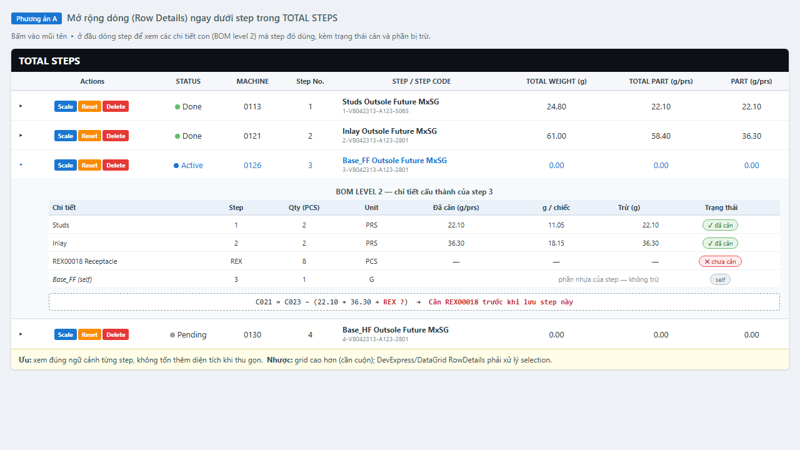
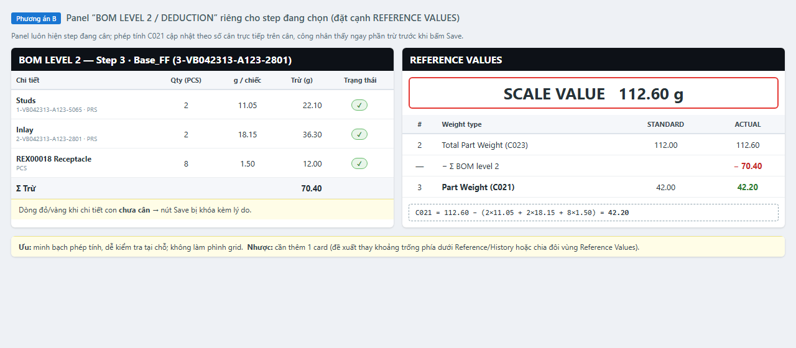
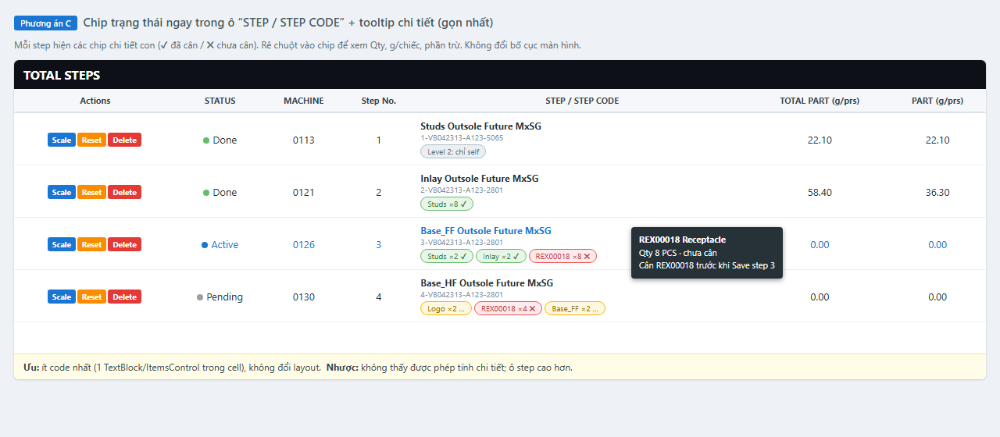
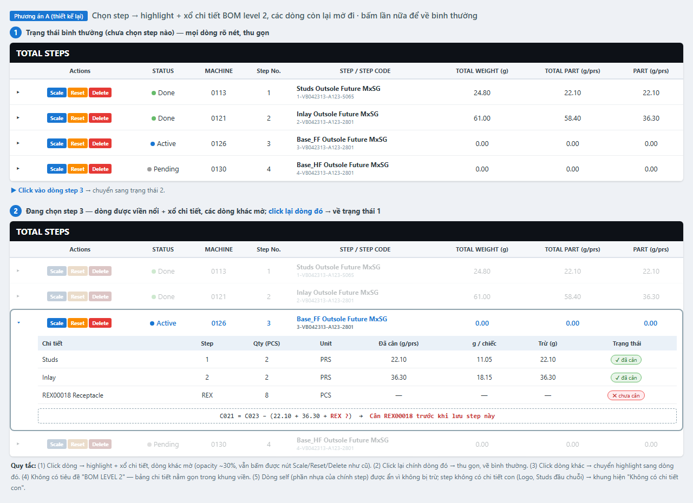
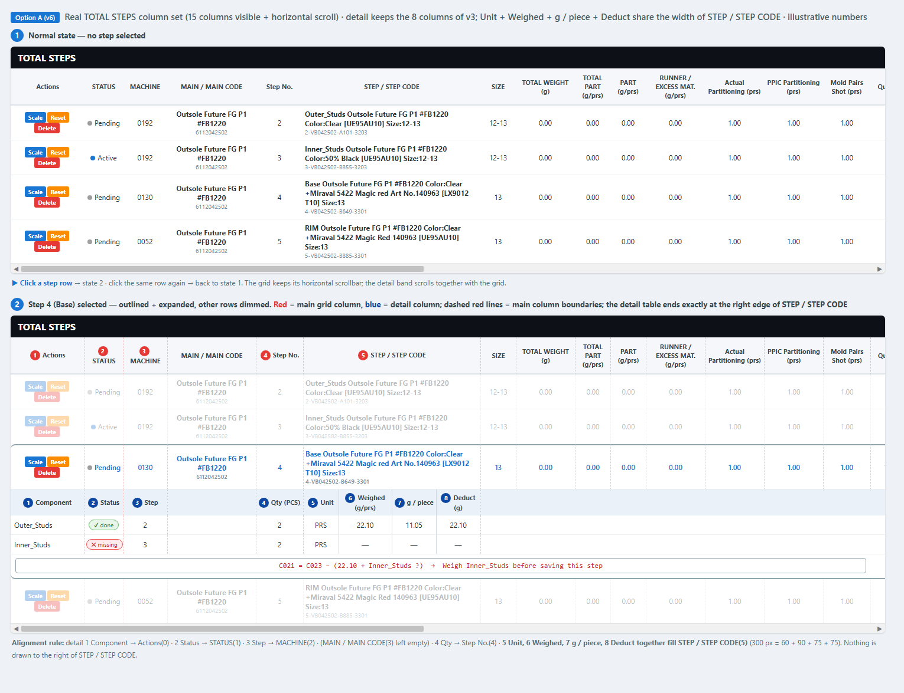

# Brainstorm: Hiển thị BOM Level 2 trên màn cân Step

- **Ngày**: 2026-11-04 · **Nhánh**: `feature/use-bom-level-2`
- **Trạng thái**: ✅ Đã chọn **phương án A** (2026-11-04) → thiết kế v6 (giữ 8 cột như v3; Unit + Weighed + g / piece + Deduct xếp chung trong bề rộng cột STEP / STEP CODE, vẽ theo đúng bộ cột thật) **chờ review**; chi tiết ở [`plan/BOM_LEVEL2_ROW_DETAILS_UI.md`](../plan/BOM_LEVEL2_ROW_DETAILS_UI.md)
- **Bối cảnh**: `C021` giờ tính theo BOM Level 2 ([BUSINESS_LOGIC.md](../tech/BUSINESS_LOGIC.md) §4.8). Công nhân cần thấy step đang dùng chi tiết con nào, đã cân chưa, và phần bị trừ là bao nhiêu. Số liệu trong ảnh là minh họa (FG `6112042313-A478-2801`).

## Phương án A — Mở rộng dòng (Row Details)

Bấm ▸ ở đầu dòng step để xổ bảng chi tiết con + công thức.
- **Ưu**: đúng ngữ cảnh từng step; thu gọn thì không tốn diện tích.
- **Nhược**: grid cao hơn, phải cuộn; cần xử lý selection của `DataGrid.RowDetailsTemplate`.

## Phương án B — Panel "BOM LEVEL 2 / DEDUCTION" riêng

Card cạnh REFERENCE VALUES cho step đang chọn, `C021` cập nhật trực tiếp theo số cân.
- **Ưu**: minh bạch nhất, thấy phép trừ trước khi Save; không làm phình grid.
- **Nhược**: thêm 1 card, phải bố trí lại vùng bên phải.

## Phương án C — Chip trạng thái trong ô STEP + tooltip

Chip ✔/✖ cho từng chi tiết con ngay trong ô "STEP / STEP CODE", tooltip hiện Qty và phần trừ.
- **Ưu**: ít code nhất, không đổi layout.
- **Nhược**: không thấy phép tính chi tiết; ô step cao hơn.

## ✅ Phương án A — thiết kế lại v2 (chờ duyệt)

Theo yêu cầu: chọn step thì highlight, làm mờ các dòng còn lại; bỏ tiêu đề "BOM LEVEL 2…".

| Hành động | Kết quả |
|-----------|---------|
| Click 1 dòng step | Dòng đó viền nổi + xổ bảng chi tiết con ngay dưới; các dòng khác mờ (~30%) |
| Click lại chính dòng đó | Thu gọn, mọi dòng về bình thường |
| Click dòng khác | Highlight chuyển sang dòng đó |
| Nút Scale/Reset/Delete | Vẫn bấm được ở cả dòng mờ (hành vi cũ) |
| Dòng self (phần nhựa của chính step) | Ẩn — không bị trừ, trùng với dòng step phía trên |
| Step không có chi tiết con | Khung hiện "Không có chi tiết con" |

Gợi ý triển khai (nếu duyệt): `DataGrid.RowDetailsVisibilityMode="VisibleWhenSelected"` + `RowDetailsTemplate` (bảng con bind `Level2Items` trên `FT600` partial `[NotMapped]`); mờ dòng khác bằng `DataTrigger` trên cờ `IsDimmed` ở VM; click lại để bỏ chọn xử lý trong code-behind `PreviewMouseLeftButtonUp` (set `SelectedItem = null`). `Level2Items` lấy từ `_level2ByStep` + `FindWeighedChild` đã có.

## ✅ Phương án A — v6: bảng chi tiết nằm gọn trong 6 cột đầu của lưới (theo đúng lưới thật)

Giữ 8 cột như v3 (đỏ = lưới chính, xanh = chi tiết). Cột 1–4 nằm dưới Actions / STATUS / MACHINE / Step No.; cột 5–8 chia nhau bề rộng cột STEP / STEP CODE nên bảng kết thúc đúng mép phải cột này:

| # | Cột chi tiết | Vị trí trong lưới chính | Rộng (px) |
|---|--------------|-------------------------|-----------|
| 1 | Component | Actions | 125 |
| 2 | Status | STATUS | 65 |
| 3 | Step | MACHINE | 75 |
| — | (trống) | MAIN / MAIN CODE | 150 |
| 4 | Qty (PCS) | Step No. | 80 |
| 5 | Unit | STEP / STEP CODE (1/4) | 60 |
| 6 | Weighed (g/prs) | STEP / STEP CODE (2/4) | 90 |
| 7 | g / piece | STEP / STEP CODE (3/4) | 75 |
| 8 | Deduct (g) | STEP / STEP CODE (4/4) | 75 |

Lưới thật còn nhiều cột khác (MAIN / MAIN CODE, SIZE, RUNNER, Actual/PPIC Partitioning, Mold Pairs Shot, Quantity, …) — hình v6 vẽ đủ; vùng bên phải cột STEP / STEP CODE để trống.

**Cài đặt** (xem session 2026-11-04):
- `ShotWeightStyles.xaml`: `StepRowStyle` (viền nổi khi chọn) + `Level2DetailsTemplate` — mỗi ô là `Border` có `Width` bind `Columns[i].ActualWidth` của `DataGrid` (kéo đổi cột vẫn thẳng hàng).
- `dgTotalSteps`: `RowDetailsVisibilityMode="VisibleWhenSelected"`.
- Code-behind (thuần hiển thị): làm mờ dòng không chọn (opacity 0.35), click lại dòng đang chọn để bỏ chọn; click nút hoặc vùng chi tiết thì không bỏ chọn.
- Dữ liệu: `FT600.Level2Items/Level2Formula/Level2HasMissing` (`[NotMapped]`) do `ShotWeightViewModel.RefreshLevel2Details()` dựng mỗi lần làm mới lưới.

## Đề xuất (ban đầu)
**C + B**: chip ở grid để nhìn nhanh step nào còn thiếu chi tiết con, panel B cho step đang cân để xem phép tính. A là phương án thay thế nếu không muốn thêm card.

Nếu chốt, nút Save bị khóa kèm lý do khi còn chi tiết con chưa cân (khớp hành vi cảnh báo hiện có của `ApplyLevel2PartWeight`).
