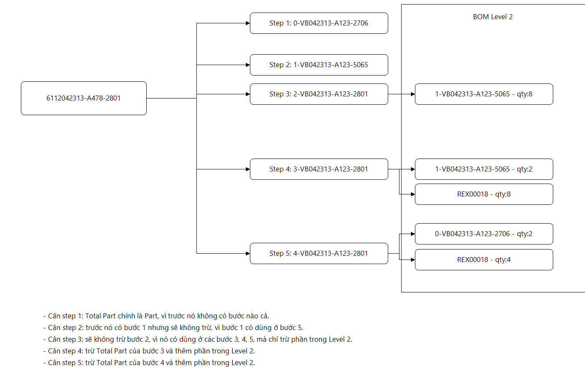
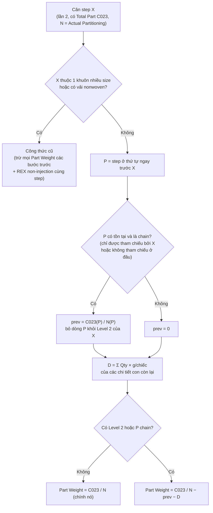

# Brainstorm: Part Weight = trừ step trước (chain) kết hợp BOM Level 2

- **Ngày**: 2026-11-05 · **Nhánh**: `feature/use-bom-level-2`
- **Trạng thái**: ✅ Đã chốt phương án B và trả lời 5 câu hỏi (2026-11-05, §7); đã code, chưa chạy app thật
- **Kế hoạch triển khai**: [PART_WEIGHT_CHAIN_AND_LEVEL2_PLAN.md](../plan/PART_WEIGHT_CHAIN_AND_LEVEL2_PLAN.md)

## 1. Bối cảnh

Từ 2026-11-02 Part Weight (C021) của step ép tính theo **BOM Level 2**: `C021 = C023 − Σ (Qty × g/chiếc của chi tiết con)`.
Cách này không còn "trừ step trước" như logic gốc. Thực tế có 2 loại quan hệ giữa các step trong 1 FG:

1. **Chi tiết con dùng chung** (vd. Studs dùng ở Inlay, Base_FF, Base_HF; Logo dùng ở Base_HF): có dòng trong BOM Level 2 → trừ theo Level 2 (Qty × g/chiếc).
2. **Chuỗi nối tiếp** (Inlay → Base_FF → Base_HF): step sau được ép **đè lên** step trước, nên Total Part của step sau đã gồm trọn step trước. Trọng lượng step trước **không** (hoặc không đáng tin) nằm trong Level 2 của step sau → phải trừ trực tiếp **Total Part của step trước**.

Yêu cầu (người dùng, 2026-11-05): giữ lại logic "step sau trừ step trước" như ban đầu, kết hợp với BOM Level 2:
- Step **không có trong BOM Level 2 của bất kỳ step nào** → trọng lượng của nó được "dồn" vào step kế tiếp; khi cân step kế tiếp: **trừ step trước + trừ Level 2**.
- Step **có nằm trong BOM Level 2** → **không trừ step trước**, chỉ trừ theo Level 2.

## 2. Dữ liệu minh họa (FG `6112042313-A478-2801`)

Sơ đồ do người dùng vẽ — **đây là nguồn đúng duy nhất** về cấu trúc BOM (Level 1 bên trái, Level 2 bên phải, ghi chú cách cân từng step bên dưới):



| Seq | Step | Level 2 (từ `sp_getBomWinlineOfItemFG`) |
|---|---|---|
| 1 | Logo `0-VB042313-A123-2706` | — |
| 2 | Studs `1-VB042313-A123-5065` | — |
| 3 | Inlay `2-VB042313-A123-2801` | Studs ×8 |
| 4 | Base_FF `3-VB042313-A123-2801` | Studs ×2, REX00018 ×8 |
| 5 | Base_HF `4-VB042313-A123-2801` | Logo ×2, REX00018 ×4 |

Level 2 của Base_FF và Base_HF **không có** Inlay / Base_FF: hai step này được "dồn" vào step kế tiếp nên phải trừ trực tiếp Total Part của step trước. (Dữ liệu `sp_getBomWinlineOfItemFG` thực tế có thể còn trả thêm dòng step ngay trước với Qty 2 PRS; code bỏ qua dòng này để không trừ trùng.)

Kỳ vọng của người dùng:

| Cân step | Cách tính Part Weight | Giải thích |
|---|---|---|
| 1 Logo | = Total Part | Không có step trước |
| 2 Studs | = Total Part | Step 1 (Logo) có dùng ở Level 2 của step 5 → không trừ |
| 3 Inlay | Total Part − (Studs ×8) | Step 2 (Studs) có dùng ở Level 2 (step 3, 4, 5) → trừ theo Level 2 |
| 4 Base_FF | Total Part − **Total Part step 3** − (Studs ×2 + REX ×8) | Step 3 (Inlay) không dùng làm chi tiết con ở đâu khác → dồn vào step 4 |
| 5 Base_HF | Total Part − **Total Part step 4** − (Logo ×2 + REX ×4) | Step 4 (Base_FF) không dùng làm chi tiết con ở đâu khác → dồn vào step 5 |

## 3. Các cách hiểu quy tắc "không có trong BOM Level 2 ở bất kỳ step nào"

Cần một quy tắc tổng quát để nhận ra step "không có trong Level 2 của step nào" (kể cả khi SP trả thêm dòng step ngay trước). Có 3 cách diễn giải:

| | Quy tắc | Kết quả với dữ liệu trên | Nhận xét |
|---|---|---|---|
| A | P là chain nếu **không xuất hiện ở bất kỳ Level 2 nào** | Đúng nếu SP không trả dòng step trước; nếu SP trả thêm dòng đó thì Inlay, Base_FF bị coi là có trong Level 2 → trừ qty×g/chiếc | Dễ sai theo dữ liệu thực tế |
| **B** | P là chain nếu **chỉ được tham chiếu bởi step kế liền sau nó** (hoặc không được tham chiếu) | Inlay, Base_FF: chỉ tham chiếu bởi step kế liền sau → chain. Studs: tham chiếu ở step 3, 4, 5 → L2. Logo: tham chiếu ở step 5 (không kế liền) → L2 | **Khớp 100% sơ đồ**; tổng quát cho FG khác |
| C | Luôn trừ step ngay trước **và** trừ Level 2 | Logo bị trừ ở step 2, Studs bị trừ ở step 3 → sai (người dùng nói rõ không trừ) | Loại |

→ **Chọn B** (đã code). Bản chất: bỏ qua các dòng "step ngay trước" trong Level 2 của step sau và thay bằng trừ Total Part của step đó.

## 4. Thiết kế phương án B



Công thức tổng quát (step không đặc biệt):

```
C021 = C023/N  −  [C023(P)/N(P) nếu P là chain]  −  Σ Qty(c) × g/chiếc(c)   (c ∈ Level 2 của X, c ≠ self, c ≠ P)
C022 = (C024 − C023) / N        (Runner = YES)
```

Định nghĩa "chain":
- `steps` = các step FG trong lưới (bỏ REX, `Z-VHXXXXXX`).
- `nextSeq(P)` = thứ tự nhỏ nhất lớn hơn thứ tự của P.
- P là **chain** ⇔ với mọi step Q có Level 2 chứa P (Qty > 0, không phải dòng self) thì `Q.seq == nextSeq(P)`.
- Không step nào tham chiếu P ⇒ P là chain (đúng tinh thần "không có trong BOM Level 2 ở bất kỳ step nào → dồn vào step kế tiếp").

## 5. Các trường hợp đặc biệt

| Trường hợp | Xử lý | Lý do |
|---|---|---|
| 1 khuôn nhiều **size** | Giữ công thức cũ (trừ mọi bước trước), cascade cũ, điều kiện cân xong mọi bước trước; runner chia lại giữa các size khi Save | Người dùng: "đang đúng rồi, đừng đụng" |
| Vải **nonwoven / mesh** | Giữ công thức cũ | Như trên |
| 1 khuôn nhiều **đôi cùng size** (N > 1) | `C023 = S`, `C021 = C023/N − …`, `C022 = (C024 − S)/N` | Đã chốt 2026-11-05 |
| Không có Level 2 và không có chain | Part Weight = chính nó (`C023/N`) | Người dùng: "không có thì bằng chính nó" |
| Step đầu tiên | Không có P → = chính nó (trừ Level 2 nếu có) | |
| Step trước là chain nhưng **chưa cân** | Chặn cân, báo step cần cân trước | Cần Total Part của P |
| Chi tiết con Level 2 **chưa cân** | Chặn cân (như hiện tại), liệt kê chi tiết thiếu | |
| Cùng thứ tự có nhiều dòng (size) ở step trước | Ưu tiên dòng cùng size, không có thì dòng đầu | Tránh trừ trùng |
| REX chỉ có ở Level 2 | Dòng riêng `C015 = 0`, `C025 = 1`, `C039` = tổng chiếc/đôi | Đã làm trước đó |
| Cân lại step trước (đổi Total Part của P) | Cascade tính lại các step đã cân phụ thuộc (qua Level 2 hoặc chain) | Giữ dữ liệu nhất quán |

## 6. Ảnh hưởng tới các phần khác

- **Điều kiện cân xong step trước**: chỉ còn bắt buộc với step ngay trước nếu nó là chain (và mọi step trước với nhóm công thức cũ). Studs/Logo (L2) không còn bị chặn theo thứ tự.
- **Row Details (BOM Level 2)** trên lưới: không liệt kê dòng step-chain trong Level 2, thay bằng 1 dòng "(previous step)" với Deduct = Total Part của step trước; công thức hiển thị gồm cả phần này.
- **C039 / g/chiếc**: C039 = tổng Qty theo Level 2 (`ComponentQuantityAggregator`); step chain bị loại khỏi bộ gộp và step không có trong Level 2 không còn fallback từ Quantity Level 1 → C039 = 0, C036 = 0 (ví dụ Inlay, Base_FF, Base_HF).
- **Test**: `PartWeightCalculator` không đổi (nhận danh sách chi tiết con đã lọc); logic chain nằm ở ViewModel nên cần tách ra lớp thuần (`ChainResolver`) để unit test (xem plan).

## 7. Câu hỏi và quyết định (2026-11-05)

1. Diễn giải **B** (chain = chỉ được tham chiếu bởi step kế liền sau) — ✅ đúng ý.
2. Trừ **Total Part của step trước** (`C023/N`, gồm cả các chi tiết con của nó) — ✅ đúng ý.
3. Khi step trước là chain nhưng **chưa cân**: ✅ **chặn cân**.
4. C039 / C036: ✅ gộp theo Level 2 để tính `C039` rồi `C036 = C021 / C039` (dùng cho REX non-injection / studs / logo / ring). **Step không có trong Level 2 (kể cả step chain) → `C039 = 0` và `C036 = 0`.**
5. Nhóm "1 khuôn nhiều size / nonwoven" giữ công thức cũ **hoàn toàn** (kể cả chặn mọi bước trước) — ✅ đúng ý.

## 8. Rủi ro

- Dữ liệu BOM thực tế khác sơ đồ (vd. step dùng ở xa nhưng đúng ra là chain) → cần xem lại bằng dữ liệu nhiều FG; log `PartWeight L2` có thể bổ sung chi tiết chain/previous để đối chiếu.
- Cascade đổi giá trị các step đã cân → kiểm tra trước khi Confirm.
- Chưa chạy app thật với DB; cần chạy các ca ở plan §5.
