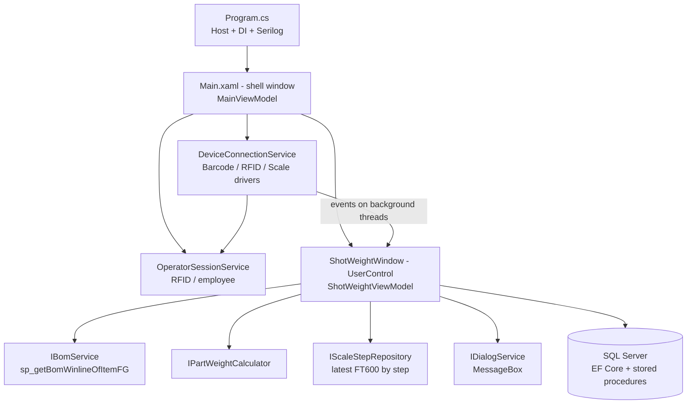
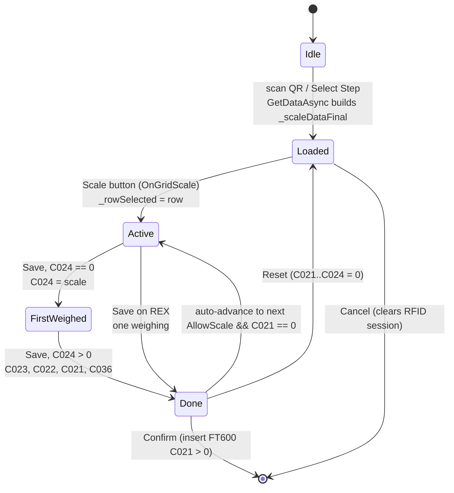

# SSSW Developer Manual (English)

> **Audience:** developers who maintain or extend the SSSW weighing application.
> **Language versions:** English (this file) · [Tiếng Việt](DEVELOPER_MANUAL.vi.md) · Operator manual: [EN](OPERATOR_MANUAL.en.md) / [VI](OPERATOR_MANUAL.vi.md)
> **Branch described:** `feature/use-bom-level-2` (entity `FT600` still points to table `FT600_dev` – see [§2.4](#24-test-table-warning)).
> This manual describes **how the weighing screen works inside** and links every operator case to the code. For the operator's point of view read the operator manual; the screenshots used there come from the harness in [§12](#12-screenshot-harness-how-the-manual-pictures-were-made).

---

## Contents

1. [Scope and map of the documentation](#1-scope-and-map-of-the-documentation)
2. [Build, run, release](#2-build-run-release)
3. [Architecture](#3-architecture)
4. [Screen → code map](#4-screen--code-map)
5. [Data model: `FT600` columns](#5-data-model-ft600-columns)
6. [Weighing life cycle (state machine)](#6-weighing-life-cycle-state-machine)
7. [Case → code matrix (operator cases)](#7-case--code-matrix-operator-cases)
8. [Formulas](#8-formulas)
9. [BOM level 2, chain steps, multi-size, PU](#9-bom-level-2-chain-steps-multi-size-pu)
10. [Confirm transaction and database](#10-confirm-transaction-and-database)
11. [Hardware and threading](#11-hardware-and-threading)
12. [Screenshot harness (how the manual pictures were made)](#12-screenshot-harness-how-the-manual-pictures-were-made)
13. [How to extend: new step type checklist](#13-how-to-extend-new-step-type-checklist)
14. [Tests](#14-tests)
15. [Developer troubleshooting](#15-developer-troubleshooting)
16. [Documentation rules (Docs-Sync)](#16-documentation-rules-docs-sync)

---

## 1. Scope and map of the documentation

| Need | Read |
|------|------|
| Project context for AI / quick start | [`CLAUDE.md`](../../../CLAUDE.md) |
| Vibe-coding rules, Docs-Sync checklist | [`VIBE_CODING_GUIDELINES.md`](../VIBE_CODING_GUIDELINES.md) |
| Components and data flow | [`architecture/ARCHITECTURE.md`](../architecture/ARCHITECTURE.md) |
| DB tables / stored procedures | [`tech/DATABASE_SCHEMA.md`](../tech/DATABASE_SCHEMA.md) |
| Formulas and business rules | [`tech/BUSINESS_LOGIC.md`](../tech/BUSINESS_LOGIC.md) |
| `AllowScale` / locked-step logic | [`tech/ALLOWSCALE_LOGIC_REVIEW.md`](../tech/ALLOWSCALE_LOGIC_REVIEW.md) |
| What changed recently | [`sessions/INDEX.md`](../sessions/INDEX.md) (newest first – **read the latest entry before coding**) |
| Older design docs of the weighing window | `SSSW/ShotWeightWindow_Documentation_EN.md` (dated 2026-06-01 – the filtering / `AllowScale` wording is partly outdated, trust the code) |

---

## 2. Build, run, release

### 2.1 Requirements
- Windows with the .NET 8 SDK and the **Desktop workload** (WinForms + WPF). Target `net8.0-windows`.
- DevExpress 24.2.3 NuGet feed configured on the machine (packages `DevExpress.Win.*`, `devexpress.wpf.grid.core`).
- `Dll/net8.0-windows/ScanAndScale.Core.dll` (referenced by `HintPath`).

### 2.2 Commands
```
dotnet build SSSW/SSSW.sln                 # Debug
dotnet run   --project SSSW/SSSW.csproj    # run (needs DB + hardware config, see 2.3)
dotnet build SSSW/SSSW.sln -c Release      # Release (+ update package, see below)
dotnet test  tests/SSSW.Tests              # xUnit tests of PartWeightCalculator / StepMainCode
```
> First restore of the DevExpress packages is slow (minutes). If the WPF markup-compile temp project (`*_wpftmp.csproj`) reports `InitializeComponent does not exist`, run the build again – it is a transient restore/markup race, not a code error.

### 2.3 Local secrets and configuration
- `SSSW/appsettings.json` is **git-ignored**. The SQL Server connection string `ConnectionStrings:SSSW` is stored **encrypted** (`EncodeMD5.DecryptString`, see `Program.cs`). Never commit a plain-text file.
- Per-machine config lives in table `FT608_Config` (`WHERE c000 = Environment.MachineName`), JSON of `ConfigModel`; loaded by `MainViewModel.StartupAsync()` into the static `GlobalVariable.ConfigSystem`. If the machine has no row, defaults are inserted.
- Relevant `ConfigModel` keys: `Scanner`, `RFID`, `Scale` (IP/port/model/decimals/stable/tare), `EnableReadScale`, `PercentOfUserNonWoven` (default usage %), `CategoryOfNonInjectionUsagePartial` (category codes that are Non-woven / Mesh), `DeltaLevel1` / `DeltaLevel2` (tolerance in **grams**, defaults 1 and 3), `DeltaUpWL`, `UpdatePath`.

### 2.4 Test-table warning
`SSSW/models/ef/entities/FT600.cs` is currently `[Table("FT600_dev")]` for the BOM-level-2 tests. **Change it back to `"FT600"` before any release.**

### 2.5 Release side effects
A Release build runs three targets after `Build`: `GenerateUpdateXml` (`update.xml`, version from date/time), `CreateUpdateZip` (`Update.zip`) and `CopyUpdateToShare` (copies to the network share `DeployDir` from `SSSW/DeployConfig.props`; **fails if the share is unreachable** – expected off the corporate network). Debug builds skip them. Switch the site by editing `<DeployDir>` in `DeployConfig.props`; the connection string in `appsettings.json` must be switched separately.

---

## 3. Architecture



- **Only the WPF path launches.** `Program.cs` builds a generic `Host`, registers `IDbContextFactory<DbContextDogeWH>`, services, the shell `Main` and `ShotWeightWindow` / `ShotWeightViewModel` (transient), then `wpfApp.Run(Main)`. The WinForms forms (`frmShotWeightScale`, `frmMainView` = history viewer, `frmUpdateMasterData` = Settings) are registered for the toolbar buttons or as legacy.
- **Tabs Step / FG are hidden** in `Main.xaml` (`StackPanel Visibility="Hidden"`): at present the Step screen is the only visible content; `ShotWeightFGWindow` is kept but not reachable from the UI.
- **MVVM split.** The View has no business logic. Code-behind only does what cannot be bound: Win32 drag, DevExpress `LookUpEdit` bridge, driver-event → `Dispatcher` bridge, Enter-key handlers, the weighing **popup** (`OpenWeighDialog`). All state and logic are in `ShotWeightViewModel` (≈3,450 lines).
- **`Action<T>` bridge** (`ClearStepComboAction`, `SetStepComboAction`, `FocusGridRowAction`, `OpenWeighDialogAction`) is wired in `ShotWeightWindow.OnLoaded`; the VM stays testable/UI-agnostic.
- **Contexts per operation.** Always use `IDbContextFactory.CreateDbContext()` in a `using` – never keep a `DbContext`.
- **Startup order** (race-sensitive, documented in `Main.xaml.cs`): `Main` shown → `Main_Loaded` → `MainViewModel.StartupAsync()` (company/year SPs → window title → `FT608_Config` → `DeviceConnectionService.EnsureInitialized()` → `OperatorSession.Attach()`) → `SelectStep()` resolves `ShotWeightWindow` → its `OnLoaded` runs `ShotWeightViewModel.InitializeAsync()` once (reads `FT601` master `C021 = true`).

---

## 4. Screen → code map

| Screen area (operator manual §2) | XAML (`UI/WPF/ShotWeightWindow.xaml`) | View-model members |
|---|---|---|
| Title / RFID / toolbar | `Main.xaml` | `MainViewModel.WindowTitle`, `OperatorSession.UserName/RfidStatus`, `HydraCommand`, `SettingsCommand`, `UpdateCommand`; `ActiveContent.DataContext.ReloadCommand/HistoryViewCommand` |
| STEP INFORMATION fields | left card | `StepName`, `StepCode`, `Machine`, `Qty`, `ActualPairs` (+`PartitioningLabel`/`AdjustLabel`/`CountUnit` prs↔pcs), `AllowPartitionAdj`, `RunnerText`, `UsagePct`/`IsUsagePctReadOnly`, `Size`, `StepIndex`, `FgName`, `FgItemCode`, `Remark` |
| Select Step | DevExpress `LookUpEdit` `cbStepName` | `StepCodeMaster`; `cbStepName_EditValueChangedAsync` → `OnStepSelectedAsync` |
| Barcode / QR | `ButtonEdit` | `BarcodeScannedValue`, `BarcodeStatus`; `OnBarcodeScannedAsync` (reads `FT606_Label` by QR) |
| TOTAL STEPS | `DataGrid dgTotalSteps` (+ Row Details) | `StepsCollection`; row `FT600` (`StatusText/StatusDotColor/StatusBarColor`, `Level2Items`, `Level2Formula`); `GridScaleCommand/GridResetCommand/GridDeleteCommand` → `OnGridScale/OnGridReset/OnGridDelete` |
| REFERENCE / HISTORY | `dgHistory` | `HistoryCollection`, `HistoryToggleText*`, `IsHistoryExpanded`; `LoadRefHistoryAsync` (last 15 `FT600` by `C002`) |
| SCALE VALUE / Save | scale card | `ScaleValue`, `ScaleDisplay`, `ScaleStable`, `ScaleTare`, `ScaleStatus`, `EnableBtnSaveScale`, `ScaleCardBorderBrush/Background`; `OnScaleValueChanged`; `SaveCommand` → `ExecuteSave` |
| REFERENCE VALUES | `dgRefValues` | `RefRowsCollection` of `ReferenceRow` (`Std/Actual/Delta/Tolerance`); `UpdateReferencePanel` |
| Cancel / Confirm | footer buttons | `CancelCommand` → `ExecuteCancel`; `ConfirmCommand` → `ExecuteConfirmAsync` → `ConfirmCoreAsync` |
| "Saving data…" | overlay | `IsOverlayVisible`, `OverlayMessage`, `ShowBusy/HideBusy` |
| Popup weighing window | built in code (`OpenWeighDialog`) | `IsDialogMode`, `CreateDialogViewModel`, `ApplyPendingStepAsync`, `ReloadWeighedValuesAsync`, `DialogCloseRequested` |

**Converters** (`UI/WPF/Converters/ScaleConverters.cs`): tolerance → brush, driver status → colour, stable → border, `ValueUnitConverter` (unit-in-cell). **Styles:** `UI/WPF/Styles/ShotWeightStyles.xaml`, loaded in `Program.cs` as an application resource.

---

## 5. Data model: `FT600` columns

`FT600` (`models/ef/entities/FT600.cs`, `SSSW.models` namespace) is both the DB row and the grid row. Columns are opaque `C0xx`; the ones used by the weighing logic:

| Col | Meaning | Notes |
|-----|---------|-------|
| `C002` | Step code | Full code `<seq>-<main>-<colour>-<size>`; `REX…` for inserts. Key for history (`LoadRefHistoryAsync`) |
| `C003` / `C027` / `C026` | Step name / main name / main code | `StartsWith("Logo")`, `"Cleat_Ring"`, `"Stud"`, `"Inlay"` drive special rules |
| `C004` | Machine | `REX` for inserts; part of the multi-size key |
| `C015` | Step index (sequence) | 0 = Level-2-only REX row (placed first) |
| `C008` | Size | Used to pick the same-size component |
| `C020` | Mold id | Multi-size key (machine + mold + step index + 2-part prefix) |
| `C019` | Machine group | `PU` ⇒ `IsPu`; `REX` |
| `C024` | **Total Weight** (g) | 1st weighing; REX: the single weighing |
| `C023` | **Total Part** (g) | 2nd weighing (sum of N pairs) |
| `C021` | **Part Weight** (g/prs, PU: g/pcs) | Result, see §8 |
| `C022` | **Runner / excess** (g/prs) | Result |
| `C025` | Quantity (Level 1) | |
| `C039` | Pieces per pair (Level 2 aggregate) | `ComponentQuantityAggregator`; 0 for chain steps / not in any Level 2 |
| `C036` | Weight per piece (g) | `C021 / C039` (REX: scale / `C039`; PU: `C021`) |
| `C037` | Unit | `PRS`, `PCS-L`, `PCS-R` |
| `C028` / `C017` / `C018` | Actual / PPIC / mold pairs per shot | `C028` = "Actual Partitioning" N |
| `C033` / `C034` / `C035` | Category code / name / usage % | non-woven / mesh |
| `C032` | `FT601.Id` | Links to the order master; `Id` is *not* unique across sizes of one mold |
| `C010` / `C011` | Operator code / name | Stamped at Confirm |
| `C013` / `C014` | FG code / name | Replaced by the scanned FG at Confirm |
| `C038` | Remark | |

UI-only (`[NotMapped]`, `FT600.partial.cs`): `AllowScale`, `StatusText`, `StatusDotColor`, `StatusBarColor`, `Level2Items`, `Level2Formula`, `Level2HasMissing`, `IsReusedFromHistory`, `IsPu`. Details of the other tables and stored procedures: `tech/DATABASE_SCHEMA.md`.

Stored procedures used by this screen: `sp_getBomWinlineOfItemFG` (Level 1 / Level 2), `sp_sssw_getGroupSize` (Logo sizes), `sp_sssw_getproductInfo` (FG/main info), `sp_GetCategorryOfItem`, `sp_MaterialGetCompanyName`, `sp_MaterialGetMesoyear`, `sp_GetFullStepItemHydraIsRun` (Hydra sync), `sp_ShotweightReport_UpsertFT609` (FG report).

---

## 6. Weighing life cycle (state machine)



Key methods (all in `ShotWeightViewModel`):

1. **`OnBarcodeScannedAsync` / `OnStepSelectedAsync` → `GetDataAsync(FT601)`** – builds the grid: Level 1 (`IBomService.GetLevel1Async`), master data per step, `AllowScale` filtering (region *"Lọc lại để cho phép cân hay là không…"*: Logo / Cleat_Ring / Studs / Inlay groups), Logo group sizes (`AddLogoGroupSizesAsync`), PU pairs, then `PreloadLevel2Async`, `ApplyPieceQuantities`, `AddLevel2OnlyRexRows`, `PrefillRexFromHistory`, `RefreshUI`.
2. **`OnGridScale(row)`** – checks `AllowScale` (locked ⇒ `SwitchToLockedStepAsync`), PU pair reload (`NeedsPuPairReload`), previous-step check (`PreviousStepsToCheck`), sets `_rowSelected`, `_articlePaisShotFinaly` (= `C028`), `RefreshUI`, `LoadRefHistoryAsync`.
3. **`OnScaleValueChanged(value, stable, tare, unit)`** (called from the driver bridge on the UI thread) – converts KG→g, updates the live display, enables **Save** (`ReadOnlyScale && !stable` ⇒ disabled).
4. **`ExecuteSave`** – the calculation core (see §8): guards (`AllowScale`, unweighed previous steps) → injection vs REX branch → multi-size distribution → `CascadeLevel2` → legacy cascade → auto-advance to the next step → `RoundDoubles` → `RefreshUI` / `UpdateReferencePanel` / `LoadRefHistoryAsync`.
5. **`ExecuteConfirmAsync` → `ConfirmCoreAsync`** – §10.
6. **`ExecuteCancel`** – popup: only closes; main: clears the operator session, combobox, QR and calls `ResetNewLoop`.

`UpdateStepStatuses` (called from `RefreshUI`): **Done** = REX `C023 > 0`, injection `C021 > 0 && C023 > 0`; **Active** = `C002` and `C032` equal the selected row; else **Pending** (colours `#4CAF50` / `#1976D2` / `#9E9E9E`).

---

## 7. Case → code matrix (operator cases)

| Operator case | Trigger in data | Code path in `ExecuteSave` / helpers |
|---|---|---|
| **A** Normal injection (2 weighings) | `C002` not `REX`, not Logo/Cleat_Ring | 1st Save: `C024 = scale`; 2nd: `C023 = scale`, `C022 = (C024 − scale)/N` if `RunnerText == "YES"`, `C021` via `ApplyLevel2PartWeight` (no L2 ⇒ `PartPerPair`), `UpdateWeightPerPiece` |
| **B** REX / receptacle | `C002.StartsWith("REX")`, category not in `CategoryOfNonInjectionUsagePartial` | `C024 = C023 = C021 = scale`; `C036 = scale / PiecesStrict(C039)` |
| **C** Non-woven / Mesh | REX + `C033` in `CategoryOfNonInjectionUsagePartial` | `usage = round(scale × %/100 / C028, 3)`; `C023 = C021 = usage`, `C022 = (scale − usage×C028)/C028`; `%` edited via `OnUsagePctEnter` (recomputes all REX rows) |
| **D** BOM level 2 | `_level2ByStep[stepCode]` has children | `ApplyLevel2PartWeight` → `ComputePartWeight` → `PartWeightCalculator`; missing child ⇒ `_dialog.Warn("Component / previous step(s)…")`, `C023/C022 = 0`, return |
| **E** Chain step | previous step referenced only by the next step (`IsChainOnly`) | `ChainPredecessors` subtracts `PartPerPair(previous)`; the previous step is removed from the L2 list |
| **F** Partitioning N | `C028 = N` (editable only when `AllowPartitionAdj`) | `PartPerPair = C023 / N`, `C022 = (C024 − C023)/N` |
| **G** Runner NO | `RunnerText == "NO"` | `C022 = 0` |
| **H** Multi-size mold | same `C020`, `C004`, `C015`, 2-part prefix (`IsMultiSizeMold`) | `UsesLegacyPartWeight` ⇒ `ApplyLegacyPartWeight`; Save copies `C024` to the group and sets `C022 = (C024 − ΣC023)/ΣC028`; `PreviousStepsToCheck` = all lower steps |
| **I** PU (L/R) | `C019 == "PU"` (`IsPu`) | `ApplyPuUnits` (`C037 = PCS-L/R` from code suffix), `UpdateWeightPerPiece` (`C036 = C021`), `SameSide` filters components, popup via `NeedsPuPairReload` |
| **J** Cleat_Ring / Logo | `C003.StartsWith("Cleat_Ring"/"Logo")` | `C021 = PartPerPair` (no deduction) |
| Locked step | `AllowScale == false` | `SwitchToLockedStepAsync`: popup (`OpenWeighDialogAction`) else `Confirm("Switch step")` and rebuild via `CreateStepFromSelectionAsync` |

---

## 8. Formulas

Let `W = C024` (shot), `S = C023` (parts of N pairs), `N = C028` (≥ 1; empty/0 ⇒ 1).

```
C023 = S                                   (kept as N pairs, not divided)
C022 = (W − S) / N        if Runner = YES, else 0
PartPerPair = S / N
C021 = PartPerPair − Σ Qty(child) × UnitWeight(child)         BOM L2 (children ≠ self)
            − PartPerPair(previous chain step)                 chain step
C036 = C021 / C039   (PU: C021;  REX: scale / C039)
UnitWeight(child) = C036 if > 0, else (not REX) C021 / C039, else "missing"
```
Example: Studs 22.10 g/prs, `C039 = 10` ⇒ 2.21 g/pc. Inlay = 48.20 − 8×2.21 = **30.52**. Base_FF = 128.40 − (2×2.21 + 8×0.55 + 48.20) = **71.38**. N = 2: W 125.40, S 96.80 ⇒ `C021 = 48.40`, `C022 = 14.30`.

Legacy formula (multi-size mold or non-woven present, `UsesLegacyPartWeight`): `C021 = PartPerPair − Σ C021(all previous steps) − Σ C021(REX non-injection of the same step)`; every lower step must be weighed first.

`RoundDoubles` rounds stored doubles to 3 decimals before display/save.

**Tolerance** (`ReferenceRow`): `Delta = round(Actual − Std, 3)` in **grams**; `Ok` if `|Δ| ≤ DeltaLevel1`, `Warn` if `≤ DeltaLevel2`, else `Err`. `TolerancePercent` is a % variant (used for the displayed %). `STANDARD` = average of positive values of the last 15 `FT600` rows of the step (`AverageOrNull`). The scale-card border/background use the worst category of the 4 rows. *(`CLAUDE.md` mentions ±1 % / ±3 %; the live code compares grams – check `ScaleModels.cs` / the converters before changing.)*

---

## 9. BOM level 2, chain steps, multi-size, PU

- **Level 2** = `sp_getBomWinlineOfItemFG @itemFG = <step code>` (cached per session in `BomService`). Child ↔ step matching uses the **main code** (`PartWeightCalculator.StepMainCode`: first 2 parts; REX keeps the full code). Self row = code `-0000` / unit `G` / same step. Same main code in several sizes ⇒ pick the same size as the parent (`PickSameSize`), else the first with a unit weight.
- **Children come from** the current session (`_scaleDataFinal`) first, then the latest saved `FT600` (`IScaleStepRepository`, `_weighedChildrenFromDb`).
- **`C039`** aggregation (`ComponentQuantityAggregator`) = Σ qty over all parents in the FG, excluding real chain steps (their `C039 = 0`).
- **Cascade** (`CascadeLevel2`): when a child changes, already-weighed parents recompute `C021` and `C022`.
- **Level-2-only REX rows** (`AddLevel2OnlyRexRows`): REX appearing only in Level 2 gets its own grid row (`C015 = 0`, `C025 = 1`).
- **Row Details** (`RefreshLevel2Details` → `Level2Items`, `Level2Formula`) is what the operator sees under a selected row.
- **Multi-size / Logo group size**: `AddLogoGroupSizesAsync` calls `sp_sssw_getGroupSize @ItemCode = <3-part prefix>` (skips `-0000` / `no size`); each size gets its own partitioning (FT601 of that size → master → copy from the Logo row).
- **PU**: `ApplyPuUnits`, `PuSideOf` (suffix `…L` / `…R` preceded by digit or `_`), `AddLogoGroupSizesAsync(pairOnly: true)`, `SameSide`. Non-last PU step or locked step ⇒ **popup**: `OpenWeighDialog` (View) creates `ShotWeightWindow` + new VM via `CreateDialogViewModel`; Confirm success closes it; on close the host VM calls `ReloadWeighedValuesAsync`. The host ignores scan/scale events while `_dialogOpen`.
- `docs/tech/BUSINESS_LOGIC.md` §4.8 holds the full formulas, mermaid diagrams and the sample FG `6112042313-A478-2801`.

---

## 10. Confirm transaction and database

`ConfirmCoreAsync`:
1. **Gate:** `_operatorSession.IsOperatorSet` else `Warn("RFID card not yet scanned.")`.
2. **Multi-size REX check** / `Scale not completed for step: …` for REX rows still empty.
3. **Insert set** = `AllowScale && C021 > 0` (includes rows reloaded from history – `IsReusedFromHistory` – which are re-inserted with the current FG).
4. For each insert: `RoundDoubles`, `C010/C011` (operator), `CreatedDate/CreatedMachine`, `Mesocomp/Mesoyear`, `C013/C014` = FG of the scanned/selected step (`_productFgCode` for Logo), PU rows get `C019 = PU`, `C037 = PCS-L/R`.
5. In **one EF transaction**: `AddRangeAsync(insert)`, `ExecuteUpdateAsync` on `FT601` (`C017 = true` for the order), `SaveChanges`, `Commit`. Errors ⇒ rollback + `Error("Transaction error …")`.
6. After commit: `ProcessUpsertFT609ForFinalStepsAsync` – if the weighed step is the last step of the FG (`Max(C015)`), call `sp_ShotweightReport_UpsertFT609 @FGItemCode, @CreatedBy`.
7. Success dialog, `ClearStepComboAction`, reset; in popup mode `DialogCloseRequested`.

---

## 11. Hardware and threading

- Drivers (`BarcodeDriver`, `RfidDriver`, `ScaleDriver`, packages `ScanAndScale.Driver/Core`) are owned by the singleton `DeviceConnectionService`; initialised once in `MainViewModel.StartupAsync()` with `GlobalVariable.ConfigSystem`; shut down once in `Program.cs`.
- Driver events fire on **background threads** – every handler in `ShotWeightWindow.xaml.cs` (`BarcodeDriver_DataValueChanged`, `ScaleDriver_DataValueChanged`) must go through `Dispatcher.Invoke/InvokeAsync`; RFID is handled in `OperatorSessionService.Device_RfidChanged` with `Dispatcher.Invoke`.
- `ReadOnlyScale = Scale.ReadOnly ?? true`: the scale box is read-only; **Save** is enabled only for a stable reading. Setting `EnableReadScale = false` in config allows manual typing (technician mode).
- Never block the UI thread with DB calls: use `Task.Run` + `await`; collections bound to the grid (`StepsCollection`, …) are modified on the dispatcher; `FT600` does **not** implement `INotifyPropertyChanged` – after editing a field, call `RefreshStepsGrid()` (clear + re-add).

---

## 12. Screenshot harness (how the manual pictures were made)

The factory database is not reachable from a development PC, so the pictures in the operator manual were produced by a small **harness** that hosts the **real** `Main` shell, `ShotWeightWindow` and `ShotWeightViewModel` with **fake services**:

| Piece | File (`docs/manual/screenshot-harness/*.cs.txt`) | Role |
|---|---|---|
| `Stage` | `Stage.cs` | Builds the real window + view-model. Fake `IDialogService`, `IBomService`, `IScaleStepRepository`; passes `null` for `IDbContextFactory`; sets `_initialized = true` so `InitializeAsync()` (DB) is skipped; seeds `_scaleDataFinal`, `_level2ByStep`, `_allStepsFG` by reflection and calls the real `ApplyPieceQuantities`, `RefreshUI`. |
| `Data` | `Data.cs` | **Simulated** product data (sample FG `6112042313-A478-2801`, non-woven, 2-pair, multi-size, PU). Not factory data. |
| `Scenes` | `Scenes.cs` | One method per operator case. Drives the **real** logic: `OnGridScale`, `OnScaleValueChanged`, `SaveCommand`, `OnUsagePctEnter`, … so the numbers in the pictures are produced by the production code. |
| `Annotator` | `Annotator.cs` | Draws red frames + numbered badges at DIP rectangles (row bounds are read from the visual tree), mocks Windows message boxes from `FakeDialog.Log`, stacks images. |
| `Reflect`, `Fakes` | | Private-member helpers, fake services, null logger. |

**What is real and what is simulated:** layout, styles, converters, status logic, Row Details and **all weight calculations** are the real code. Simulated: DB reads (history = `Data.History(...)` seeded into `_stdRow`/`HistoryCollection`, mimicking `LoadRefHistoryAsync`), RFID login (private fields of `OperatorSessionService`), scale readings (`OnScaleValueChanged`), message boxes (drawn), the Confirm transaction (only the *Saving data…* overlay and the success text are shown).

**Re-generating the pictures** (nothing in the application source is modified):
1. Build the app: `dotnet build SSSW/SSSW.csproj` (Debug).
2. Copy `SSSW/bin/Debug/net8.0-windows` to a scratch folder, e.g. `run/`.
3. Create a scratch project next to it, copy the harness files **removing the `.txt` suffix**, and use `ManualShots.csproj.txt` as the project file (it references the copied DLLs and writes its exe into `run/`).
4. Copy `SSSW/UI/WPF/Styles/ShotWeightStyles.xaml` into the scratch project (`UI/WPF/Styles/`), add `;assembly=SSSW` to its two `clr-namespace` declarations and include it as `<Resource>` – needed because a relative `Source` is resolved against the *entry* assembly.
5. `dotnet build` the scratch project, then run `run/ManualShots.exe <output folder> [scene]` (scenes: `overview login load-steps grid-columns standard rex nonwoven level2 chain partition multisize pu tolerance warnings confirm rowactions`). Window size is fixed at 1920×1200 DIP; images are written as PNG to `docs/manual/images/`.

> **Important:** the harness files carry the `.cs.txt` suffix on purpose. `SSSW.csproj` compiles every `*.cs` under `SSSW/`, so a plain `.cs` placed in `docs/` would break the application build.

**Adding a scene:** create the rows with `Data.Row(...)`, register BOM children in `stage.Bom.L2[...]` (include the self row, unit `G`), `stage.Load(rows, masters)`, drive the VM (`ClickScale`, `PutOnScale`, `ClickSave`), then `Shot(stage, "name", anns)` with fixed rectangles (`StepInfo`, `TotalSteps`, `ScaleBox`, … for 1920×1200) or `Row(stage, row)` / `ActionBtn(...)` for row-relative boxes. `Stage.Settle()` must run after grid refreshes before row containers exist.

Limitations: DevExpress popups (the opened *Select Step* list), real WinForms dialogs (`frmRfidInput`, history viewer, Settings) and the hidden FG tab are not captured; they are described in text.

---

## 13. How to extend: new step type checklist

1. **Identify the rule** in terms of `C002` / `C003` / `C019` / `C033` and decide which of the cases in §7 it resembles.
2. Add the branch in `ExecuteSave` (and, if it deducts, in `ComputePartWeight` / `RefreshLevel2Details`) – keep `RefreshLevel2Details` and `ExecuteSave` consistent: the Row Details formula must show exactly what Save computes.
3. Update `UpdateStepStatuses` if "Done" means something else.
4. If the step needs a different set of buttons/locking, touch the `AllowScale` region of `GetDataAsync` and read `tech/ALLOWSCALE_LOGIC_REVIEW.md` first.
5. Persisted columns: check `ConfirmCoreAsync` (insert set, FG fields, units) and `DATABASE_SCHEMA.md`.
6. Add xUnit tests for any new pure calculation (put pure logic in `PartWeightCalculator`-style services, not in the VM).
7. Add a scene to the screenshot harness and a section to both operator manuals (EN + VI).
8. Run the Docs-Sync checklist (§16).

---

## 14. Tests

`tests/SSSW.Tests` (xUnit, references `SSSW.csproj`): `PartWeightCalculatorTests` (level-2 deduction, missing children, self rows, unit weights) and `StepMainCodeTests` (main-code extraction). Run `dotnet test tests/SSSW.Tests`. The view-model itself has no automated tests (it needs DB and a dispatcher) – the screenshot harness is the nearest thing to a smoke test of the UI logic: if a scene throws, a binding or calculation path broke.

---

## 15. Developer troubleshooting

| Symptom | Cause / fix |
|---|---|
| Release build fails at `CopyUpdateToShare` | Network share not reachable – expected off-site. |
| `_wpftmp.csproj … InitializeComponent does not exist` | Transient WPF markup race after a long restore – rebuild. |
| Grid shows stale numbers after editing an `FT600` field | `FT600` has no change notification – call `RefreshStepsGrid()` / `RefreshUI()`. |
| UI exception from a driver event | Handler not marshalled – use `Dispatcher.Invoke`. |
| Step shows *locked* unexpectedly | `AllowScale` region in `GetDataAsync` (Logo / Cleat_Ring / Studs / Inlay grouping) – see `ALLOWSCALE_LOGIC_REVIEW.md`. |
| Wrong `C021` for a compound step | Check `Level2Formula` in Row Details first; then `_level2ByStep` content, main-code matching and `C039`. |
| Main window empty at start | Startup race – `StartupAsync()` must run from `Main_Loaded` (not from the VM constructor). |
| Logs | `Logs/` next to the exe (Serilog rolling daily, 30 days). |

---

## 16. Documentation rules (Docs-Sync)

After every task: update the session log (`docs/sessions/YYYY-MM-DD_slug.md` + `sessions/INDEX.md`), `tech/` and `architecture/` docs and Mermaid diagrams if behaviour changed, `CLAUDE.md`, and **both language versions of these manuals** when screen behaviour changes (regenerate affected pictures with the harness). Commit docs with the related code.
