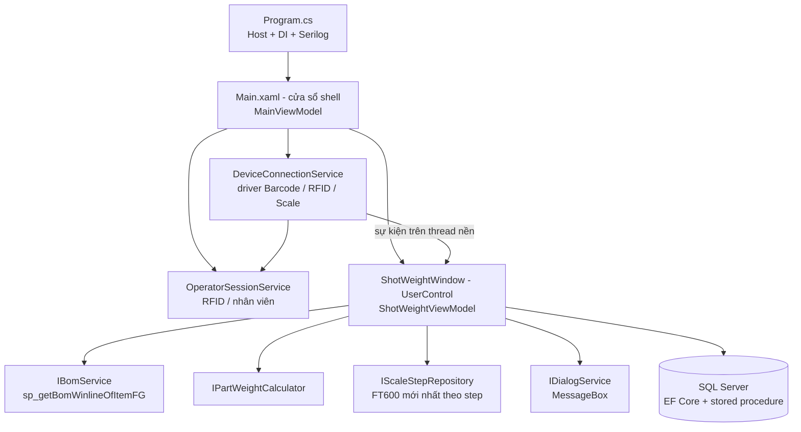
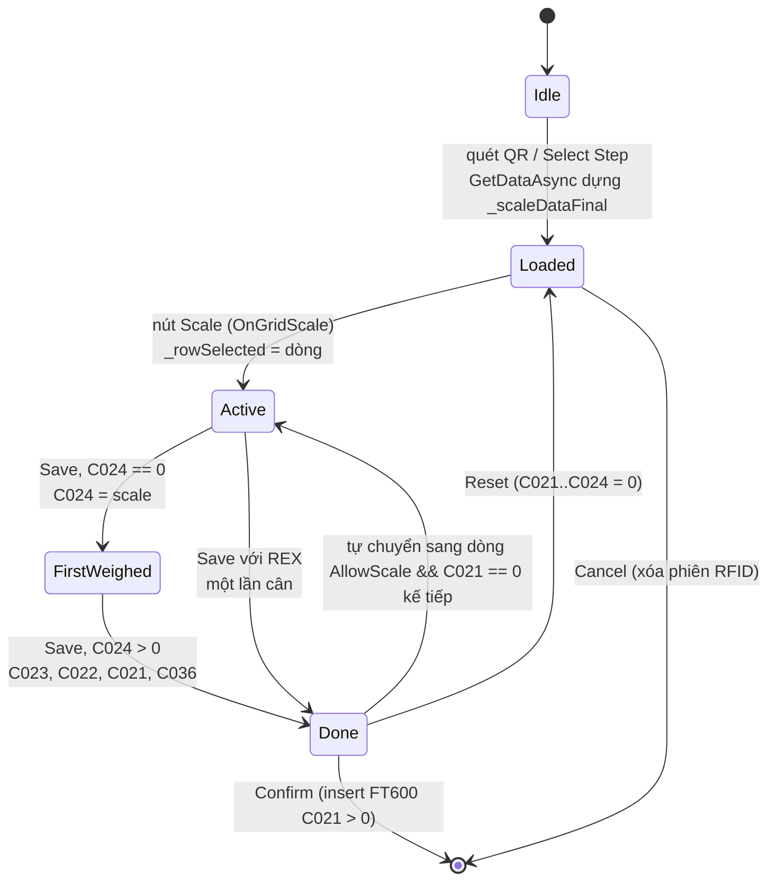

# Hướng dẫn cho Developer SSSW (Tiếng Việt)

> **Đối tượng:** lập trình viên bảo trì / mở rộng ứng dụng cân SSSW.
> **Ngôn ngữ:** Tiếng Việt (file này) · [English](DEVELOPER_MANUAL.en.md) · Tài liệu vận hành: [EN](OPERATOR_MANUAL.en.md) / [VI](OPERATOR_MANUAL.vi.md)
> **Nhánh mô tả:** `feature/use-bom-level-2` (entity `FT600` vẫn trỏ bảng `FT600_dev` – xem [§2.4](#24-cảnh-báo-bảng-test)).
> Tài liệu này mô tả **bên trong màn hình cân hoạt động thế nào** và nối từng trường hợp thao tác của operator với code. Góc nhìn của operator xem tài liệu vận hành; ảnh trong đó được tạo bằng harness ở [§12](#12-harness-chụp-ảnh-cách-tạo-ảnh-trong-manual).

---

## Mục lục

1. [Phạm vi và bản đồ tài liệu](#1-phạm-vi-và-bản-đồ-tài-liệu)
2. [Build, chạy, release](#2-build-chạy-release)
3. [Kiến trúc](#3-kiến-trúc)
4. [Bản đồ màn hình → code](#4-bản-đồ-màn-hình--code)
5. [Mô hình dữ liệu: các cột `FT600`](#5-mô-hình-dữ-liệu-các-cột-ft600)
6. [Vòng đời một lần cân (state machine)](#6-vòng-đời-một-lần-cân-state-machine)
7. [Ma trận trường hợp → code](#7-ma-trận-trường-hợp--code)
8. [Công thức](#8-công-thức)
9. [BOM level 2, step chain, nhiều size, PU](#9-bom-level-2-step-chain-nhiều-size-pu)
10. [Giao dịch Confirm và cơ sở dữ liệu](#10-giao-dịch-confirm-và-cơ-sở-dữ-liệu)
11. [Phần cứng và đa luồng](#11-phần-cứng-và-đa-luồng)
12. [Harness chụp ảnh (cách tạo ảnh trong manual)](#12-harness-chụp-ảnh-cách-tạo-ảnh-trong-manual)
13. [Cách mở rộng: checklist thêm loại step mới](#13-cách-mở-rộng-checklist-thêm-loại-step-mới)
14. [Test](#14-test)
15. [Xử lý sự cố cho Dev](#15-xử-lý-sự-cố-cho-dev)
16. [Quy tắc tài liệu (Docs-Sync)](#16-quy-tắc-tài-liệu-docs-sync)

---

## 1. Phạm vi và bản đồ tài liệu

| Cần gì | Đọc |
|--------|-----|
| Bối cảnh dự án cho AI / bắt đầu nhanh | [`CLAUDE.md`](../../../CLAUDE.md) |
| Quy chuẩn vibe-coding, checklist Docs-Sync | [`VIBE_CODING_GUIDELINES.md`](../VIBE_CODING_GUIDELINES.md) |
| Thành phần và luồng dữ liệu | [`architecture/ARCHITECTURE.md`](../architecture/ARCHITECTURE.md) |
| Bảng DB / stored procedure | [`tech/DATABASE_SCHEMA.md`](../tech/DATABASE_SCHEMA.md) |
| Công thức và quy tắc nghiệp vụ | [`tech/BUSINESS_LOGIC.md`](../tech/BUSINESS_LOGIC.md) |
| Logic `AllowScale` / step bị khóa | [`tech/ALLOWSCALE_LOGIC_REVIEW.md`](../tech/ALLOWSCALE_LOGIC_REVIEW.md) |
| Gần đây đã đổi gì | [`sessions/INDEX.md`](../sessions/INDEX.md) (mới nhất lên trên – **đọc entry mới nhất trước khi code**) |
| Tài liệu thiết kế cũ của màn cân | `SSSW/ShotWeightWindow_Documentation_EN.md` (ngày 2026-06-01 – phần lọc step / `AllowScale` đã cũ một phần, tin vào code) |

---

## 2. Build, chạy, release

### 2.1 Yêu cầu
- Windows, .NET 8 SDK và **Desktop workload** (WinForms + WPF). Target `net8.0-windows`.
- NuGet feed DevExpress 24.2.3 đã cấu hình trên máy (`DevExpress.Win.*`, `devexpress.wpf.grid.core`).
- `Dll/net8.0-windows/ScanAndScale.Core.dll` (tham chiếu bằng `HintPath`).

### 2.2 Lệnh
```
dotnet build SSSW/SSSW.sln                 # Debug
dotnet run   --project SSSW/SSSW.csproj    # chạy (cần DB + cấu hình phần cứng, xem 2.3)
dotnet build SSSW/SSSW.sln -c Release      # Release (+ gói update, xem bên dưới)
dotnet test  tests/SSSW.Tests              # test xUnit của PartWeightCalculator / StepMainCode
```
> Lần restore đầu của DevExpress rất chậm (vài phút). Nếu project tạm biên dịch markup WPF (`*_wpftmp.csproj`) báo `InitializeComponent does not exist`, build lại – đây là race restore/markup tạm thời, không phải lỗi code.

### 2.3 Bí mật cục bộ và cấu hình
- `SSSW/appsettings.json` bị **git-ignore**. Chuỗi kết nối SQL Server `ConnectionStrings:SSSW` được lưu **mã hóa** (`EncodeMD5.DecryptString`, xem `Program.cs`). Không commit file dạng plain-text.
- Cấu hình theo máy nằm trong bảng `FT608_Config` (`WHERE c000 = Environment.MachineName`), JSON của `ConfigModel`; `MainViewModel.StartupAsync()` nạp vào biến tĩnh `GlobalVariable.ConfigSystem`. Máy chưa có dòng thì chèn mặc định.
- Khóa `ConfigModel` liên quan: `Scanner`, `RFID`, `Scale` (IP/port/model/số lẻ/stable/tare), `EnableReadScale`, `PercentOfUserNonWoven` (usage % mặc định), `CategoryOfNonInjectionUsagePartial` (mã category là Non-woven / Mesh), `DeltaLevel1` / `DeltaLevel2` (dung sai tính bằng **gram**, mặc định 1 và 3), `DeltaUpWL`, `UpdatePath`.

### 2.4 Cảnh báo bảng test
`SSSW/models/ef/entities/FT600.cs` hiện là `[Table("FT600_dev")]` để test BOM level 2. **Phải đổi lại `"FT600"` trước mọi lần release.**

### 2.5 Tác dụng phụ của Release
Build Release chạy 3 target sau `Build`: `GenerateUpdateXml` (`update.xml`, version theo ngày giờ), `CreateUpdateZip` (`Update.zip`) và `CopyUpdateToShare` (copy lên share mạng `DeployDir` trong `SSSW/DeployConfig.props`; **lỗi nếu không vào được share** – bình thường khi ngoài mạng công ty). Debug bỏ qua. Đổi site bằng cách sửa `<DeployDir>` trong `DeployConfig.props`; chuỗi kết nối trong `appsettings.json` phải đổi riêng.

---

## 3. Kiến trúc



- **Chỉ đường WPF được chạy.** `Program.cs` dựng `Host`, đăng ký `IDbContextFactory<DbContextDogeWH>`, các service, shell `Main` và `ShotWeightWindow` / `ShotWeightViewModel` (transient), rồi `wpfApp.Run(Main)`. Các form WinForms (`frmShotWeightScale`, `frmMainView` = xem lịch sử, `frmUpdateMasterData` = Settings) được đăng ký cho nút trên toolbar hoặc là legacy.
- **Tab Step / FG bị ẩn** trong `Main.xaml` (`StackPanel Visibility="Hidden"`): hiện chỉ màn Step hiển thị; `ShotWeightFGWindow` vẫn còn nhưng không truy cập được từ UI.
- **Tách MVVM.** View không có business logic. Code-behind chỉ làm việc không bind được: kéo cửa sổ Win32, cầu nối DevExpress `LookUpEdit`, cầu nối sự kiện driver → `Dispatcher`, xử lý phím Enter, **popup** cân (`OpenWeighDialog`). Toàn bộ state và logic ở `ShotWeightViewModel` (≈3.450 dòng).
- **Cầu nối `Action<T>`** (`ClearStepComboAction`, `SetStepComboAction`, `FocusGridRowAction`, `OpenWeighDialogAction`) được gán trong `ShotWeightWindow.OnLoaded`; VM không phụ thuộc UI.
- **Context theo từng thao tác.** Luôn dùng `IDbContextFactory.CreateDbContext()` trong `using` – không giữ `DbContext` lâu.
- **Thứ tự khởi động** (nhạy race, có ghi chú trong `Main.xaml.cs`): hiện `Main` → `Main_Loaded` → `MainViewModel.StartupAsync()` (SP company/year → tiêu đề → `FT608_Config` → `DeviceConnectionService.EnsureInitialized()` → `OperatorSession.Attach()`) → `SelectStep()` resolve `ShotWeightWindow` → `OnLoaded` của nó chạy `ShotWeightViewModel.InitializeAsync()` một lần (đọc master `FT601` có `C021 = true`).

---

## 4. Bản đồ màn hình → code

| Khu vực màn hình (tài liệu vận hành §2) | XAML (`UI/WPF/ShotWeightWindow.xaml`) | Thành viên view-model |
|---|---|---|
| Tiêu đề / RFID / toolbar | `Main.xaml` | `MainViewModel.WindowTitle`, `OperatorSession.UserName/RfidStatus`, `HydraCommand`, `SettingsCommand`, `UpdateCommand`; `ActiveContent.DataContext.ReloadCommand/HistoryViewCommand` |
| Các ô STEP INFORMATION | card trái | `StepName`, `StepCode`, `Machine`, `Qty`, `ActualPairs` (+`PartitioningLabel`/`AdjustLabel`/`CountUnit` prs↔pcs), `AllowPartitionAdj`, `RunnerText`, `UsagePct`/`IsUsagePctReadOnly`, `Size`, `StepIndex`, `FgName`, `FgItemCode`, `Remark` |
| Select Step | DevExpress `LookUpEdit` `cbStepName` | `StepCodeMaster`; `cbStepName_EditValueChangedAsync` → `OnStepSelectedAsync` |
| Barcode / QR | `ButtonEdit` | `BarcodeScannedValue`, `BarcodeStatus`; `OnBarcodeScannedAsync` (đọc `FT606_Label` theo QR) |
| TOTAL STEPS | `DataGrid dgTotalSteps` (+ Row Details) | `StepsCollection`; dòng `FT600` (`StatusText/StatusDotColor/StatusBarColor`, `Level2Items`, `Level2Formula`); `GridScaleCommand/GridResetCommand/GridDeleteCommand` → `OnGridScale/OnGridReset/OnGridDelete` |
| REFERENCE / HISTORY | `dgHistory` | `HistoryCollection`, `HistoryToggleText*`, `IsHistoryExpanded`; `LoadRefHistoryAsync` (15 `FT600` gần nhất theo `C002`) |
| SCALE VALUE / Save | card cân | `ScaleValue`, `ScaleDisplay`, `ScaleStable`, `ScaleTare`, `ScaleStatus`, `EnableBtnSaveScale`, `ScaleCardBorderBrush/Background`; `OnScaleValueChanged`; `SaveCommand` → `ExecuteSave` |
| REFERENCE VALUES | `dgRefValues` | `RefRowsCollection` gồm `ReferenceRow` (`Std/Actual/Delta/Tolerance`); `UpdateReferencePanel` |
| Cancel / Confirm | nút chân trang | `CancelCommand` → `ExecuteCancel`; `ConfirmCommand` → `ExecuteConfirmAsync` → `ConfirmCoreAsync` |
| "Saving data…" | overlay | `IsOverlayVisible`, `OverlayMessage`, `ShowBusy/HideBusy` |
| Cửa sổ cân popup | dựng bằng code (`OpenWeighDialog`) | `IsDialogMode`, `CreateDialogViewModel`, `ApplyPendingStepAsync`, `ReloadWeighedValuesAsync`, `DialogCloseRequested` |

**Converter** (`UI/WPF/Converters/ScaleConverters.cs`): tolerance → brush, trạng thái driver → màu, stable → viền, `ValueUnitConverter` (đơn vị trong ô). **Style:** `UI/WPF/Styles/ShotWeightStyles.xaml`, nạp trong `Program.cs` làm resource ứng dụng.

---

## 5. Mô hình dữ liệu: các cột `FT600`

`FT600` (`models/ef/entities/FT600.cs`, namespace `SSSW.models`) vừa là dòng DB vừa là dòng lưới. Cột có tên mờ `C0xx`; các cột dùng trong logic cân:

| Cột | Ý nghĩa | Ghi chú |
|-----|---------|---------|
| `C002` | Mã step | Dạng `<seq>-<main>-<màu>-<size>`; `REX…` cho chi tiết chèn. Khóa lịch sử (`LoadRefHistoryAsync`) |
| `C003` / `C027` / `C026` | Tên step / tên main / mã main | `StartsWith("Logo")`, `"Cleat_Ring"`, `"Stud"`, `"Inlay"` quyết định quy tắc đặc biệt |
| `C004` | Máy | `REX` cho chi tiết chèn; thuộc khóa multi-size |
| `C015` | Thứ tự step | 0 = dòng REX chỉ có ở Level 2 (đặt đầu) |
| `C008` | Size | Dùng chọn chi tiết con cùng size |
| `C020` | Mold id | Khóa multi-size (máy + khuôn + thứ tự + prefix 2 đoạn) |
| `C019` | Machine group | `PU` ⇒ `IsPu`; `REX` |
| `C024` | **Total Weight** (g) | Lần cân 1; REX: lần cân duy nhất |
| `C023` | **Total Part** (g) | Lần cân 2 (tổng N đôi) |
| `C021` | **Part Weight** (g/prs, PU: g/pcs) | Kết quả, xem §8 |
| `C022` | **Runner / excess** (g/prs) | Kết quả |
| `C025` | Quantity (Level 1) | |
| `C039` | Số chiếc/đôi (gộp Level 2) | `ComponentQuantityAggregator`; 0 với step chain / không thuộc Level 2 nào |
| `C036` | Trọng lượng/chiếc (g) | `C021 / C039` (REX: scale / `C039`; PU: `C021`) |
| `C037` | Đơn vị | `PRS`, `PCS-L`, `PCS-R` |
| `C028` / `C017` / `C018` | Số đôi/shot thực tế / PPIC / khuôn | `C028` = "Actual Partitioning" N |
| `C033` / `C034` / `C035` | Mã / tên category / usage % | non-woven / mesh |
| `C032` | `FT601.Id` | Liên kết master lệnh; `Id` *không* duy nhất giữa các size của 1 khuôn |
| `C010` / `C011` | Mã / tên operator | Gán lúc Confirm |
| `C013` / `C014` | Mã / tên FG | Thay bằng FG đang quét khi Confirm |
| `C038` | Remark | |

Chỉ có trên UI (`[NotMapped]`, `FT600.partial.cs`): `AllowScale`, `StatusText`, `StatusDotColor`, `StatusBarColor`, `Level2Items`, `Level2Formula`, `Level2HasMissing`, `IsReusedFromHistory`, `IsPu`. Chi tiết các bảng khác và stored procedure: `tech/DATABASE_SCHEMA.md`.

Stored procedure màn này dùng: `sp_getBomWinlineOfItemFG` (Level 1 / Level 2), `sp_sssw_getGroupSize` (size của Logo), `sp_sssw_getproductInfo` (thông tin FG/main), `sp_GetCategorryOfItem`, `sp_MaterialGetCompanyName`, `sp_MaterialGetMesoyear`, `sp_GetFullStepItemHydraIsRun` (đồng bộ Hydra), `sp_ShotweightReport_UpsertFT609` (báo cáo FG).

---

## 6. Vòng đời một lần cân (state machine)



Các hàm chính (đều trong `ShotWeightViewModel`):

1. **`OnBarcodeScannedAsync` / `OnStepSelectedAsync` → `GetDataAsync(FT601)`** – dựng lưới: Level 1 (`IBomService.GetLevel1Async`), master từng step, lọc `AllowScale` (vùng *"Lọc lại để cho phép cân hay là không…"*: nhóm Logo / Cleat_Ring / Studs / Inlay), size của Logo (`AddLogoGroupSizesAsync`), cặp PU, rồi `PreloadLevel2Async`, `ApplyPieceQuantities`, `AddLevel2OnlyRexRows`, `PrefillRexFromHistory`, `RefreshUI`.
2. **`OnGridScale(row)`** – kiểm tra `AllowScale` (khóa ⇒ `SwitchToLockedStepAsync`), tải lại cặp PU (`NeedsPuPairReload`), kiểm tra step trước (`PreviousStepsToCheck`), gán `_rowSelected`, `_articlePaisShotFinaly` (= `C028`), `RefreshUI`, `LoadRefHistoryAsync`.
3. **`OnScaleValueChanged(value, stable, tare, unit)`** (gọi từ cầu nối driver trên UI thread) – đổi KG→g, cập nhật số hiển thị, bật **Save** (`ReadOnlyScale && !stable` ⇒ tắt).
4. **`ExecuteSave`** – lõi tính toán (xem §8): kiểm tra (`AllowScale`, step trước chưa cân) → nhánh injection hay REX → phân bổ multi-size → `CascadeLevel2` → cascade cũ → tự chuyển step kế → `RoundDoubles` → `RefreshUI` / `UpdateReferencePanel` / `LoadRefHistoryAsync`.
5. **`ExecuteConfirmAsync` → `ConfirmCoreAsync`** – §10.
6. **`ExecuteCancel`** – popup: chỉ đóng; màn chính: xóa phiên operator, combobox, QR và gọi `ResetNewLoop`.

`UpdateStepStatuses` (gọi từ `RefreshUI`): **Done** = REX `C023 > 0`, step ép `C021 > 0 && C023 > 0`; **Active** = `C002` và `C032` trùng dòng đang chọn; còn lại **Pending** (màu `#4CAF50` / `#1976D2` / `#9E9E9E`).

---

## 7. Ma trận trường hợp → code

| Trường hợp operator | Dấu hiệu trong dữ liệu | Đường đi trong `ExecuteSave` / hàm phụ |
|---|---|---|
| **A** Step ép thường (2 lần cân) | `C002` không phải `REX`, không phải Logo/Cleat_Ring | Save 1: `C024 = scale`; Save 2: `C023 = scale`, `C022 = (C024 − scale)/N` nếu `RunnerText == "YES"`, `C021` qua `ApplyLevel2PartWeight` (không có L2 ⇒ `PartPerPair`), `UpdateWeightPerPiece` |
| **B** REX / receptacle | `C002.StartsWith("REX")`, category không nằm trong `CategoryOfNonInjectionUsagePartial` | `C024 = C023 = C021 = scale`; `C036 = scale / PiecesStrict(C039)` |
| **C** Non-woven / Mesh | REX + `C033` thuộc `CategoryOfNonInjectionUsagePartial` | `usage = round(scale × %/100 / C028, 3)`; `C023 = C021 = usage`, `C022 = (scale − usage×C028)/C028`; `%` sửa qua `OnUsagePctEnter` (tính lại mọi dòng REX) |
| **D** BOM level 2 | `_level2ByStep[mã step]` có chi tiết con | `ApplyLevel2PartWeight` → `ComputePartWeight` → `PartWeightCalculator`; thiếu con ⇒ `_dialog.Warn("Component / previous step(s)…")`, `C023/C022 = 0`, return |
| **E** Step chain | step trước chỉ được step kế tiếp tham chiếu (`IsChainOnly`) | `ChainPredecessors` trừ `PartPerPair(step trước)`; step trước bị loại khỏi danh sách L2 |
| **F** Partitioning N | `C028 = N` (chỉ sửa khi `AllowPartitionAdj`) | `PartPerPair = C023 / N`, `C022 = (C024 − C023)/N` |
| **G** Runner NO | `RunnerText == "NO"` | `C022 = 0` |
| **H** Khuôn nhiều size | cùng `C020`, `C004`, `C015`, prefix 2 đoạn (`IsMultiSizeMold`) | `UsesLegacyPartWeight` ⇒ `ApplyLegacyPartWeight`; Save copy `C024` cho cả nhóm và đặt `C022 = (C024 − ΣC023)/ΣC028`; `PreviousStepsToCheck` = mọi step nhỏ hơn |
| **I** PU (L/R) | `C019 == "PU"` (`IsPu`) | `ApplyPuUnits` (`C037 = PCS-L/R` theo hậu tố mã), `UpdateWeightPerPiece` (`C036 = C021`), `SameSide` lọc thành phần, popup qua `NeedsPuPairReload` |
| **J** Cleat_Ring / Logo | `C003.StartsWith("Cleat_Ring"/"Logo")` | `C021 = PartPerPair` (không trừ) |
| Step bị khóa | `AllowScale == false` | `SwitchToLockedStepAsync`: popup (`OpenWeighDialogAction`), nếu không thì `Confirm("Switch step")` và dựng lại bằng `CreateStepFromSelectionAsync` |

---

## 8. Công thức

Đặt `W = C024` (shot), `S = C023` (chi tiết của N đôi), `N = C028` (≥ 1; rỗng/0 ⇒ 1).

```
C023 = S                                   (giữ nguyên tổng N đôi, không chia)
C022 = (W − S) / N        nếu Runner = YES, ngược lại 0
PartPerPair = S / N
C021 = PartPerPair − Σ Qty(con) × UnitWeight(con)             BOM L2 (con ≠ self)
            − PartPerPair(step chain ngay trước)               step chain
C036 = C021 / C039   (PU: C021;  REX: scale / C039)
UnitWeight(con) = C036 nếu > 0, ngược lại (không phải REX) C021 / C039, ngược lại "thiếu"
```
Ví dụ: Studs 22.10 g/prs, `C039 = 10` ⇒ 2.21 g/chiếc. Inlay = 48.20 − 8×2.21 = **30.52**. Base_FF = 128.40 − (2×2.21 + 8×0.55 + 48.20) = **71.38**. N = 2: W 125.40, S 96.80 ⇒ `C021 = 48.40`, `C022 = 14.30`.

Công thức cũ (khuôn nhiều size hoặc có non-woven, `UsesLegacyPartWeight`): `C021 = PartPerPair − Σ C021(mọi step trước) − Σ C021(REX non-injection cùng step)`; mọi step nhỏ hơn phải cân trước.

`RoundDoubles` làm tròn các cột double 3 số lẻ trước khi hiển thị/lưu.

**Dung sai** (`ReferenceRow`): `Delta = round(Actual − Std, 3)` tính bằng **gram**; `Ok` nếu `|Δ| ≤ DeltaLevel1`, `Warn` nếu `≤ DeltaLevel2`, ngược lại `Err`. `TolerancePercent` là biến thể % (dùng cho số % hiển thị). `STANDARD` = trung bình các giá trị dương của 15 dòng `FT600` gần nhất của step (`AverageOrNull`). Viền/nền card cân lấy mức xấu nhất trong 4 dòng. *(`CLAUDE.md` ghi ±1 % / ±3 %; code thực tế so sánh theo gram – kiểm tra `ScaleModels.cs` / converter trước khi đổi.)*

---

## 9. BOM level 2, step chain, nhiều size, PU

- **Level 2** = `sp_getBomWinlineOfItemFG @itemFG = <mã step>` (cache theo phiên trong `BomService`). Ghép child ↔ step theo **mã chính** (`PartWeightCalculator.StepMainCode`: 2 đoạn đầu; REX giữ nguyên). Dòng self = mã `-0000` / đơn vị `G` / cùng step. Cùng mã chính nhiều size ⇒ chọn cùng size với step cha (`PickSameSize`), nếu không thì dòng đầu tiên có g/chiếc.
- **Con lấy từ** phiên hiện tại (`_scaleDataFinal`) trước, rồi `FT600` đã lưu mới nhất (`IScaleStepRepository`, `_weighedChildrenFromDb`).
- **Gộp `C039`** (`ComponentQuantityAggregator`) = Σ qty theo mọi step cha trong FG, trừ step chain thực sự (`C039 = 0`).
- **Cascade** (`CascadeLevel2`): khi con đổi, các step cha đã cân tính lại `C021` và `C022`.
- **Dòng REX chỉ có ở Level 2** (`AddLevel2OnlyRexRows`): REX chỉ xuất hiện ở Level 2 có dòng riêng (`C015 = 0`, `C025 = 1`).
- **Row Details** (`RefreshLevel2Details` → `Level2Items`, `Level2Formula`) là phần operator thấy dưới dòng đang chọn.
- **Nhiều size / group size của Logo**: `AddLogoGroupSizesAsync` gọi `sp_sssw_getGroupSize @ItemCode = <prefix 3 đoạn>` (bỏ `-0000` / `no size`); mỗi size có partitioning riêng (FT601 của size đó → master → copy từ dòng Logo).
- **PU**: `ApplyPuUnits`, `PuSideOf` (hậu tố `…L` / `…R` đứng sau chữ số hoặc `_`), `AddLogoGroupSizesAsync(pairOnly: true)`, `SameSide`. Step PU không phải cuối hoặc step bị khóa ⇒ **popup**: `OpenWeighDialog` (View) tạo `ShotWeightWindow` + VM mới qua `CreateDialogViewModel`; Confirm thành công thì đóng; khi đóng, VM chủ gọi `ReloadWeighedValuesAsync`. VM chủ bỏ qua sự kiện quét/cân khi `_dialogOpen`.
- `docs/tech/BUSINESS_LOGIC.md` §4.8 có đầy đủ công thức, sơ đồ mermaid và FG mẫu `6112042313-A478-2801`.

---

## 10. Giao dịch Confirm và cơ sở dữ liệu

`ConfirmCoreAsync`:
1. **Chặn:** `_operatorSession.IsOperatorSet` nếu không thì `Warn("RFID card not yet scanned.")`.
2. **Kiểm tra REX multi-size** / `Scale not completed for step: …` cho dòng REX còn trống.
3. **Tập insert** = `AllowScale && C021 > 0` (gồm dòng nạp từ lịch sử – `IsReusedFromHistory` – được insert lại với FG hiện tại).
4. Với mỗi dòng: `RoundDoubles`, `C010/C011` (operator), `CreatedDate/CreatedMachine`, `Mesocomp/Mesoyear`, `C013/C014` = FG của step đang quét/chọn (`_productFgCode` với Logo), dòng PU có `C019 = PU`, `C037 = PCS-L/R`.
5. Trong **một transaction EF**: `AddRangeAsync(insert)`, `ExecuteUpdateAsync` trên `FT601` (`C017 = true` cho lệnh), `SaveChanges`, `Commit`. Lỗi ⇒ rollback + `Error("Transaction error …")`.
6. Sau commit: `ProcessUpsertFT609ForFinalStepsAsync` – nếu step vừa cân là step cuối của FG (`Max(C015)`), gọi `sp_ShotweightReport_UpsertFT609 @FGItemCode, @CreatedBy`.
7. Hộp thoại thành công, `ClearStepComboAction`, reset; popup thì `DialogCloseRequested`.

---

## 11. Phần cứng và đa luồng

- Driver (`BarcodeDriver`, `RfidDriver`, `ScaleDriver`, gói `ScanAndScale.Driver/Core`) do singleton `DeviceConnectionService` giữ; khởi tạo một lần trong `MainViewModel.StartupAsync()` bằng `GlobalVariable.ConfigSystem`; tắt một lần trong `Program.cs`.
- Sự kiện driver bắn trên **thread nền** – mọi handler trong `ShotWeightWindow.xaml.cs` (`BarcodeDriver_DataValueChanged`, `ScaleDriver_DataValueChanged`) phải qua `Dispatcher.Invoke/InvokeAsync`; RFID xử lý trong `OperatorSessionService.Device_RfidChanged` bằng `Dispatcher.Invoke`.
- `ReadOnlyScale = Scale.ReadOnly ?? true`: ô cân chỉ đọc; **Save** chỉ bật khi số ổn định. Đặt `EnableReadScale = false` trong config cho phép gõ tay (chế độ kỹ thuật).
- Không chặn UI thread bằng gọi DB: dùng `Task.Run` + `await`; collection bind vào lưới (`StepsCollection`, …) sửa trên dispatcher; `FT600` **không** implement `INotifyPropertyChanged` – sau khi sửa field phải gọi `RefreshStepsGrid()` (clear + add lại).

---

## 12. Harness chụp ảnh (cách tạo ảnh trong manual)

Không kết nối được DB nhà máy từ máy dev, nên ảnh trong tài liệu vận hành được tạo bằng một **harness** nhỏ chứa **đúng** shell `Main`, `ShotWeightWindow` và `ShotWeightViewModel` **thật** nhưng với **service giả**:

| Thành phần | File (`docs/manual/screenshot-harness/*.cs.txt`) | Vai trò |
|---|---|---|
| `Stage` | `Stage.cs` | Dựng cửa sổ + view-model thật. `IDialogService`, `IBomService`, `IScaleStepRepository` giả; truyền `null` cho `IDbContextFactory`; đặt `_initialized = true` để bỏ qua `InitializeAsync()` (cần DB); gán `_scaleDataFinal`, `_level2ByStep`, `_allStepsFG` bằng reflection rồi gọi `ApplyPieceQuantities`, `RefreshUI` thật. |
| `Data` | `Data.cs` | Dữ liệu sản phẩm **giả lập** (FG mẫu `6112042313-A478-2801`, non-woven, 2 đôi, nhiều size, PU). Không phải dữ liệu nhà máy. |
| `Scenes` | `Scenes.cs` | Mỗi trường hợp thao tác một hàm. Điều khiển logic **thật**: `OnGridScale`, `OnScaleValueChanged`, `SaveCommand`, `OnUsagePctEnter`, … nên số liệu trong ảnh do chính code production tính ra. |
| `Annotator` | `Annotator.cs` | Vẽ khung đỏ + số thứ tự theo toạ độ DIP (khung dòng lấy từ visual tree), vẽ giả hộp thoại Windows từ `FakeDialog.Log`, ghép ảnh. |
| `Reflect`, `Fakes` | | Hàm hỗ trợ truy cập thành viên private, service giả, logger rỗng. |

**Cái gì thật, cái gì giả:** layout, style, converter, logic trạng thái, Row Details và **mọi phép tính trọng lượng** là code thật. Giả lập: đọc DB (lịch sử = `Data.History(...)` nạp vào `_stdRow`/`HistoryCollection`, mô phỏng `LoadRefHistoryAsync`), đăng nhập RFID (field private của `OperatorSessionService`), số cân (`OnScaleValueChanged`), hộp thoại (vẽ lại), transaction Confirm (chỉ hiển thị overlay *Saving data…* và thông báo thành công).

**Tạo lại ảnh** (không sửa gì trong source ứng dụng):
1. Build app: `dotnet build SSSW/SSSW.csproj` (Debug).
2. Copy `SSSW/bin/Debug/net8.0-windows` ra thư mục tạm, vd. `run/`.
3. Tạo project tạm cạnh đó, copy các file harness và **bỏ đuôi `.txt`**, dùng `ManualShots.csproj.txt` làm file project (tham chiếu DLL đã copy và xuất exe vào `run/`).
4. Copy `SSSW/UI/WPF/Styles/ShotWeightStyles.xaml` vào project tạm (`UI/WPF/Styles/`), thêm `;assembly=SSSW` vào hai khai báo `clr-namespace` và đưa vào làm `<Resource>` – cần vì `Source` tương đối được resolve theo assembly *entry*.
5. `dotnet build` project tạm rồi chạy `run/ManualShots.exe <thư mục xuất> [scene]` (scene: `overview login load-steps grid-columns standard rex nonwoven level2 chain partition multisize pu tolerance warnings confirm rowactions`). Cửa sổ cố định 1920×1200 DIP; ảnh PNG ghi ra `docs/manual/images/`.

> **Quan trọng:** file harness có đuôi `.cs.txt` là cố ý. `SSSW.csproj` biên dịch mọi `*.cs` dưới `SSSW/`, nên file `.cs` thường đặt trong `docs/` sẽ làm hỏng build ứng dụng.

**Thêm scene mới:** tạo dòng bằng `Data.Row(...)`, đăng ký con BOM trong `stage.Bom.L2[...]` (gồm dòng self, unit `G`), `stage.Load(rows, masters)`, điều khiển VM (`ClickScale`, `PutOnScale`, `ClickSave`), rồi `Shot(stage, "tên", anns)` với các hình chữ nhật cố định (`StepInfo`, `TotalSteps`, `ScaleBox`, … cho 1920×1200) hoặc `Row(stage, row)` / `ActionBtn(...)` cho khung theo dòng. Phải gọi `Stage.Settle()` sau khi làm mới lưới, trước khi row container tồn tại.

Giới hạn: popup DevExpress (danh sách *Select Step* đang mở), hộp thoại WinForms thật (`frmRfidInput`, xem lịch sử, Settings) và tab FG đang ẩn không được chụp; được mô tả bằng chữ.

---

## 13. Cách mở rộng: checklist thêm loại step mới

1. **Xác định quy tắc** theo `C002` / `C003` / `C019` / `C033` và xem nó giống trường hợp nào ở §7.
2. Thêm nhánh trong `ExecuteSave` (và nếu có trừ thì cả `ComputePartWeight` / `RefreshLevel2Details`) – giữ `RefreshLevel2Details` và `ExecuteSave` nhất quán: công thức Row Details phải hiển thị đúng điều Save tính.
3. Cập nhật `UpdateStepStatuses` nếu "Done" mang nghĩa khác.
4. Nếu step cần bộ nút/khóa khác, sửa vùng `AllowScale` của `GetDataAsync` và đọc `tech/ALLOWSCALE_LOGIC_REVIEW.md` trước.
5. Cột lưu DB: kiểm tra `ConfirmCoreAsync` (tập insert, field FG, đơn vị) và `DATABASE_SCHEMA.md`.
6. Viết test xUnit cho mọi phép tính thuần mới (đặt logic thuần trong service kiểu `PartWeightCalculator`, không đặt trong VM).
7. Thêm scene vào harness chụp ảnh và một mục vào cả hai manual vận hành (EN + VI).
8. Chạy checklist Docs-Sync (§16).

---

## 14. Test

`tests/SSSW.Tests` (xUnit, tham chiếu `SSSW.csproj`): `PartWeightCalculatorTests` (trừ level 2, thiếu con, dòng self, trọng lượng đơn vị) và `StepMainCodeTests` (tách mã chính). Chạy `dotnet test tests/SSSW.Tests`. Bản thân view-model không có test tự động (cần DB và dispatcher) – harness chụp ảnh là thứ gần nhất với smoke test cho logic UI: nếu một scene ném lỗi nghĩa là binding hoặc đường tính toán đã hỏng.

---

## 15. Xử lý sự cố cho Dev

| Triệu chứng | Nguyên nhân / cách xử lý |
|---|---|
| Build Release lỗi ở `CopyUpdateToShare` | Không vào được share mạng – bình thường khi ngoài công ty. |
| `_wpftmp.csproj … InitializeComponent does not exist` | Race markup WPF tạm thời sau restore lâu – build lại. |
| Lưới hiện số cũ sau khi sửa field `FT600` | `FT600` không có thông báo thay đổi – gọi `RefreshStepsGrid()` / `RefreshUI()`. |
| Exception UI từ sự kiện driver | Handler chưa marshal – dùng `Dispatcher.Invoke`. |
| Step bị *khóa* bất ngờ | Vùng `AllowScale` trong `GetDataAsync` (nhóm Logo / Cleat_Ring / Studs / Inlay) – xem `ALLOWSCALE_LOGIC_REVIEW.md`. |
| `C021` sai ở step ghép | Xem `Level2Formula` trong Row Details trước; rồi nội dung `_level2ByStep`, ghép mã chính và `C039`. |
| Cửa sổ chính trống lúc khởi động | Race khởi động – `StartupAsync()` phải chạy từ `Main_Loaded` (không phải constructor của VM). |
| Log | `Logs/` cạnh file exe (Serilog theo ngày, giữ 30 ngày). |

---

## 16. Quy tắc tài liệu (Docs-Sync)

Sau mỗi task: cập nhật session log (`docs/sessions/YYYY-MM-DD_slug.md` + `sessions/INDEX.md`), tài liệu `tech/` và `architecture/` cùng sơ đồ Mermaid nếu hành vi đổi, `CLAUDE.md`, và **cả hai phiên bản ngôn ngữ của các manual này** khi hành vi màn hình đổi (tạo lại các ảnh bị ảnh hưởng bằng harness). Commit docs cùng code liên quan.
