# SSSW Operator Manual (English)

> **Audience:** production-floor operators and line technicians who weigh injection-molding shots on the SSSW workstation.
> **Language versions:** English (this file) · [Tiếng Việt](OPERATOR_MANUAL.vi.md) · [Bahasa Indonesia](OPERATOR_MANUAL.id.md) · Developer manual: [EN](DEVELOPER_MANUAL.en.md) / [VI](DEVELOPER_MANUAL.vi.md)
> **Screenshots:** all screenshots were taken from the real application screen with **simulated (sample) data** — item codes, machines, names and weights are examples, not factory data. Red frames and numbered badges are explained in the list under each picture.

---

## Contents

1. [What the application does](#1-what-the-application-does)
2. [The screen at a glance](#2-the-screen-at-a-glance)
3. [Sign in with your RFID card](#3-sign-in-with-your-rfid-card)
4. [Load the steps of a product](#4-load-the-steps-of-a-product)
5. [How to read the TOTAL STEPS table](#5-how-to-read-the-total-steps-table)
6. [Weighing cases](#6-weighing-cases)
   - [6.1 Case A – Normal injection step (2 weighings)](#61-case-a--normal-injection-step-2-weighings)
   - [6.2 Case B – REX / receptacle (1 weighing)](#62-case-b--rex--receptacle-1-weighing)
   - [6.3 Case C – Non-woven / Mesh (use only a percentage)](#63-case-c--non-woven--mesh-use-only-a-percentage)
   - [6.4 Case D – Step made of other parts (BOM level 2)](#64-case-d--step-made-of-other-parts-bom-level-2)
   - [6.5 Case E – "Chain" step (previous step is inside it)](#65-case-e--chain-step-previous-step-is-inside-it)
   - [6.6 Case F – Several pairs in one shot (Partitioning)](#66-case-f--several-pairs-in-one-shot-partitioning)
   - [6.7 Case G – Runner = NO](#67-case-g--runner--no)
   - [6.8 Case H – One mold, several sizes (e.g. Logo)](#68-case-h--one-mold-several-sizes-eg-logo)
   - [6.9 Case I – PU items (weighed per piece, L / R)](#69-case-i--pu-items-weighed-per-piece-l--r)
   - [6.10 Case J – Cleat_Ring](#610-case-j--cleat_ring)
7. [Tolerance colours](#7-tolerance-colours)
8. [Row buttons: Scale / Reset / Delete](#8-row-buttons-scale--reset--delete)
9. [Remark, Confirm and Cancel](#9-remark-confirm-and-cancel)
10. [Messages you may see](#10-messages-you-may-see)
11. [Troubleshooting](#11-troubleshooting)
12. [Quick reference card](#12-quick-reference-card)

---

## 1. What the application does

SSSW (**S**can and **S**cale **S**hot **W**eight) checks the weight of every step of a product against the **BOM standard** and the **last weighings**, and stores your result in the database. You always do the same three things:

1. **Identify** – sign in (RFID card) and load the product's steps (scan the QR label).
2. **Weigh** – put the item on the scale, press **Save** on the screen; the program calculates everything else.
3. **Confirm** – press **Confirm** once all steps are *Done*.

> The program does the arithmetic (runner, part weight, deductions of other parts). You only put the right item on the scale and press **Save**.

---

## 2. The screen at a glance

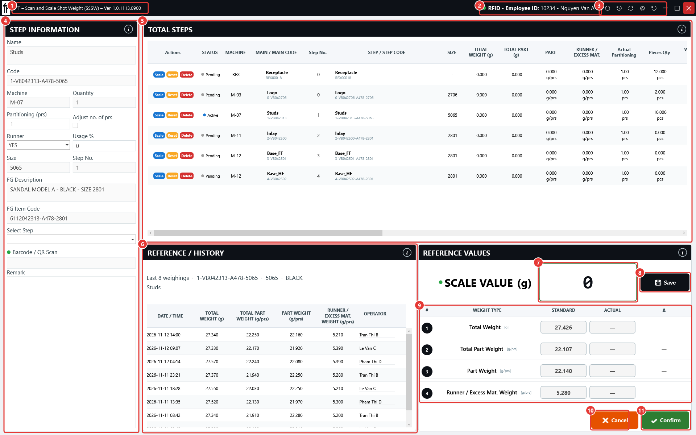

| # | Area | What it is for |
|---|------|----------------|
| 1 | **Title bar** | Site code (e.g. `fFT`), application name and **version**. Drag it to move the window. |
| 2 | **RFID – Employee ID** | Green dot = card reader connected. Shows `card code – your name` after you scan your card. **Click it** to type your ID manually. |
| 3 | **Toolbar icons** | Reload · History · Hydra sync · Settings · Update (see table below), then minimise / maximise / close. |
| 4 | **STEP INFORMATION** | Details of the step you are weighing (name, code, machine, partitioning, runner, size, FG…). Also the **Select Step** list, the **Barcode / QR Scan** box and the **Remark** box. |
| 5 | **TOTAL STEPS** | One row per step of the product, with status and weights. Buttons **Scale / Reset / Delete** are on each row. |
| 6 | **REFERENCE / HISTORY** | The last weighings of the selected step (date, weights, who weighed). |
| 7 | **SCALE VALUE (g)** | The live number from the scale. A green dot beside the title = scale connected. |
| 8 | **Save** | Stores the number currently on the scale into the active step. |
| 9 | **REFERENCE VALUES** | STANDARD (average of the last weighings) vs ACTUAL (this weighing) and the difference Δ, coloured by tolerance. |
| 10 | **Cancel** | Discards everything on the screen **and signs you out**. |
| 11 | **Confirm** | Writes all finished steps to the database. |

**Toolbar icons (item 3)**

| Icon | Name | Use |
|------|------|-----|
| ⟳ (circular arrow) | Reload | Reload the list of products/steps from the database. |
| 🕘 | History | Open the weighing-history viewer. |
| ⇄ | Hydra | Pull the latest production orders from the MES (Hydra). |
| ⚙ | Settings | Opens the master-data / settings form (full-screen). For technicians only; the weighing list reloads when you close it. |
| ↺ | Update | Check for a newer version of the application. |

Hover the mouse over the small **ⓘ** icon on a card title to read a short help text for that card.

**Device dots** – green = connected and working, red = not connected:
the RFID dot (header), the Barcode dot (left of "Barcode / QR Scan") and the Scale dot (left of "SCALE VALUE").

---

## 3. Sign in with your RFID card

You must be signed in before you can **Confirm**.

**Before sign-in** – the RFID dot is green, the name is empty:


1. Window title and version.
2. Employee area – still empty.

**After you tap your card** on the reader:


1. `RFID – Employee ID: <card code> – <your name>`. The name stays while you move between steps. It is cleared only by **Cancel**.

**Card reader not working?** Click the employee area (item 1 above). A small window opens: type your **Employee ID** and press **Enter**; your name appears; press **OK**. If the ID is new the window asks for your name – type it, press **Enter**, then **OK**.

---

## 4. Load the steps of a product

Do **one** of the following:

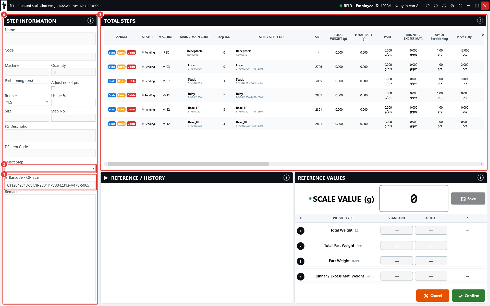

1. **Barcode / QR Scan** – scan the QR label on the production order or on the part. The program finds the order and loads all steps automatically.
2. **Select Step** – click the list and pick the step (you can type part of the code or name to search all columns).
3. **TOTAL STEPS** – after loading, every step of the product appears here.
4. **STEP INFORMATION** – fills with the step you are about to weigh.

Possible messages: *"Label information not found."*, *"Step information not found."*, *"No matching data found!"* → the label is not registered; call your supervisor.

---

## 5. How to read the TOTAL STEPS table

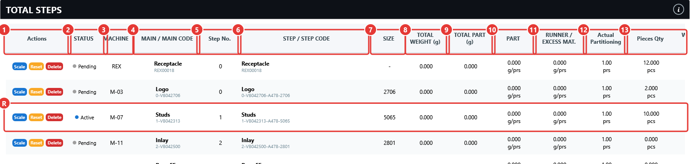

| # | Column | Meaning |
|---|--------|---------|
| 1 | **Actions** | **Scale** (select/weigh this step) · **Reset** (clear its weights) · **Delete** (remove the row from this session). |
| 2 | **STATUS** | Grey **Pending** – not weighed · Blue **Active** – the step being weighed · Green **Done** – weights complete. |
| 3 | **MACHINE** | Injection machine of the step (`REX` for inserts). |
| 4 | **MAIN / MAIN CODE** | The main item the step belongs to. |
| 5 | **Step No.** | Production order of the step (0 = parts that belong to several steps, e.g. REX). Lower steps are weighed first. |
| 6 | **STEP / STEP CODE** | Step name and full code (includes colour and size). |
| 7 | **SIZE** | Size code of the step. |
| 8 | **TOTAL WEIGHT (g)** | Weight of the whole shot (parts + runner) – 1st weighing. |
| 9 | **TOTAL PART (g)** | Weight of the parts only – 2nd weighing. |
| 10 | **PART (g/prs)** | **Result:** weight of one pair (or one piece for PU: `g/pcs`) after deductions. |
| 11 | **RUNNER / EXCESS MAT.** | Runner weight per pair (calculated). |
| 12 | **Actual Partitioning** | Number of pairs (PU: pieces) in one shot. |
| 13 | **Pieces Qty** | Number of pieces of this item in one pair (from the BOM). |
| R | **Selected row** | The row you clicked is highlighted, others are dimmed. Click the same row again to un-select. |

More columns are on the right (scroll the table sideways): Weight per Unit, PPIC Partitioning, Mold Pairs Shot, FG / FG code, Machine group, Mold ID, Remarks, Article, Hydra order, Category, Percent of usage, QR code, Quantity.

**Click a row** to open its **BOM level-2 details** (the other parts that are already inside this step and are deducted – see [Case D](#64-case-d--step-made-of-other-parts-bom-level-2)).

---

## 6. Weighing cases

General rules for every case:

- Always wait until the **SCALE VALUE** is **stable** before pressing **Save**.
- Make sure the scale shows **0.00** with nothing on it (press *Zero/Tare* on the scale if not).
- The step you are weighing is the **Active** one (blue). Press **Scale** on a row to make it active.
- After a step is **Done** the program automatically moves to the next step that still needs weighing.

### 6.1 Case A – Normal injection step (2 weighings)

Used for every moulded item (Logo, Studs, Inlay, Base…) that is **not** REX.
Example: step **Studs**.

**Step 1 – Select the step.** Press **Scale** on the row (or scan the QR / pick it in *Select Step*).

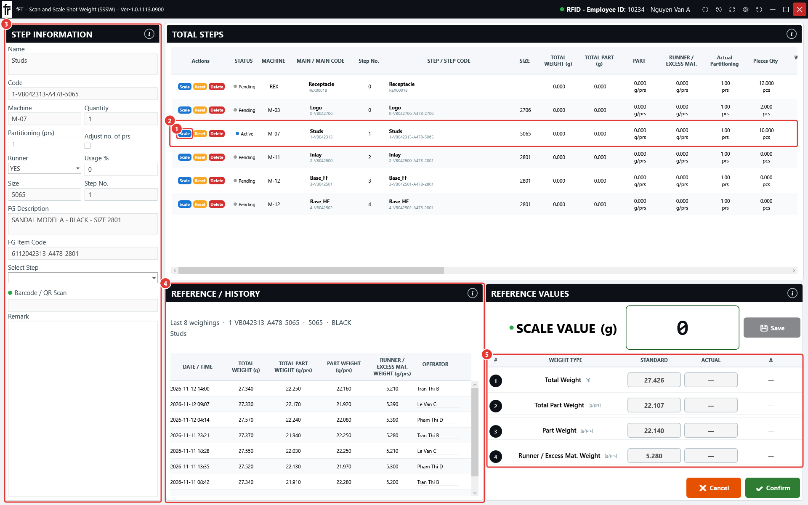

1. **Scale** button of the row – makes the step *Active*.
2. The row is highlighted, status = **Active**.
3. **STEP INFORMATION** shows the step (name, machine, size, partitioning, runner YES).
4. **REFERENCE / HISTORY** lists the last weighings of this step.
5. **STANDARD** column = average of those last weighings.

**Step 2 – 1st weighing: the whole shot (parts + runner).** Place the complete shot on the scale, wait until it is stable, press **Save**.

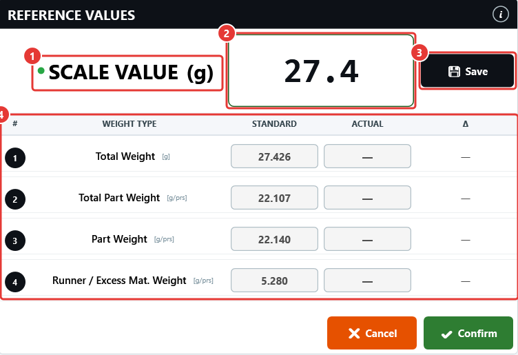

1. Title with the green *scale connected* dot.
2. **SCALE VALUE** – the live reading (here 27.40 g).
3. **Save** – press when stable.
4. The comparison table is in the lower part: STANDARD 27.426 vs ACTUAL 27.400.

**Step 3 – 2nd weighing: the parts only.** Take the runner away and keep **only the parts** on the scale. Wait for a stable number and press **Save** again.

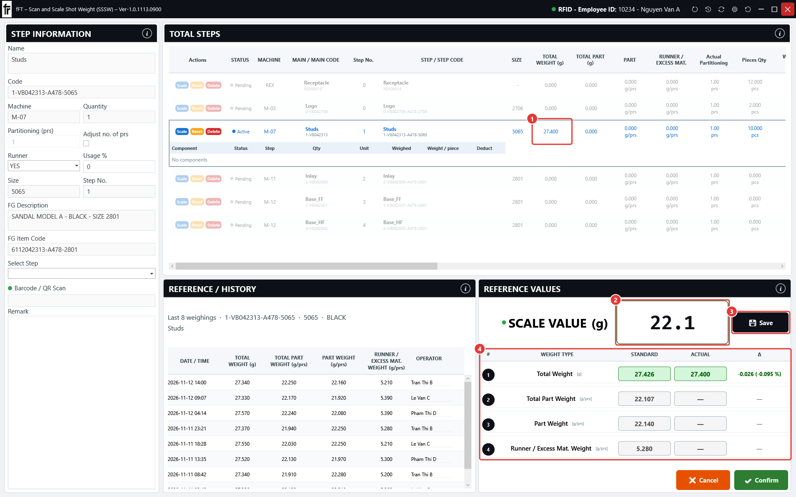

1. **TOTAL WEIGHT** of the row is already filled (27.400).
2. **SCALE VALUE** now shows the parts only (22.10 g).
3. **Save**.
4. The ACTUAL column will be filled after saving.

**Result.**

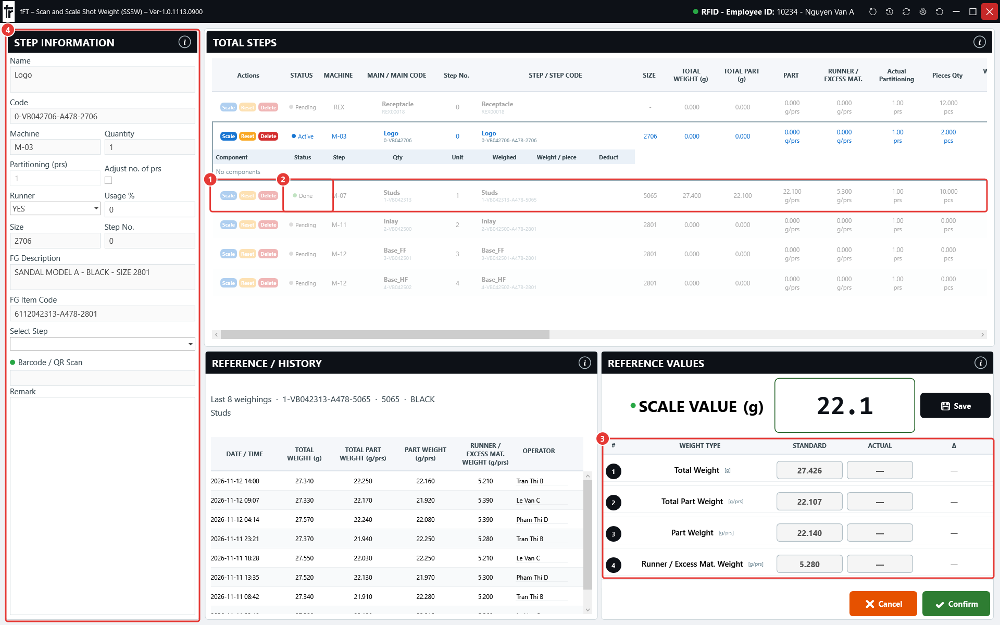

1. Status = **Done** (green).
2. **TOTAL WEIGHT 27.400 · TOTAL PART 22.100 · PART 22.100 g/prs · RUNNER 5.300 g/prs** are calculated automatically.
3. All four lines of REFERENCE VALUES have ACTUAL values and Δ.
4. The program has moved on to the next step.

> **Formula (1 pair per shot):** Total Part = 2nd weighing; Runner = Total Weight − Total Part; Part = Total Part (minus the parts already inside it, see Case D/E).

### 6.2 Case B – REX / receptacle (1 weighing)

Items whose code starts with **REX** (metal inserts, receptacles) have no runner: **one weighing only**. Weigh **all pieces needed for one pair together** – the *Pieces Qty* column tells how many (e.g. 12 pcs).

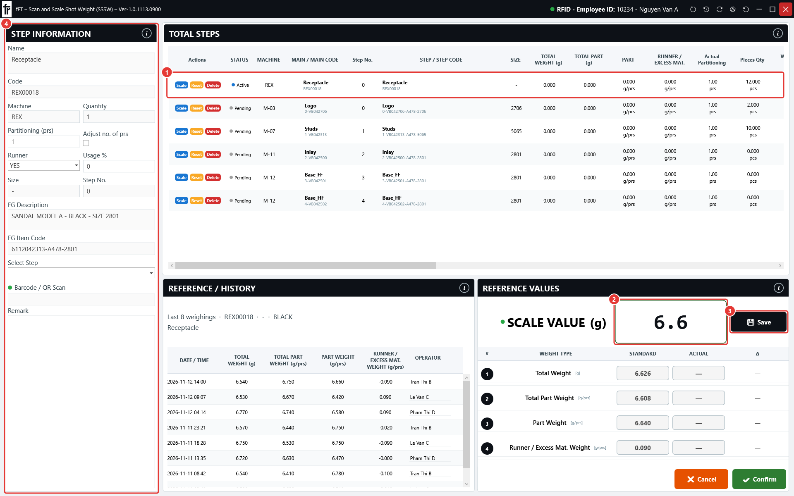

1. REX row (Machine `REX`, Step No. 0, Pieces Qty 12 pcs). Press **Scale**.
2. **SCALE VALUE** – weight of the 12 pieces (6.60 g).
3. **Save** – one press completes the step.
4. **STEP INFORMATION** – note *Quantity*.

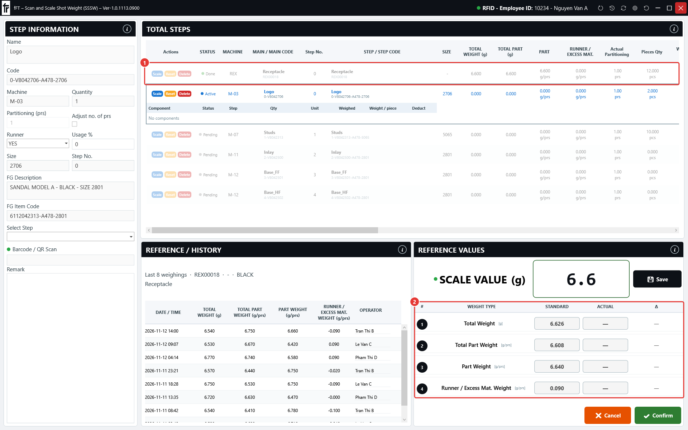

1. Status **Done**; Total Weight = Total Part = Part = 6.600; **weight per piece = 6.60 ÷ 12 = 0.55 g** (used later to deduct the inserts from other steps).
2. REFERENCE VALUES compared with history.

### 6.3 Case C – Non-woven / Mesh (use only a percentage)

For REX-type materials such as **Non Woven** or **Mesh** only a part of the sheet ends up in the product. The **Usage %** box (STEP INFORMATION) is enabled only for these items.

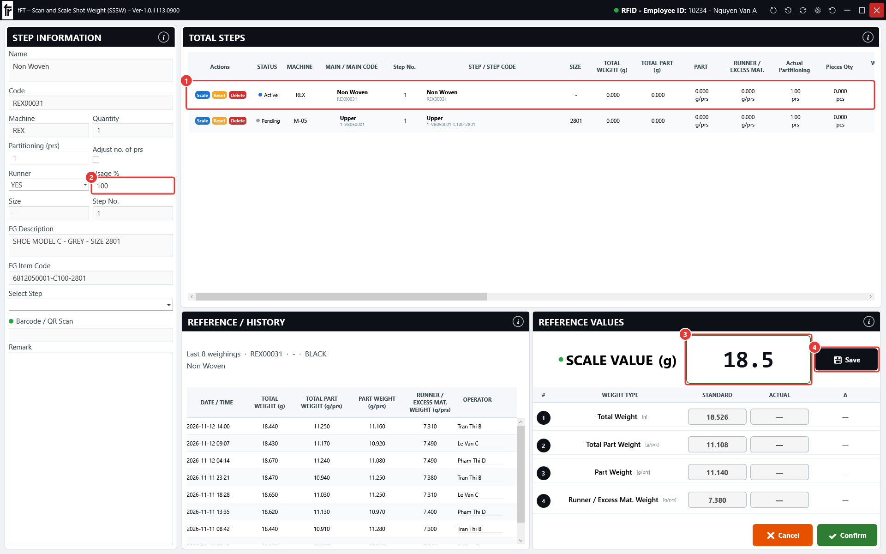

1. The Non-woven row is selected (category *Non Woven*).
2. **Usage %** – editable for this item.
3. Put the material on the scale: 18.50 g.
4. **Save**.

Then type the usage percentage and press **Enter**:

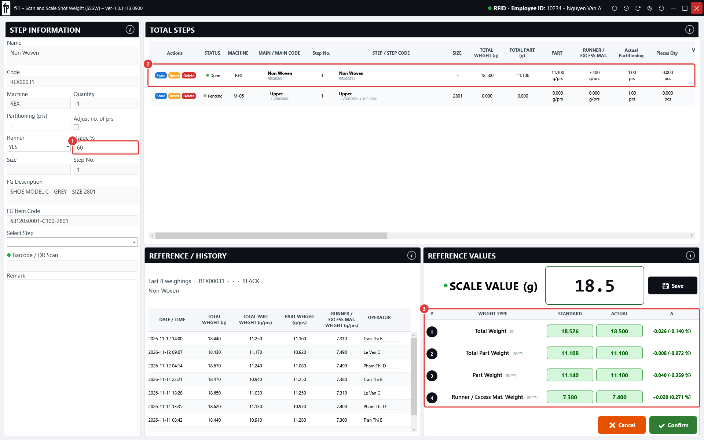

1. **Usage % = 60** → used part = 18.50 × 60 % = **11.10 g**; the rest (7.40 g) is the unused / excess material.
2. Row shows Total Weight 18.500, Total Part 11.100, Runner / Excess 7.400.
3. Comparison with history.

### 6.4 Case D – Step made of other parts (BOM level 2)

Some steps already contain other parts (e.g. *Inlay* contains 8 *Studs*). The program **deducts** their weight so that **PART** is the weight of the new plastic only.

> **Rule:** weigh the contained parts (here **Studs**) **first**. If you do not, the program refuses to save the step.

Click the row to open its **details panel**. If a part has not been weighed yet:

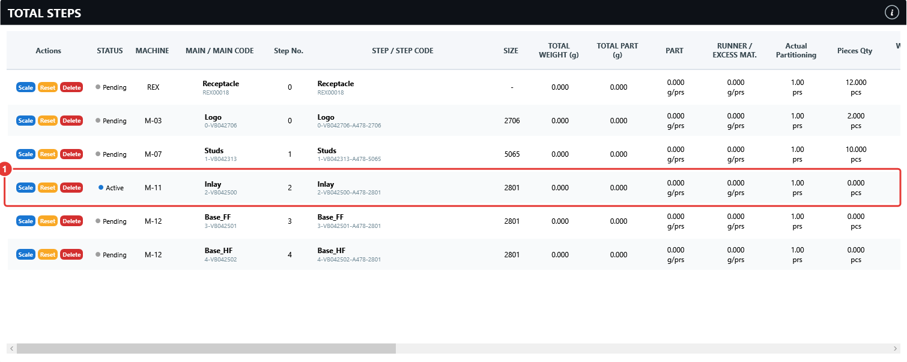

1. Detail line **Studs – ✖ missing**; the formula in red tells you which part to weigh first.

After **Studs** is Done, weigh the Inlay (shot 61.00 g, then parts 48.20 g):

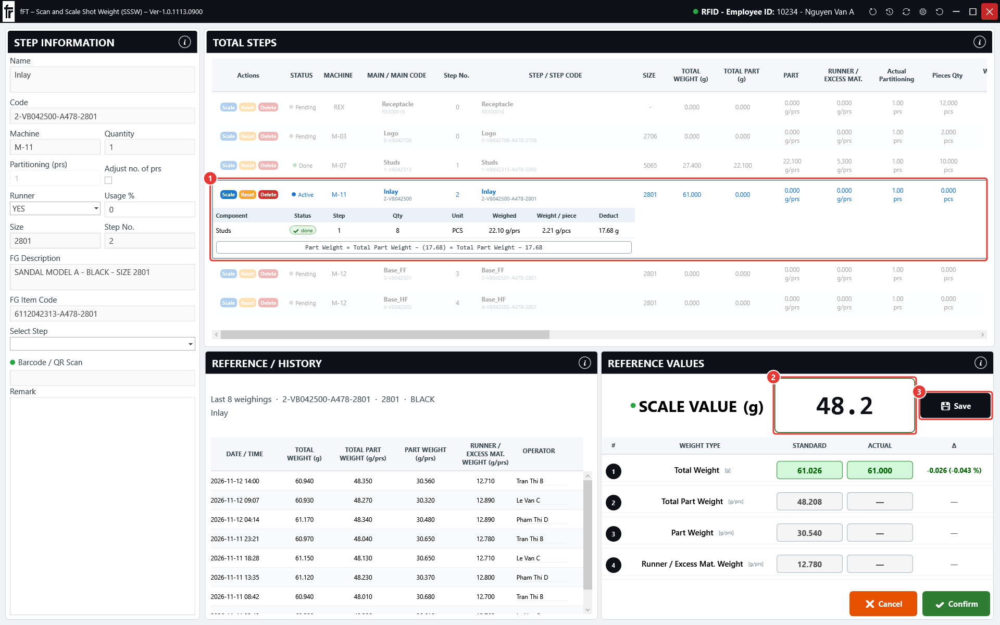

1. Row details: **Studs × 8 pcs, 2.21 g/pcs → deduct 17.68 g**, status ✔ done.
2. **SCALE VALUE** 48.20 g (parts only).
3. **Save**.


1. **PART = 48.20 − 17.68 = 30.52 g/prs.**
2. Reference values for the step.

### 6.5 Case E – "Chain" step (previous step is inside it)

If the step just before is used **only** inside this step, its whole **Total Part** is deducted as well (marked *(previous step)* in the details). Example: **Base_FF** contains Inlay.

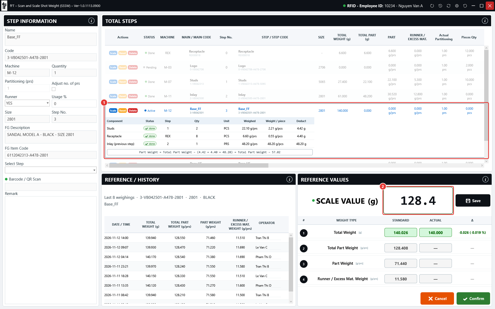

1. Details: **Studs ×2** (4.42 g) + **Receptacle ×8** (4.40 g) + **Inlay (previous step)** 48.20 g.
2. **SCALE VALUE** – 128.40 g (parts only).
3. The formula under the table: `Part Weight = Total Part Weight − (4.42 + 4.40 + 48.20) = Total Part Weight − 57.02`.

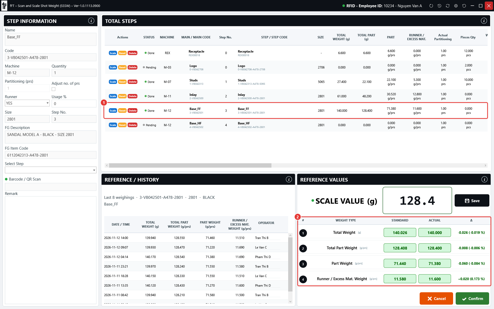

1. **PART = 128.40 − 57.02 = 71.38 g/prs.**
2. Reference values.

If the previous step has not been weighed you get *"The previous step has not been weighed."* – weigh it first.

### 6.6 Case F – Several pairs in one shot (Partitioning)

When the mold makes **N pairs** in one shot, the second weighing is the weight of **all N pairs together**; the program divides by N. **Partitioning** shows N and is normally locked.

If N is different today (e.g. a cavity is blocked), tick **Adjust no. of prs**, type the real number and press **Enter**:

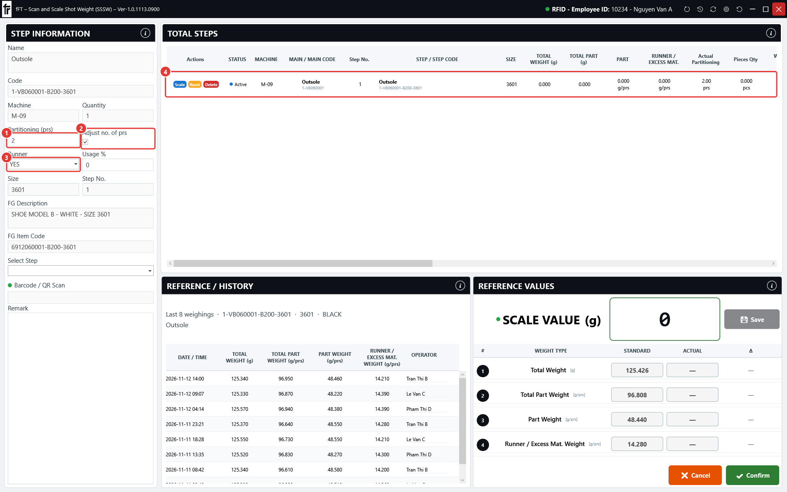

1. **Partitioning (prs)** – enabled after ticking the box.
2. **Adjust no. of prs** checkbox.
3. **Runner** – YES/NO (see Case G).
4. Row shows *Actual Partitioning 2.00 prs*.

Weigh as in Case A: shot 125.40 g, then parts of both pairs 96.80 g.

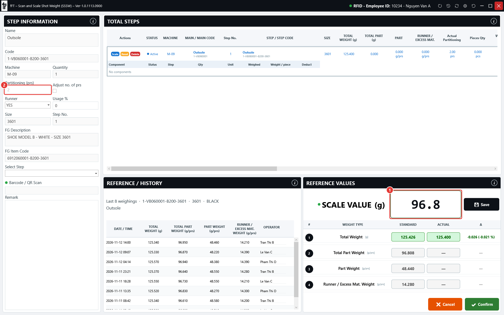

1. 96.80 g on the scale = parts of **2 pairs**.
2. Partitioning = 2.

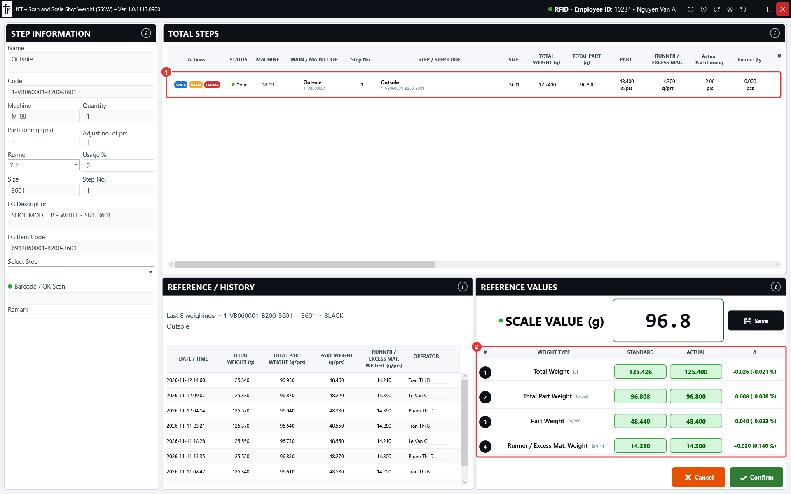

1. **TOTAL PART 96.800 → PART = 96.80 ÷ 2 = 48.40 g/prs; RUNNER = (125.40 − 96.80) ÷ 2 = 14.30 g/prs.**
2. Reference values.

### 6.7 Case G – Runner = NO

If the shot has **no runner** (hot-runner mold), set **Runner = NO** before weighing. The runner is then stored as 0.

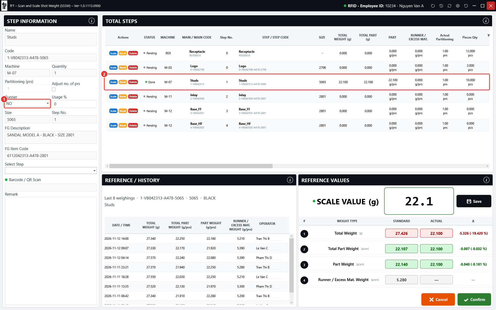

1. **Runner** list set to **NO**.
2. Result row: Runner / Excess = 0.000.

### 6.8 Case H – One mold, several sizes (e.g. Logo)

One mold can make several sizes in the same shot (rows with the same machine, mold and main code). They are listed together.

1. Weigh the **whole shot once** (Total Weight) on the first size row – the value is copied to all sizes of that mold.

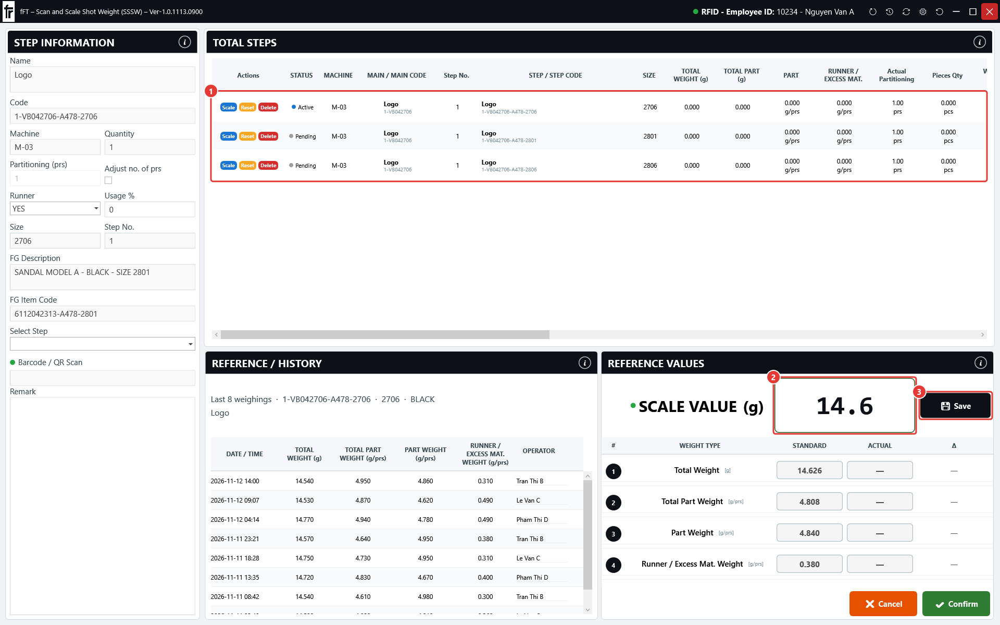

1. The three size rows (2706, 2801, 2806) share the same machine and mold.
2. **SCALE VALUE** – whole shot, 14.60 g.
3. **Save** – the Total Weight appears on **all three** rows.

2. Then weigh **each size alone** (take the other sizes away) and **Save**.

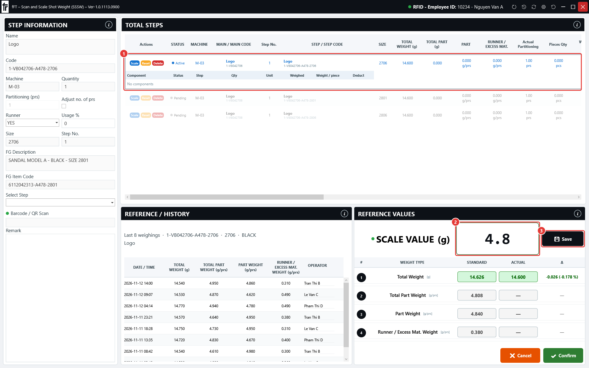

1. Size 2706 row.
2. 4.80 g – the 2706 part alone.
3. **Save**.

After each Save the next size becomes active automatically:

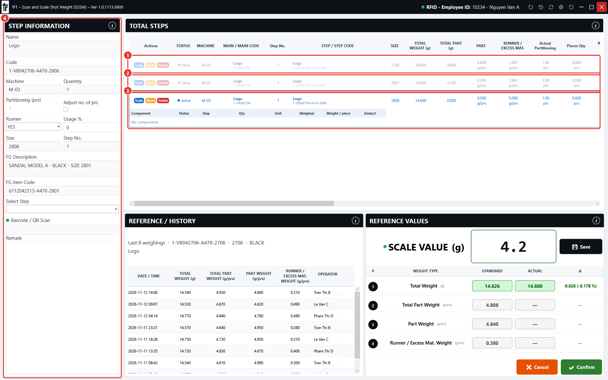

1. 2706 **Done** (4.80 g).
2. 2801 **Done** (4.20 g).
3. 2806 **Active** – weigh it now.
4. STEP INFORMATION shows size 2806.

The **Runner** of each size is shared: `(Total Weight − sum of all part weights) ÷ number of pairs`. It becomes final when all sizes are weighed.

> For multi-size molds every step with a **lower Step No.** must be weighed first. Otherwise: *"N previous step(s) are missing Part Weight and must be weighed first"*.

### 6.9 Case I – PU items (weighed per piece, L / R)

PU items (machine group **PU**) are counted in **pieces**, not pairs: units show `pcs`, `g/pcs-L`, `g/pcs-R`. The **Left (…L)** and **Right (…R)** parts are weighed in the **same shot**.

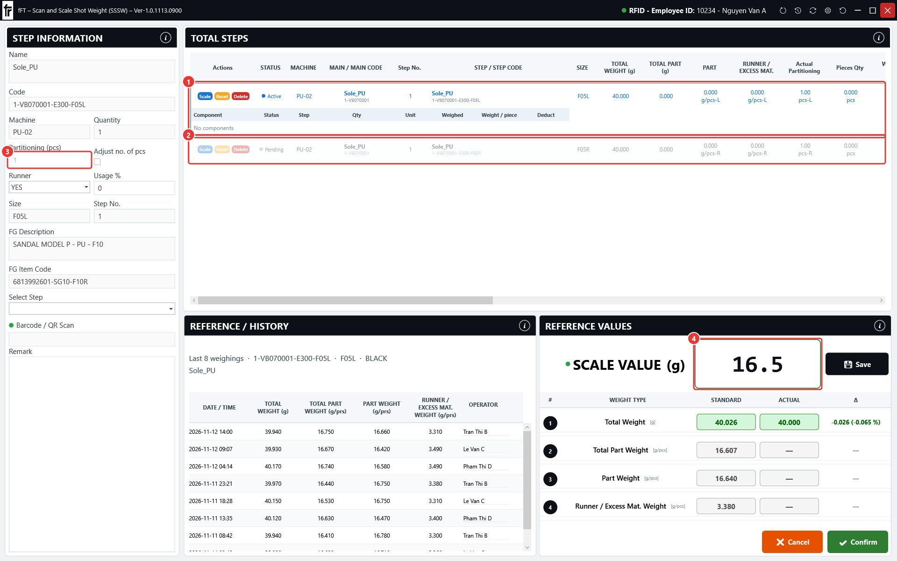

1. Left row `…-F05L`.
2. Right row `…-F05R` (same mold, same step).
3. Partitioning counted in **pcs**.
4. Live reading: the **L part alone** (16.50 g) after the whole shot (40.00 g) was saved.

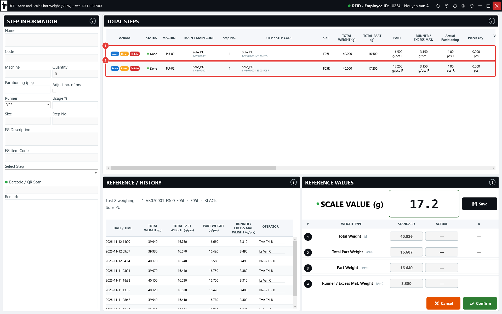

1. L: Part **16.500 g/pcs-L**.
2. R: Part **17.200 g/pcs-R**, Runner 3.150 g for each.

Notes:
- Press **Scale** on a PU row of a **non-last step**: a **weighing window** opens in front of the main screen, containing that step together with its L/R pair (the main list stays behind it, dimmed). Weigh L and R there and press **Confirm** – the window closes by itself and the weights are loaded back into the main list. **Cancel** inside the window only closes it.
- A PU step deducts only the component of the **same side** (L from L, R from R).

### 6.10 Case J – Cleat_Ring

`Cleat_Ring` steps are weighed exactly like **Case A** (2 weighings). For Cleat_Ring (and Logo) the **PART equals the Total Part ÷ number of pairs** – no other parts are deducted by the program. If a Cleat_Ring is made around REX studs, weigh the REX item first so the standard comparison is meaningful. A Cleat_Ring step belongs to the group "weigh separately": see *locked steps* below.

**Locked steps.** Logo, Cleat_Ring, Studs and Inlay with several sizes must be weighed in their own group. If you press **Scale** on a step that is *locked* in the current check, a **weighing window** opens in front of the main screen for that step (title `WEIGH STEP · <step code> · <name>`). The main list is not rebuilt. Weigh the step in the window as usual and press **Confirm** (the window closes itself) – the main list then picks up the new weights. If the window cannot be opened, the program instead asks:

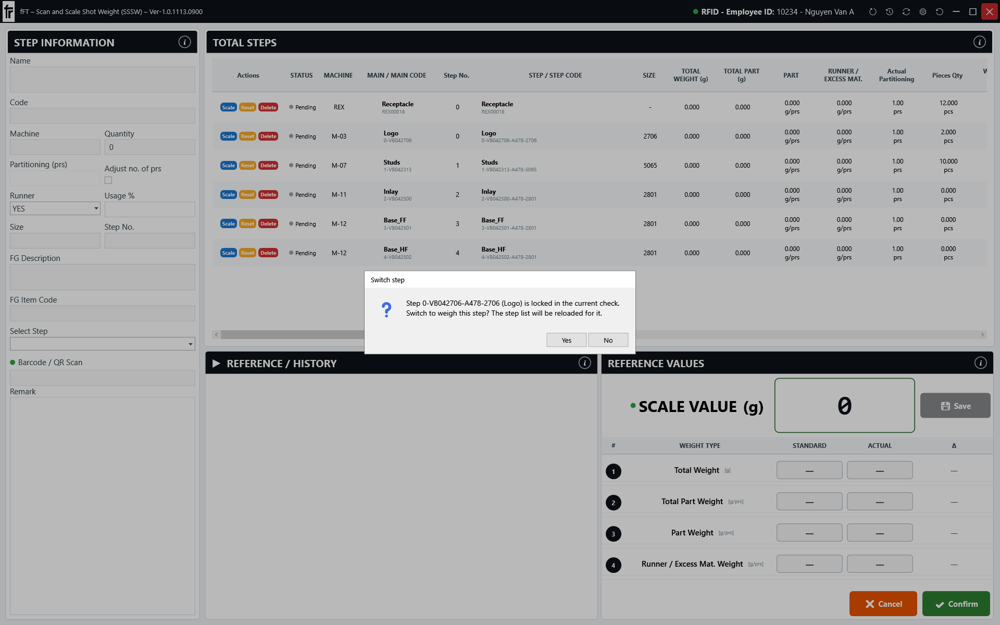

*"Step … is locked in the current check. Switch to weigh this step? The step list will be reloaded for it."* Press **Yes** to continue. If other steps are weighed but not confirmed, the message lists how many will be discarded – **Confirm first if you want to keep them**.

---

## 7. Tolerance colours

After each weighing the **Actual** value is compared with **STANDARD** (the average of the last 15 weighings). Δ = Actual − Standard **in grams**:

| Colour | Condition (default) | What to do |
|--------|---------------------|------------|
| 🟩 **Green** | −1 g ≤ Δ ≤ +1 g | OK – continue. |
| 🟧 **Orange** | between 1 g and 3 g (either side) | Warning – re-check the part, call the technician if it repeats. |
| 🟥 **Red** | more than 3 g (either side) | Out of tolerance – stop and call the mold technician / supervisor. |

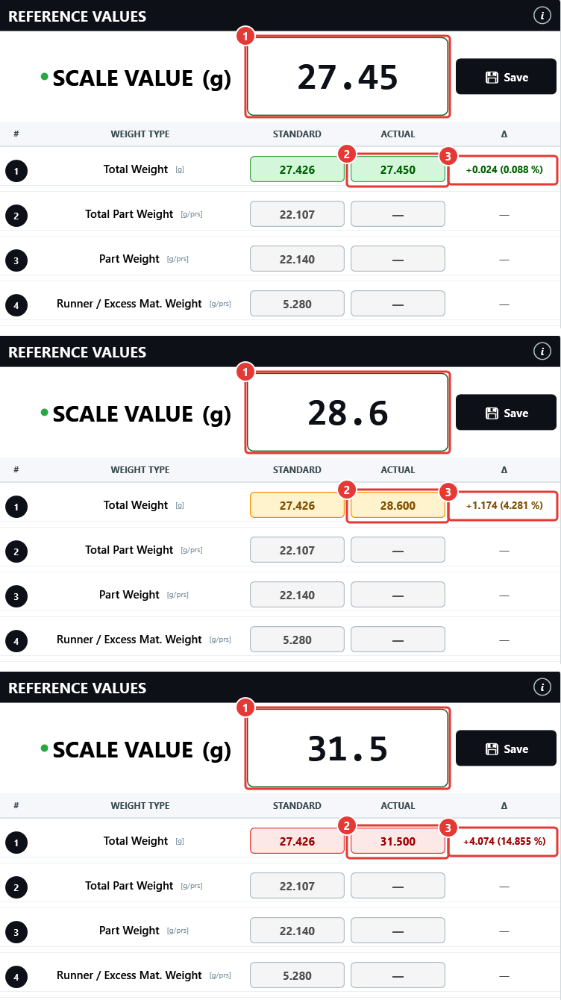

Top to bottom: 27.45 g (Δ +0.024 – green) · 28.60 g (Δ +1.174 – orange) · 31.50 g (Δ +4.074 – red).

1. The scale box.
2. **ACTUAL** cell – coloured.
3. **Δ** – difference in grams and in %.

The limits (1 g / 3 g) are settings (`DeltaLevel1`, `DeltaLevel2`) and may differ on your line. The colour does **not** block saving – it is information for you.

---

## 8. Row buttons: Scale / Reset / Delete

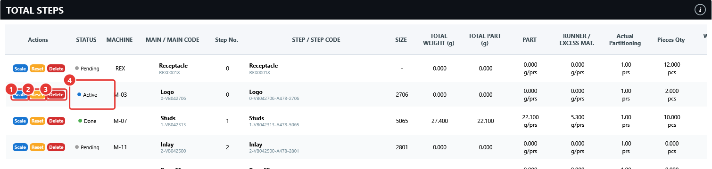

1. **Scale** – make this row the active step (and open its reference/history).
2. **Reset** – set the weights of this row to 0 so it can be weighed again. For a multi-size mold it resets **all sizes** of that mold.
3. **Delete** – remove the row from the current list (it will not be saved).
4. Row selected – status **Active**.

To **re-weigh a step that is already Done**: press **Reset** on it, then **Scale**, then weigh again.

Buttons are greyed when the step is not allowed in the current check (see *locked steps*).

---

## 9. Remark, Confirm and Cancel

When all steps are **Done** (green) you can add a note and confirm.

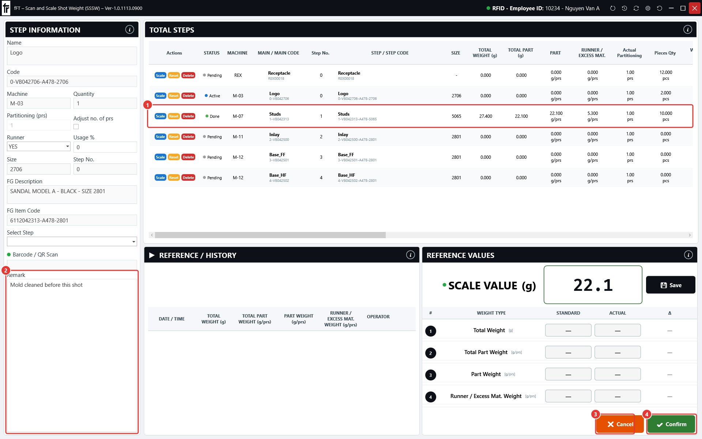

1. A weighed step (**Done**). In this sample only Studs was weighed; in a real order you normally finish all rows. Only rows that are Done (Part Weight > 0) are saved.
2. **Remark** – optional note stored with the step that is currently selected/active (here the next step, Logo), e.g. "Mold cleaned before this shot".
3. **Cancel** – discards the session **and clears your RFID sign-in**.
4. **Confirm** – saves.

When you press **Confirm** the screen shows *"Saving data…"* – wait, do not close the application:

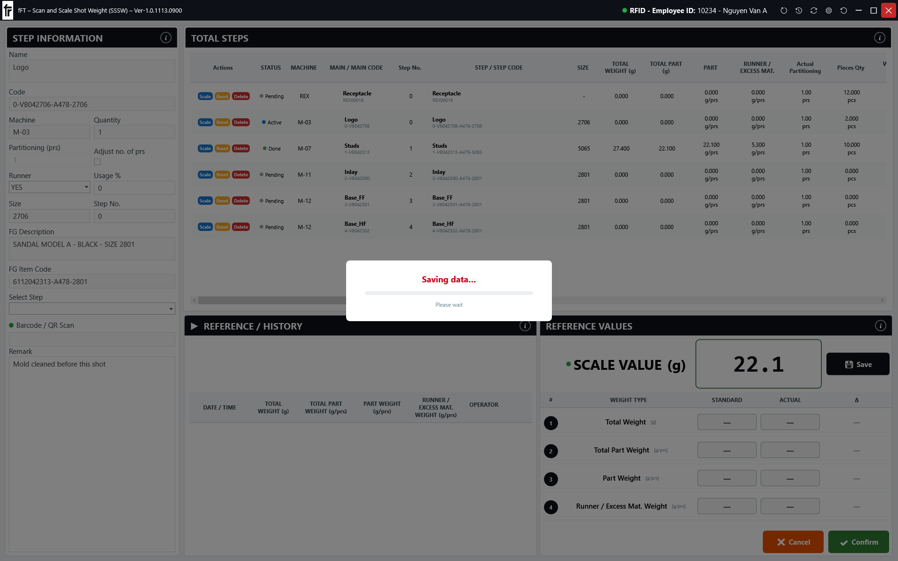

Success message:

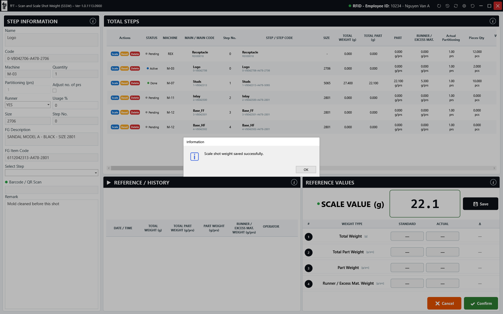

*"Scale shot weight saved successfully."* – press **OK**; the screen is ready for the next order.

What is saved: every step with a Part Weight > 0 (including steps loaded from the previous weighing). The record contains your employee code/name, date/time and the machine. If the step is the **last step of a finished good**, the average part weight is also sent automatically to the FG report.

---

## 10. Messages you may see

| Message | Meaning | What to do |
|---------|---------|------------|
| *RFID card not yet scanned.* | You pressed Confirm without signing in. | Tap your card (or click the employee area and type your ID). |
| *The previous step has not been weighed.* | The step before is deducted but still has no weight. | Weigh the previous step first. |
| *Component / previous step(s) of this step (BOM level 2) have no weight yet and must be weighed first: …* | Parts inside this step are not weighed (listed). | Weigh the listed parts, then this step. Nothing was saved. |
| *N previous step(s) are missing Part Weight and must be weighed first: …* | Multi-size / non-woven rule – all lower steps must be done. | Weigh the listed steps. |
| *Cannot scale this step.* / *Do not allow to scale this step.* | The step is locked in the current check. | Press **Scale** on the row – a weighing window opens (or answer **Yes** to the switch question, see 6.10). |
| *Scale not completed for step: …* | A REX item has no weight at Confirm. | Weigh the REX item. |
| *Label does not match the item being weighed.* | The scanned label belongs to a different item. | Scan the correct label. |
| *Cannot reset this line.* | The row is locked. | Switch step first. |
| *Transaction error …* | Database problem while saving. Nothing was saved. | Check the network, press Confirm again; if it repeats call IT. |

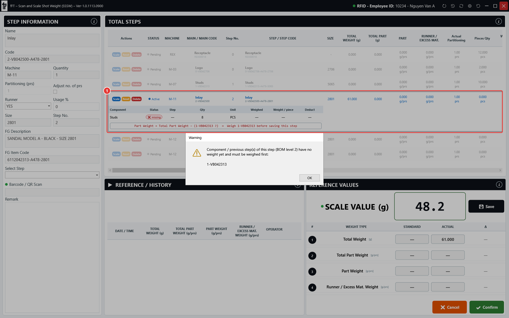

Example: a missing-component warning while saving *Inlay* (the row details show *✖ missing*).

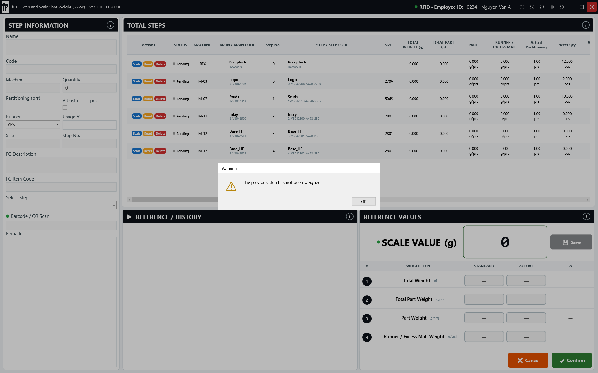

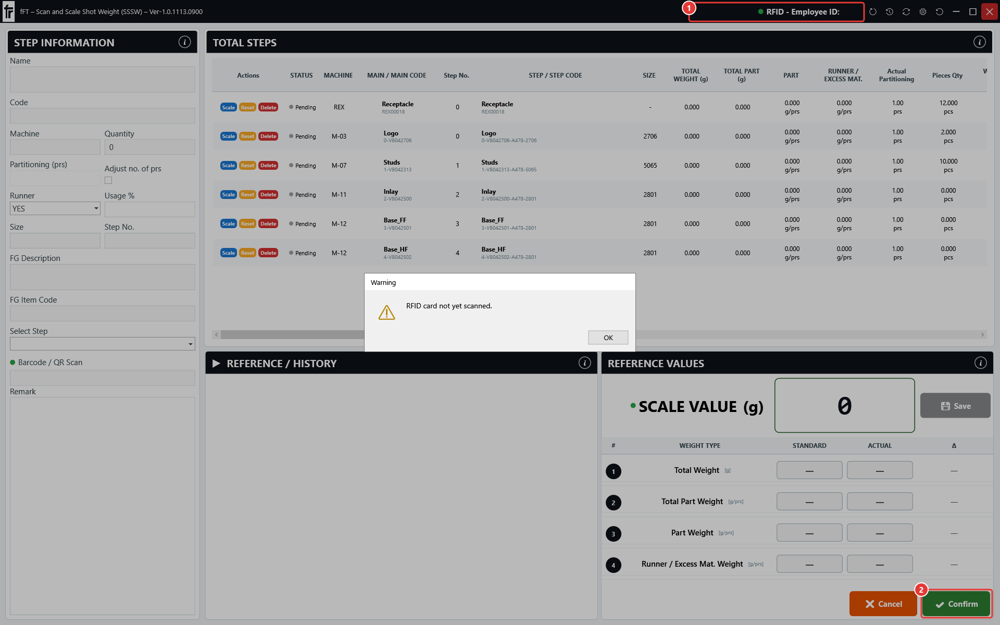

---

## 11. Troubleshooting

| Problem | Likely cause | Fix |
|---------|--------------|-----|
| Scale dot **red**, SCALE VALUE stays 0 | Scale off, network cable, wrong IP | Check power and network cable; press **Reload**; call IT. |
| SCALE VALUE negative or drifting | Scale not zeroed / unstable table | Remove everything, press Zero/Tare on the scale, wait for stable. |
| **Save** greyed | The scale reading is not stable | Wait for a stable reading (the box border turns steady). |
| Barcode dot red, QR not read | Scanner disconnected | Re-plug the scanner or pick the step in **Select Step**. |
| RFID dot red | Card reader disconnected | Re-plug; meanwhile click the employee area to type your ID. |
| Step list empty | No order for this QR / Hydra not synced | Press the **Hydra** icon, then **Reload**. |
| PART value is much lower than standard | A contained part was weighed wrongly | Check the details panel (Case D/E), **Reset** the wrong part and re-weigh. |
| Red Δ on every item | Scale calibration or wrong item on scale | Check with a reference weight; call the technician. |
| Application slow after hours | Many sessions open | **Cancel**, restart the application. |

---

## 12. Quick reference card

```
1  Tap RFID card (or click employee area → type ID)
2  Scan QR label  (or choose in Select Step)
3  For every step, in order:
     • Scale on the row            → step becomes Active
     • Injection step:  whole shot → Save   |   parts only → Save
     • REX / insert:    all pieces of 1 pair → Save
     • Non-woven/Mesh:  weigh → Save → type Usage % → Enter
4  Check the colours  (green OK · orange warning · red STOP)
5  All rows Done?  → Remark (optional) → Confirm → OK
   Wrong?  → Reset on the row, weigh again       Cancel = start over (and sign out)
```
