# Panduan Operator SSSW (Bahasa Indonesia)

> **Pembaca:** operator lantai produksi dan teknisi line yang menimbang shot injeksi di workstation SSSW.
> **Versi bahasa:** Bahasa Indonesia (file ini) · [English](OPERATOR_MANUAL.en.md) · [Tiếng Việt](OPERATOR_MANUAL.vi.md) · Panduan developer: [EN](DEVELOPER_MANUAL.en.md) / [VI](DEVELOPER_MANUAL.vi.md)
> **Tangkapan layar:** semua gambar diambil dari layar aplikasi yang asli dengan **data simulasi (contoh)** — kode item, mesin, nama, dan berat hanyalah contoh, bukan data pabrik. Kotak merah dan nomor dalam lingkaran dijelaskan pada daftar di bawah setiap gambar. Tampilan aplikasi berbahasa Inggris, sehingga nama tombol/kolom tetap dalam bahasa Inggris.

---

## Daftar isi

1. [Fungsi aplikasi](#1-fungsi-aplikasi)
2. [Gambaran umum layar](#2-gambaran-umum-layar)
3. [Login dengan kartu RFID](#3-login-dengan-kartu-rfid)
4. [Memuat step dari sebuah produk](#4-memuat-step-dari-sebuah-produk)
5. [Cara membaca tabel TOTAL STEPS](#5-cara-membaca-tabel-total-steps)
6. [Kasus penimbangan](#6-kasus-penimbangan)
   - [6.1 Kasus A – Step injeksi biasa (2 kali timbang)](#61-kasus-a--step-injeksi-biasa-2-kali-timbang)
   - [6.2 Kasus B – REX / receptacle (1 kali timbang)](#62-kasus-b--rex--receptacle-1-kali-timbang)
   - [6.3 Kasus C – Non-woven / Mesh (hanya sebagian persen yang dipakai)](#63-kasus-c--non-woven--mesh-hanya-sebagian-persen-yang-dipakai)
   - [6.4 Kasus D – Step berisi komponen lain (BOM level 2)](#64-kasus-d--step-berisi-komponen-lain-bom-level-2)
   - [6.5 Kasus E – Step "chain" (step sebelumnya ada di dalamnya)](#65-kasus-e--step-chain-step-sebelumnya-ada-di-dalamnya)
   - [6.6 Kasus F – Beberapa pasang dalam 1 shot (Partitioning)](#66-kasus-f--beberapa-pasang-dalam-1-shot-partitioning)
   - [6.7 Kasus G – Runner = NO](#67-kasus-g--runner--no)
   - [6.8 Kasus H – 1 cetakan banyak ukuran (mis. Logo)](#68-kasus-h--1-cetakan-banyak-ukuran-mis-logo)
   - [6.9 Kasus I – Item PU (ditimbang per buah, L / R)](#69-kasus-i--item-pu-ditimbang-per-buah-l--r)
   - [6.10 Kasus J – Cleat_Ring dan step yang terkunci](#610-kasus-j--cleat_ring-dan-step-yang-terkunci)
7. [Warna toleransi](#7-warna-toleransi)
8. [Tombol pada baris: Scale / Reset / Delete](#8-tombol-pada-baris-scale--reset--delete)
9. [Remark, Confirm, dan Cancel](#9-remark-confirm-dan-cancel)
10. [Pesan yang mungkin muncul](#10-pesan-yang-mungkin-muncul)
11. [Pemecahan masalah](#11-pemecahan-masalah)
12. [Kartu ringkasan cepat](#12-kartu-ringkasan-cepat)

---

## 1. Fungsi aplikasi

SSSW (**S**can and **S**cale **S**hot **W**eight) memeriksa berat setiap step produk terhadap **standar BOM** dan **penimbangan terakhir**, lalu menyimpan hasilnya ke database. Anda selalu melakukan tiga hal:

1. **Identifikasi** – login (kartu RFID) dan muat step produk (scan label QR).
2. **Timbang** – letakkan barang di timbangan, tekan **Save** di layar; program menghitung sisanya.
3. **Konfirmasi** – tekan **Confirm** setelah semua step berstatus *Done*.

> Program yang melakukan perhitungan (runner, berat part, pengurangan komponen lain). Anda hanya perlu meletakkan **barang yang benar** di timbangan dan menekan **Save**.

---

## 2. Gambaran umum layar

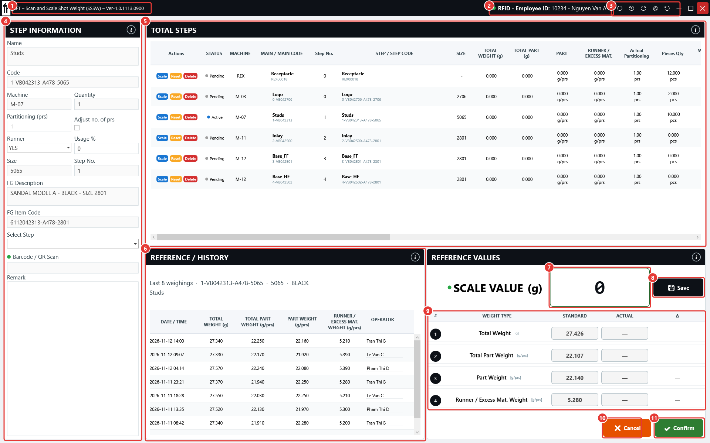

| # | Area | Kegunaan |
|---|------|----------|
| 1 | **Title bar** | Kode pabrik (mis. `fFT`), nama aplikasi, dan **versi**. Seret untuk memindahkan jendela. |
| 2 | **RFID – Employee ID** | Titik hijau = pembaca kartu terhubung. Menampilkan `kode kartu – nama Anda` setelah kartu di-scan. **Klik** untuk mengetik ID karyawan secara manual. |
| 3 | **Ikon toolbar** | Reload · History · Hydra · Settings · Update (lihat tabel di bawah), lalu minimize / maximize / close. |
| 4 | **STEP INFORMATION** | Detail step yang sedang ditimbang (nama, kode, mesin, partitioning, runner, size, FG…). Juga berisi daftar **Select Step**, kotak **Barcode / QR Scan**, dan kotak **Remark**. |
| 5 | **TOTAL STEPS** | Satu baris untuk setiap step produk, dengan status dan berat. Tombol **Scale / Reset / Delete** ada di setiap baris. |
| 6 | **REFERENCE / HISTORY** | Penimbangan terakhir dari step yang dipilih (tanggal, berat, penimbang). |
| 7 | **SCALE VALUE (g)** | Angka langsung dari timbangan. Titik hijau di samping judul = timbangan terhubung. |
| 8 | **Save** | Menyimpan angka yang sedang tampil di timbangan ke step yang aktif. |
| 9 | **REFERENCE VALUES** | STANDARD (rata-rata penimbangan terakhir) dibandingkan dengan ACTUAL (penimbangan ini) dan selisih Δ, diberi warna sesuai toleransi. |
| 10 | **Cancel** | Membatalkan semua data di layar **dan logout**. |
| 11 | **Confirm** | Menulis semua step yang selesai ke database. |

**Ikon toolbar (nomor 3)**

| Ikon | Nama | Kegunaan |
|------|------|----------|
| ⟳ (panah melingkar) | Reload | Memuat ulang daftar produk/step dari database. |
| 🕘 | History | Membuka tampilan riwayat penimbangan. |
| ⇄ | Hydra | Mengambil order produksi terbaru dari MES (Hydra). |
| ⚙ | Settings | Membuka form master data / pengaturan (layar penuh). Khusus teknisi; daftar timbang dimuat ulang setelah form ditutup. |
| ↺ | Update | Memeriksa versi aplikasi yang lebih baru. |

Arahkan mouse ke ikon kecil **ⓘ** pada judul setiap kartu untuk membaca bantuan singkat.

**Lampu perangkat** – hijau = terhubung, merah = tidak terhubung: lampu RFID (header), lampu Barcode (di kiri "Barcode / QR Scan"), dan lampu Scale (di kiri "SCALE VALUE").

---

## 3. Login dengan kartu RFID

Anda harus login sebelum dapat menekan **Confirm**.

**Sebelum login** – titik RFID hijau, nama masih kosong:


1. Judul jendela dan versi.
2. Area karyawan – masih kosong.

**Setelah kartu ditempelkan** pada pembaca:


1. `RFID – Employee ID: <kode kartu> – <nama Anda>`. Nama tetap tampil saat berpindah antar step; hanya dihapus oleh **Cancel**.

**Pembaca kartu rusak?** Klik area karyawan (nomor 1 di atas). Jendela kecil terbuka: ketik **Employee ID**, tekan **Enter**; nama muncul; tekan **OK**. Jika ID baru, jendela meminta nama – ketik nama, **Enter**, lalu **OK**.

---

## 4. Memuat step dari sebuah produk

Lakukan **salah satu** cara berikut:

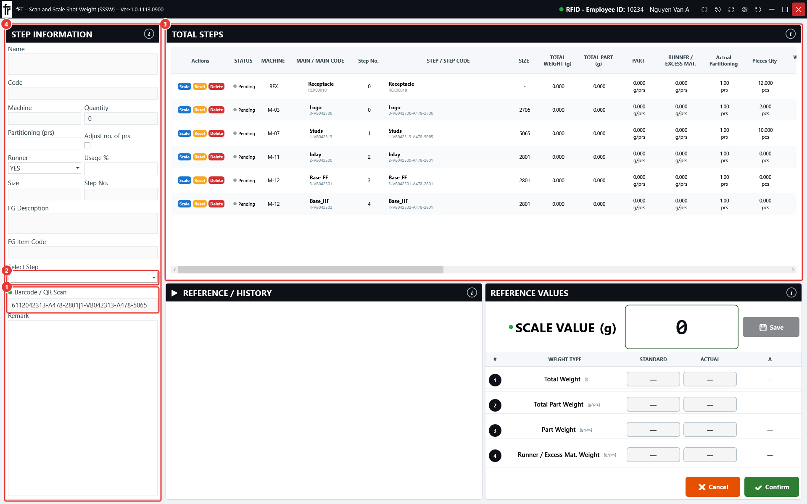

1. **Barcode / QR Scan** – scan label QR pada order produksi atau pada part. Program mencari order dan memuat semua step secara otomatis.
2. **Select Step** – klik daftar dan pilih step (Anda dapat mengetik sebagian kode/nama untuk mencari di semua kolom).
3. **TOTAL STEPS** – setelah dimuat, semua step produk muncul di sini.
4. **STEP INFORMATION** – terisi dengan step yang akan ditimbang.

Pesan yang mungkin muncul: *"Label information not found."*, *"Step information not found."*, *"No matching data found!"* → label belum terdaftar; hubungi supervisor.

---

## 5. Cara membaca tabel TOTAL STEPS

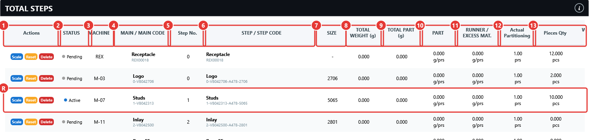

| # | Kolom | Arti |
|---|-------|------|
| 1 | **Actions** | **Scale** (pilih/timbang step ini) · **Reset** (hapus beratnya) · **Delete** (hapus baris dari sesi ini). |
| 2 | **STATUS** | **Pending** (abu-abu) – belum ditimbang · **Active** (biru) – step yang sedang ditimbang · **Done** (hijau) – berat sudah lengkap. |
| 3 | **MACHINE** | Mesin injeksi dari step (`REX` untuk insert). |
| 4 | **MAIN / MAIN CODE** | Item utama tempat step tersebut berada. |
| 5 | **Step No.** | Urutan step (0 = part yang dipakai oleh beberapa step, mis. REX). Step yang lebih kecil ditimbang lebih dulu. |
| 6 | **STEP / STEP CODE** | Nama dan kode lengkap step (termasuk warna dan size). |
| 7 | **SIZE** | Kode size dari step. |
| 8 | **TOTAL WEIGHT (g)** | Berat seluruh shot (part + runner) – penimbangan ke-1. |
| 9 | **TOTAL PART (g)** | Berat part saja – penimbangan ke-2. |
| 10 | **PART (g/prs)** | **Hasil:** berat 1 pasang (item PU: 1 buah, `g/pcs`) setelah dikurangi. |
| 11 | **RUNNER / EXCESS MAT.** | Berat runner per pasang (dihitung otomatis). |
| 12 | **Actual Partitioning** | Jumlah pasang (PU: jumlah buah) dalam 1 shot. |
| 13 | **Pieces Qty** | Jumlah buah item ini dalam 1 pasang (dari BOM). |
| R | **Baris terpilih** | Baris yang diklik disorot, baris lain diredupkan. Klik baris yang sama lagi untuk membatalkan pilihan. |

Kolom lain ada di sebelah kanan (geser tabel ke samping): Weight per Unit, PPIC Partitioning, Mold Pairs Shot, FG / FG code, Machine group, Mold ID, Remarks, Article, Hydra order, Category, Percent of usage, QR code, Quantity.

**Klik baris** untuk membuka **detail BOM level 2** (komponen lain yang sudah ada di dalam step ini dan dikurangkan – lihat [Kasus D](#64-kasus-d--step-berisi-komponen-lain-bom-level-2)).

---

## 6. Kasus penimbangan

Aturan umum untuk semua kasus:

- Selalu tunggu angka **SCALE VALUE** **stabil** sebelum menekan **Save**.
- Pastikan timbangan menunjukkan **0.00** saat kosong (jika tidak, tekan *Zero/Tare* pada timbangan).
- Step yang ditimbang adalah step **Active** (biru). Tekan **Scale** pada baris untuk memilihnya.
- Setelah sebuah step **Done**, program otomatis pindah ke step berikutnya yang masih perlu ditimbang.

### 6.1 Kasus A – Step injeksi biasa (2 kali timbang)

Untuk semua item cetak (Logo, Studs, Inlay, Base…) yang **bukan** REX. Contoh: step **Studs**.

**Langkah 1 – Pilih step.** Tekan **Scale** pada baris (atau scan QR / pilih di *Select Step*).

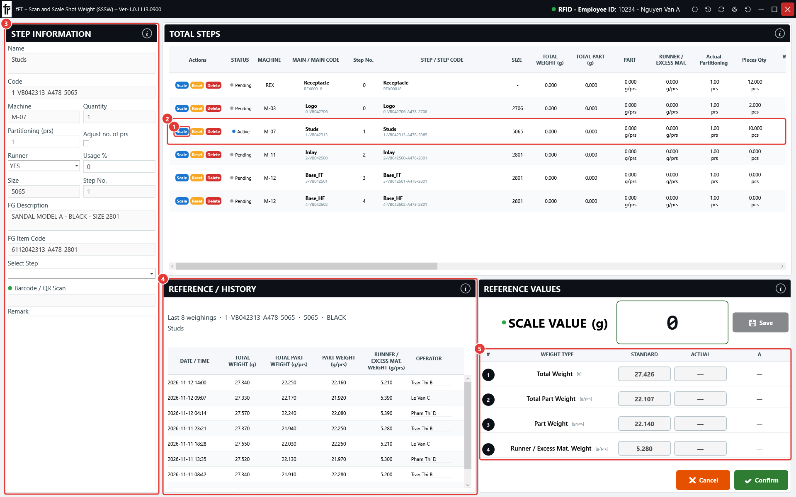

1. Tombol **Scale** pada baris – menjadikan step *Active*.
2. Baris disorot, status = **Active**.
3. **STEP INFORMATION** menampilkan step (nama, mesin, size, partitioning, runner YES).
4. **REFERENCE / HISTORY** menampilkan penimbangan terakhir dari step ini.
5. Kolom **STANDARD** = rata-rata penimbangan terakhir tersebut.

**Langkah 2 – Timbang ke-1: seluruh shot (part + runner).** Letakkan shot utuh di timbangan, tunggu stabil, tekan **Save**.

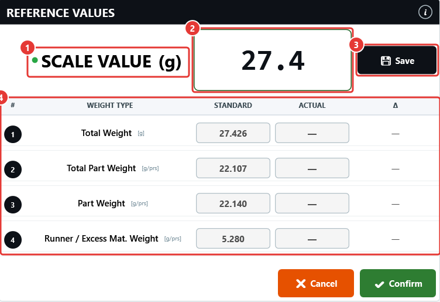

1. Judul dengan titik hijau *timbangan terhubung*.
2. **SCALE VALUE** – angka langsung (di sini 27.40 g).
3. **Save** – tekan saat angka stabil.
4. Tabel perbandingan di bagian bawah: STANDARD 27.426 dibandingkan ACTUAL 27.400.

**Langkah 3 – Timbang ke-2: part saja.** Singkirkan runner, sisakan **hanya part** di timbangan. Tunggu angka stabil dan tekan **Save** lagi.

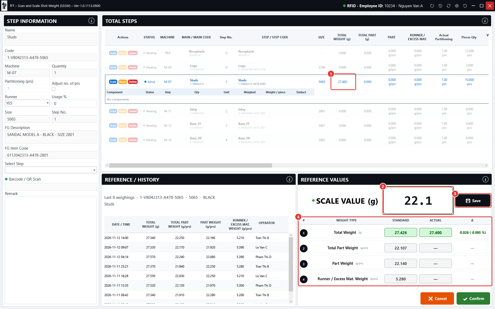

1. **TOTAL WEIGHT** pada baris sudah terisi (27.400).
2. **SCALE VALUE** kini hanya part (22.10 g).
3. **Save**.
4. Kolom ACTUAL akan terisi setelah disimpan.

**Hasil.**

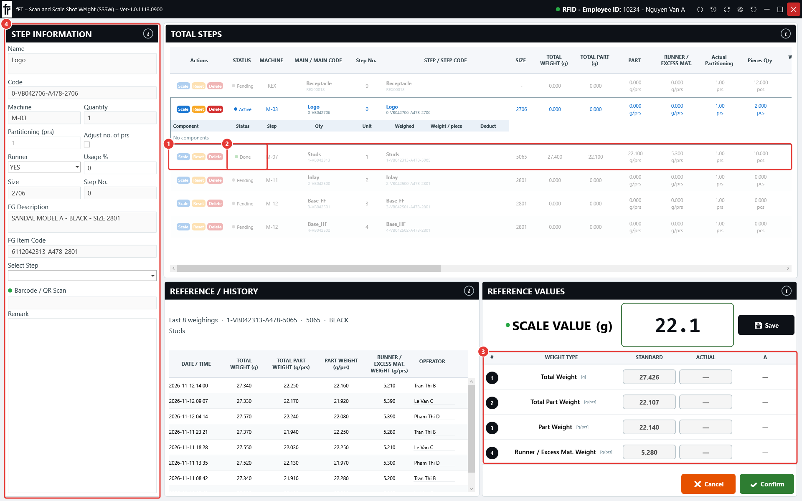

1. Status = **Done** (hijau).
2. **TOTAL WEIGHT 27.400 · TOTAL PART 22.100 · PART 22.100 g/prs · RUNNER 5.300 g/prs** dihitung otomatis.
3. Keempat baris REFERENCE VALUES sudah memiliki nilai ACTUAL dan Δ.
4. Program sudah pindah ke step berikutnya.

> **Rumus (1 pasang/shot):** Total Part = timbang ke-2; Runner = Total Weight − Total Part; Part = Total Part (dikurangi part yang sudah ada di dalamnya, lihat Kasus D/E).

### 6.2 Kasus B – REX / receptacle (1 kali timbang)

Item dengan kode diawali **REX** (insert logam, receptacle) tidak punya runner: **hanya ditimbang sekali**. Timbang **semua buah yang dibutuhkan untuk 1 pasang sekaligus** – kolom *Pieces Qty* menunjukkan jumlahnya (mis. 12 pcs).

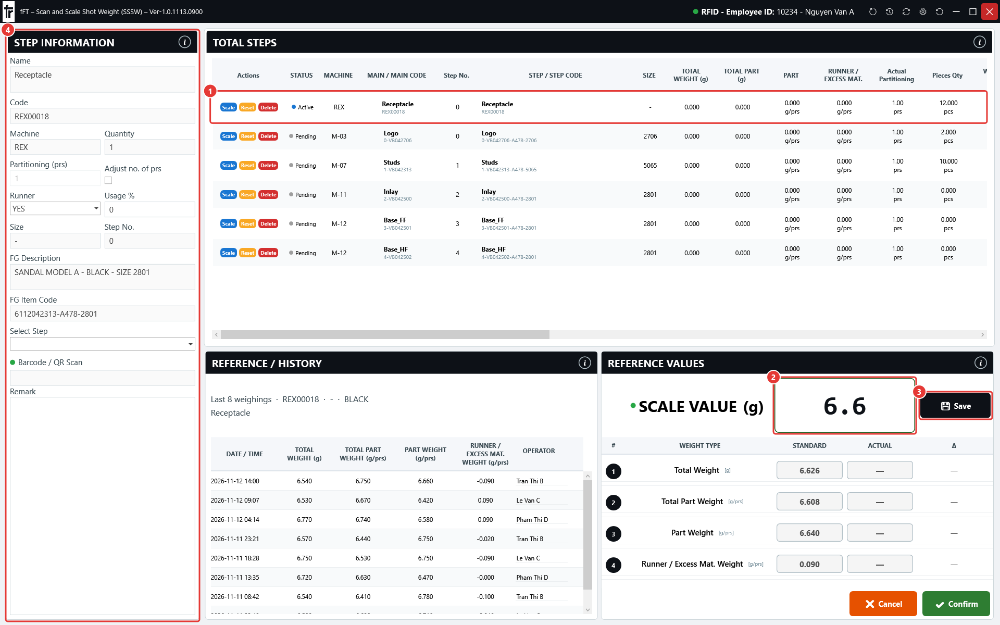

1. Baris REX (Machine `REX`, Step No. 0, Pieces Qty 12 pcs). Tekan **Scale**.
2. **SCALE VALUE** – berat 12 buah (6.60 g).
3. **Save** – satu kali tekan menyelesaikan step.
4. **STEP INFORMATION** – perhatikan kotak *Quantity*.

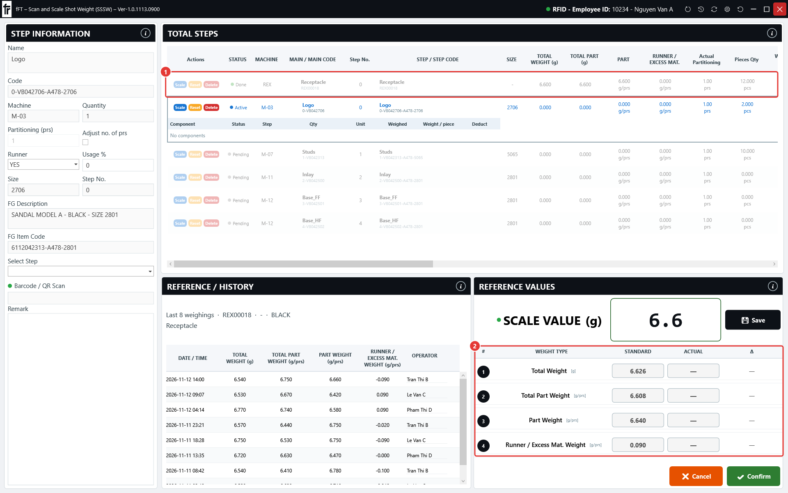

1. Status **Done**; Total Weight = Total Part = Part = 6.600; **berat per buah = 6.60 ÷ 12 = 0.55 g** (dipakai kemudian untuk mengurangi insert dari step lain).
2. REFERENCE VALUES dibandingkan dengan riwayat.

### 6.3 Kasus C – Non-woven / Mesh (hanya sebagian persen yang dipakai)

Untuk material tipe REX seperti **Non Woven** atau **Mesh**, hanya sebagian lembaran yang masuk ke produk. Kotak **Usage %** (STEP INFORMATION) hanya aktif untuk item ini.

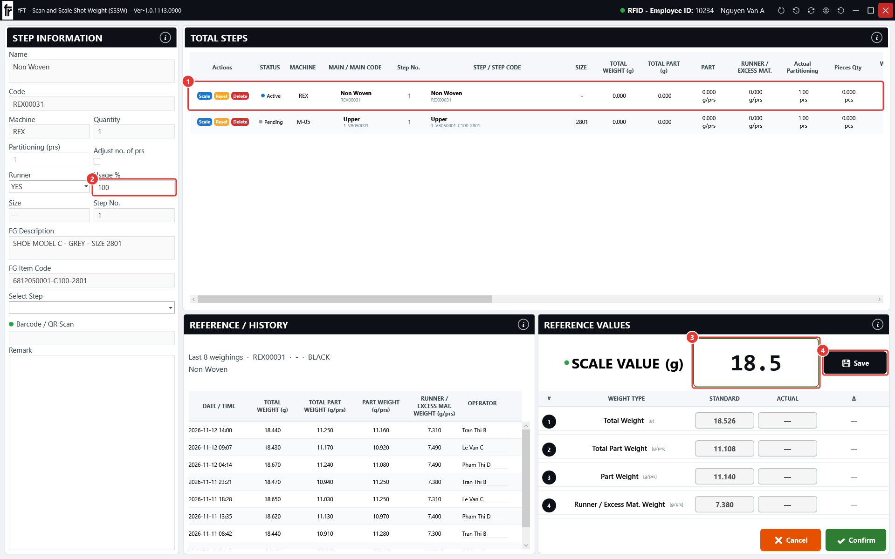

1. Baris Non-woven terpilih (category *Non Woven*).
2. **Usage %** – dapat diubah untuk item ini.
3. Letakkan material di timbangan: 18.50 g.
4. **Save**.

Lalu ketik persentase pemakaian dan tekan **Enter**:

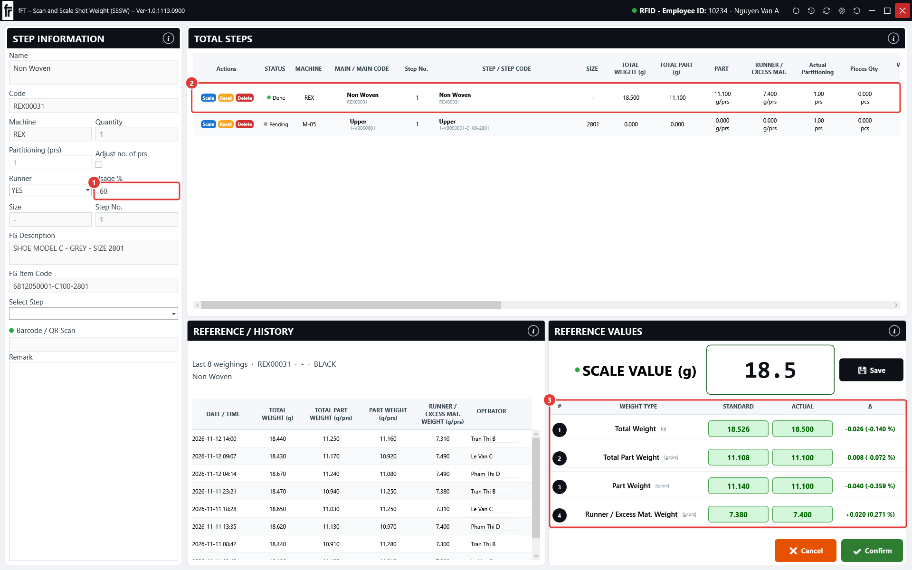

1. **Usage % = 60** → bagian terpakai = 18.50 × 60 % = **11.10 g**; sisanya (7.40 g) adalah material sisa.
2. Baris menampilkan Total Weight 18.500, Total Part 11.100, Runner / Excess 7.400.
3. Perbandingan dengan riwayat.

### 6.4 Kasus D – Step berisi komponen lain (BOM level 2)

Beberapa step sudah berisi komponen lain (mis. *Inlay* berisi 8 *Studs*). Program **mengurangkan** beratnya sehingga **PART** hanya berat plastik baru.

> **Aturan:** timbang dulu komponen di dalamnya (di sini **Studs**). Jika belum, program menolak menyimpan step.

Klik baris untuk membuka **panel detail**. Jika sebuah komponen belum ditimbang:

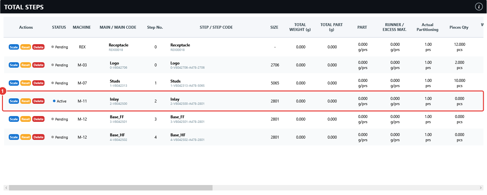

1. Baris detail **Studs – ✖ missing**; rumus berwarna merah menunjukkan komponen mana yang harus ditimbang lebih dulu.

Setelah **Studs** Done, timbang Inlay (shot 61.00 g, lalu part 48.20 g):

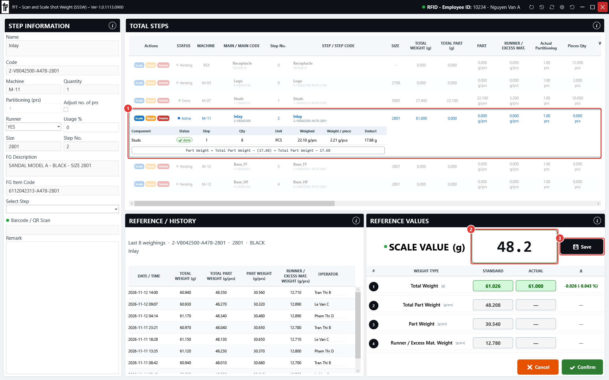

1. Detail: **Studs × 8 pcs, 2.21 g/pcs → kurangi 17.68 g**, status ✔ done.
2. **SCALE VALUE** 48.20 g (hanya part).
3. **Save**.


1. **PART = 48.20 − 17.68 = 30.52 g/prs.**
2. Nilai referensi step.

### 6.5 Kasus E – Step "chain" (step sebelumnya ada di dalamnya)

Jika step tepat sebelumnya hanya dipakai **di dalam** step ini, seluruh **Total Part**-nya juga dikurangkan (ditandai *(previous step)* pada detail). Contoh: **Base_FF** berisi Inlay.

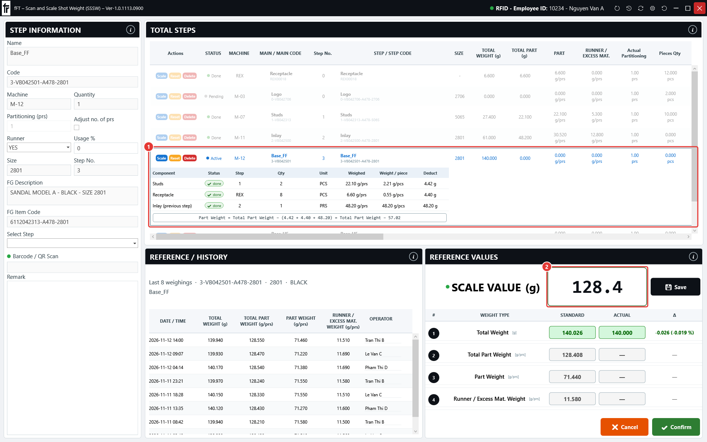

1. Detail: **Studs ×2** (4.42 g) + **Receptacle ×8** (4.40 g) + **Inlay (previous step)** 48.20 g.
2. **SCALE VALUE** – 128.40 g (hanya part).
3. Rumus di bawah tabel: `Part Weight = Total Part Weight − (4.42 + 4.40 + 48.20) = Total Part Weight − 57.02`.

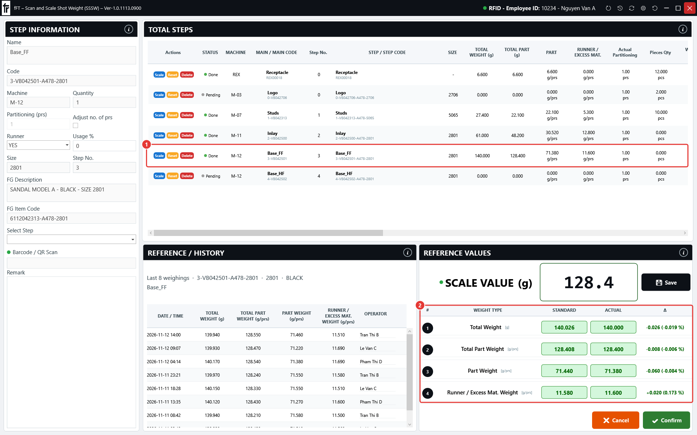

1. **PART = 128.40 − 57.02 = 71.38 g/prs.**
2. Nilai referensi.

Jika step sebelumnya belum ditimbang akan muncul *"The previous step has not been weighed."* – timbang step sebelumnya dulu.

### 6.6 Kasus F – Beberapa pasang dalam 1 shot (Partitioning)

Jika cetakan menghasilkan **N pasang** dalam 1 shot, timbang ke-2 adalah berat **seluruh N pasang**; program membaginya dengan N. Kotak **Partitioning** menampilkan N dan biasanya terkunci.

Jika hari ini N berbeda (mis. satu cavity ditutup), centang **Adjust no. of prs**, ketik angka sebenarnya, dan tekan **Enter**:

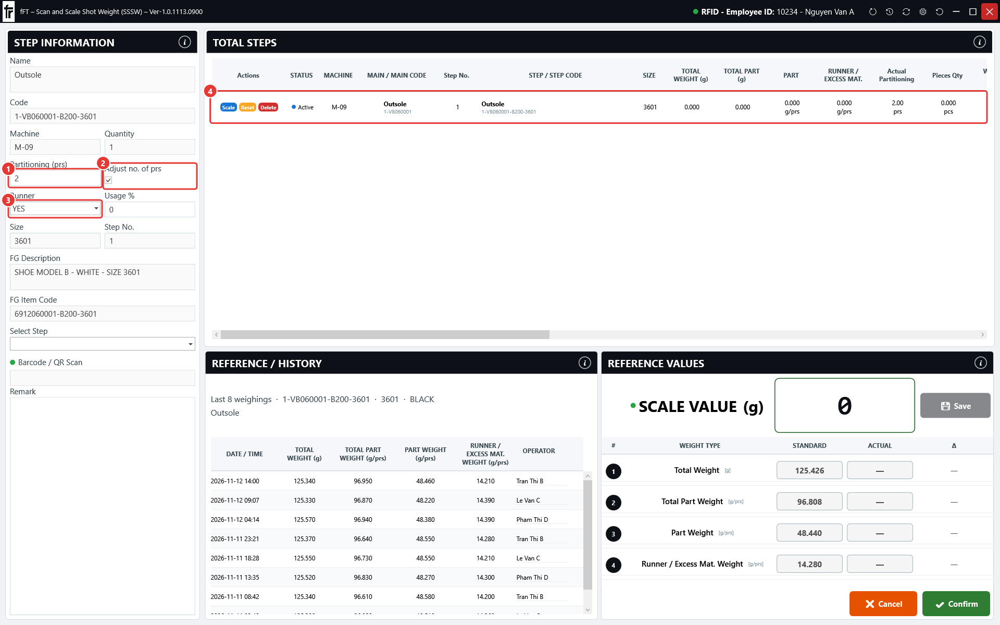

1. **Partitioning (prs)** – aktif setelah kotak dicentang.
2. Kotak centang **Adjust no. of prs**.
3. **Runner** – YES/NO (lihat Kasus G).
4. Baris menampilkan *Actual Partitioning 2.00 prs*.

Timbang seperti Kasus A: shot 125.40 g, lalu part kedua pasang 96.80 g.

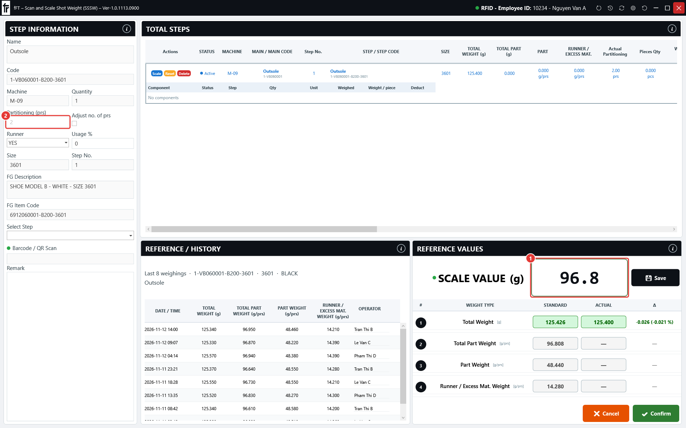

1. 96.80 g di timbangan = part dari **2 pasang**.
2. Partitioning = 2.

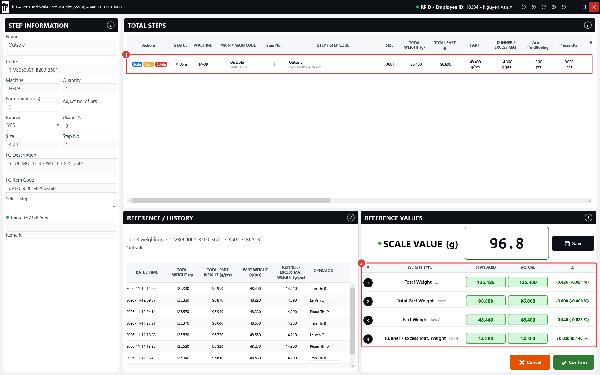

1. **TOTAL PART 96.800 → PART = 96.80 ÷ 2 = 48.40 g/prs; RUNNER = (125.40 − 96.80) ÷ 2 = 14.30 g/prs.**
2. Nilai referensi.

### 6.7 Kasus G – Runner = NO

Jika shot **tanpa runner** (cetakan hot-runner), atur **Runner = NO** sebelum menimbang. Runner disimpan sebagai 0.

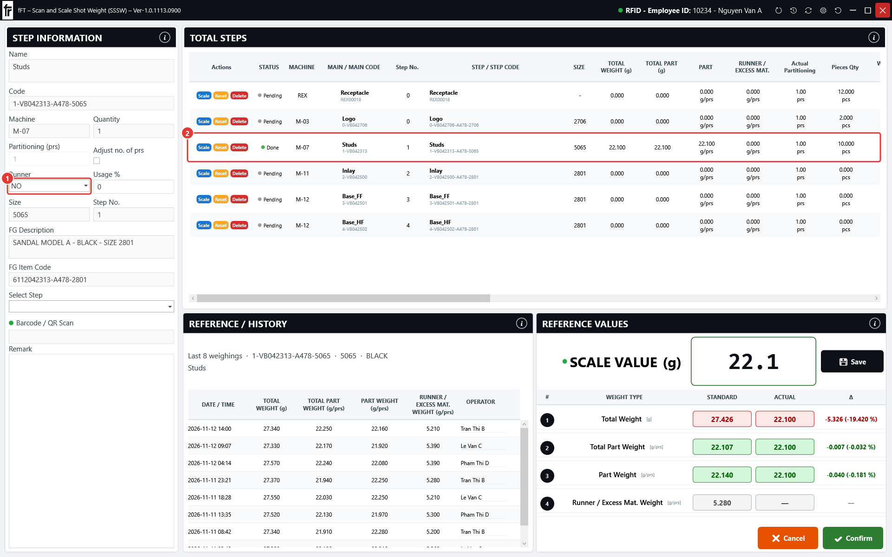

1. Daftar **Runner** diatur ke **NO**.
2. Baris hasil: Runner / Excess = 0.000.

### 6.8 Kasus H – 1 cetakan banyak ukuran (mis. Logo)

Satu cetakan dapat menghasilkan beberapa ukuran dalam shot yang sama (baris dengan mesin, cetakan, dan kode utama yang sama). Baris-baris tersebut ditampilkan bersama.

1. Timbang **seluruh shot sekali** (Total Weight) pada baris ukuran pertama – nilainya disalin ke semua ukuran pada cetakan itu.

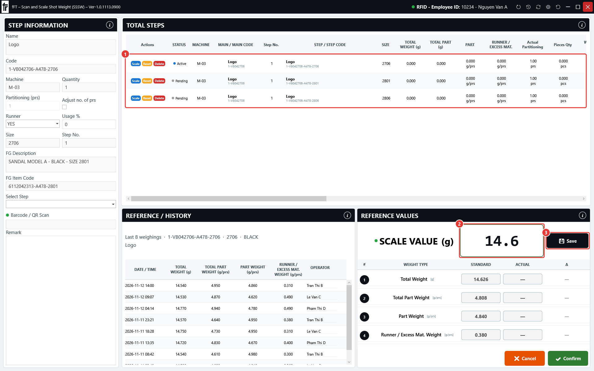

1. Ketiga baris ukuran (2706, 2801, 2806) memakai mesin dan cetakan yang sama.
2. **SCALE VALUE** – seluruh shot, 14.60 g.
3. **Save** – Total Weight muncul pada **ketiga** baris.

2. Lalu timbang **setiap ukuran sendiri-sendiri** (singkirkan ukuran lain) dan **Save**.

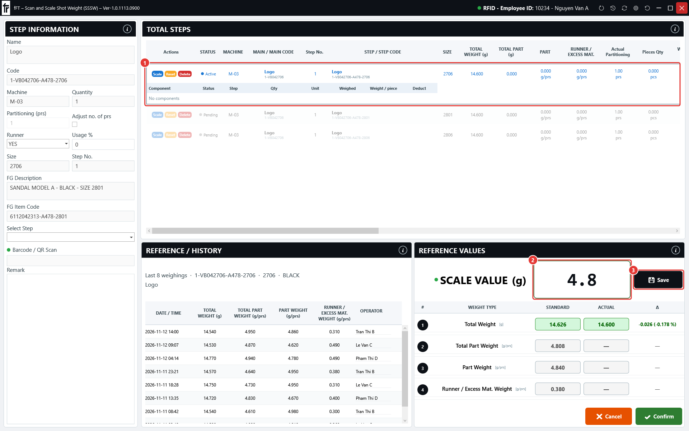

1. Baris ukuran 2706.
2. 4.80 g – part ukuran 2706 saja.
3. **Save**.

Setelah setiap Save, ukuran berikutnya otomatis menjadi Active:

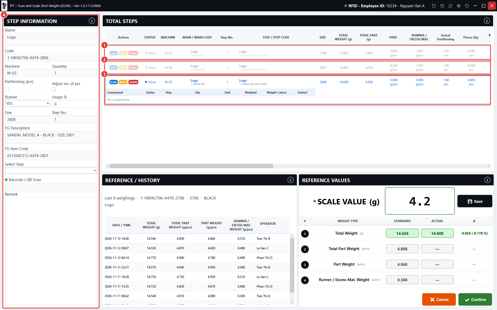

1. 2706 **Done** (4.80 g).
2. 2801 **Done** (4.20 g).
3. 2806 **Active** – timbang sekarang.
4. STEP INFORMATION menampilkan size 2806.

**Runner** tiap ukuran dihitung bersama: `(Total Weight − jumlah semua berat part) ÷ jumlah pasang`. Nilainya final setelah semua ukuran ditimbang.

> Untuk cetakan banyak ukuran, semua step dengan **Step No. lebih kecil** harus ditimbang lebih dulu. Jika tidak: *"N previous step(s) are missing Part Weight and must be weighed first"*.

### 6.9 Kasus I – Item PU (ditimbang per buah, L / R)

Item PU (machine group **PU**) dihitung per **buah**, bukan per pasang: satuan tampil `pcs`, `g/pcs-L`, `g/pcs-R`. Bagian **kiri (…L)** dan **kanan (…R)** ditimbang dalam **shot yang sama**.

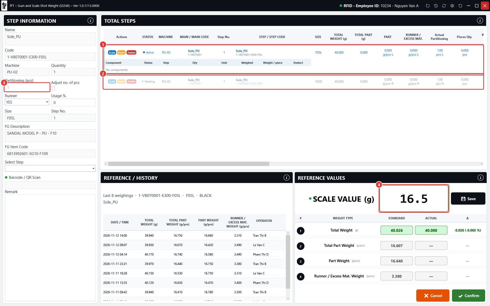

1. Baris kiri `…-F05L`.
2. Baris kanan `…-F05R` (cetakan dan step yang sama).
3. Partitioning dihitung dalam **pcs**.
4. Angka yang tampil: **hanya part L** (16.50 g) setelah seluruh shot (40.00 g) disimpan.

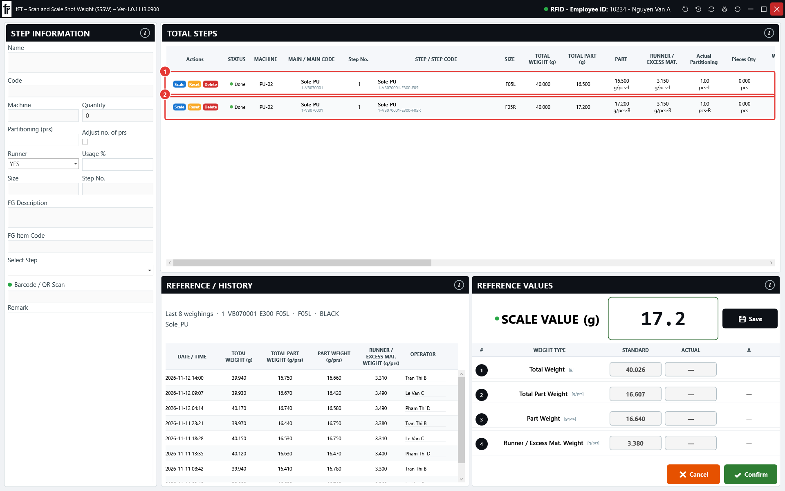

1. L: Part **16.500 g/pcs-L**.
2. R: Part **17.200 g/pcs-R**, Runner 3.150 g untuk masing-masing.

Catatan:
- Tekan **Scale** pada baris PU dari **step yang bukan terakhir**: sebuah **jendela timbang** terbuka di depan layar utama, berisi step tersebut beserta pasangan L/R-nya (daftar utama tetap di belakang, diredupkan). Timbang L dan R di sana lalu tekan **Confirm** – jendela menutup sendiri dan berat dimuat kembali ke daftar utama. **Cancel** di dalam jendela hanya menutup jendela.
- Step PU hanya mengurangkan komponen dari **sisi yang sama** (L dari L, R dari R).

### 6.10 Kasus J – Cleat_Ring dan step yang terkunci

Step `Cleat_Ring` ditimbang persis seperti **Kasus A** (2 kali). Untuk Cleat_Ring (dan Logo), **PART = Total Part ÷ jumlah pasang** – program tidak mengurangkan komponen lain. Jika Cleat_Ring dicetak mengelilingi stud REX, timbang item REX terlebih dahulu agar perbandingan dengan standar bermakna.

**Step terkunci.** Logo, Cleat_Ring, Studs, dan Inlay dengan banyak ukuran harus ditimbang dalam kelompoknya sendiri. Jika Anda menekan **Scale** pada step yang *terkunci* pada pemeriksaan saat ini, sebuah **jendela timbang** terbuka di depan layar utama untuk step tersebut (judul `WEIGH STEP · <kode step> · <nama>`). Daftar utama tidak dibangun ulang. Timbang step di jendela seperti biasa lalu tekan **Confirm** (jendela menutup sendiri) – daftar utama kemudian menerima berat yang baru. Jika jendela tidak dapat dibuka, program akan bertanya:

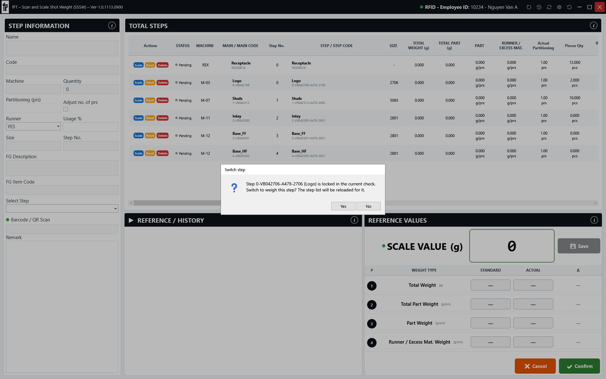

*"Step … is locked in the current check. Switch to weigh this step? The step list will be reloaded for it."* Tekan **Yes** untuk melanjutkan. Jika ada step yang sudah ditimbang tetapi belum di-Confirm, pesan menyebutkan berapa banyak yang akan dibuang – **Confirm dulu jika ingin menyimpannya**.

---

## 7. Warna toleransi

Setelah setiap penimbangan, nilai **Actual** dibandingkan dengan **STANDARD** (rata-rata 15 penimbangan terakhir). Δ = Actual − Standard **dalam gram**:

| Warna | Kondisi (default) | Tindakan |
|-------|-------------------|----------|
| 🟩 **Hijau** | −1 g ≤ Δ ≤ +1 g | OK – lanjutkan. |
| 🟧 **Oranye** | antara 1 g dan 3 g (kedua sisi) | Peringatan – periksa ulang part, hubungi teknisi jika berulang. |
| 🟥 **Merah** | lebih dari 3 g (kedua sisi) | Di luar toleransi – berhenti dan hubungi teknisi cetakan / supervisor. |

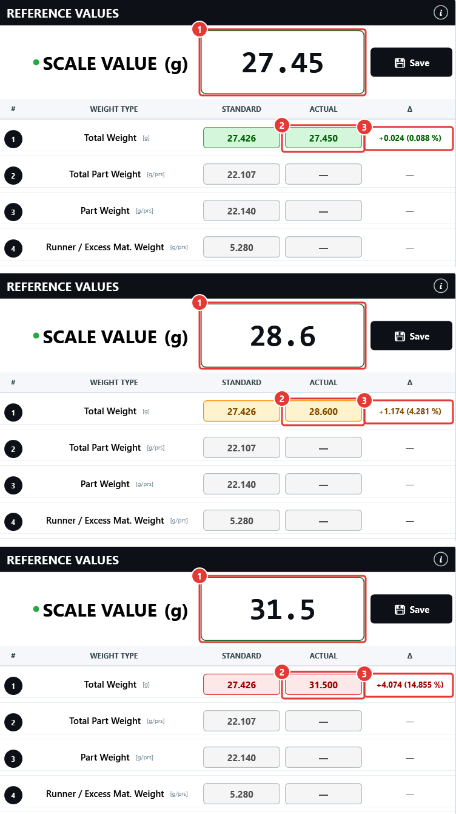

Dari atas ke bawah: 27.45 g (Δ +0.024 – hijau) · 28.60 g (Δ +1.174 – oranye) · 31.50 g (Δ +4.074 – merah).

1. Kotak nilai timbangan.
2. Sel **ACTUAL** – diberi warna.
3. **Δ** – selisih dalam gram dan %.

Batas (1 g / 3 g) adalah pengaturan (`DeltaLevel1`, `DeltaLevel2`) dan dapat berbeda di line Anda. Warna **tidak** menghalangi penyimpanan – hanya informasi untuk Anda.

---

## 8. Tombol pada baris: Scale / Reset / Delete

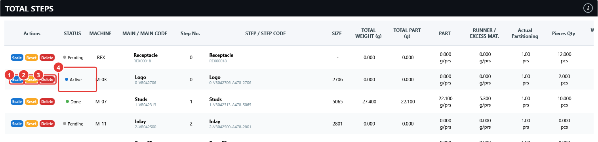

1. **Scale** – jadikan baris ini step aktif (dan buka referensi/riwayatnya).
2. **Reset** – kembalikan berat baris ini ke 0 agar dapat ditimbang ulang. Untuk cetakan banyak ukuran, Reset berlaku untuk **semua ukuran** pada cetakan itu.
3. **Delete** – hapus baris dari daftar saat ini (tidak akan disimpan).
4. Baris terpilih – status **Active**.

Untuk **menimbang ulang step yang sudah Done**: tekan **Reset** pada baris, lalu **Scale**, lalu timbang lagi.

Tombol tampak redup jika step tidak diizinkan pada pemeriksaan saat ini (lihat *step terkunci*).

---

## 9. Remark, Confirm, dan Cancel

Jika semua step **Done** (hijau), Anda dapat menambahkan catatan dan mengonfirmasi.

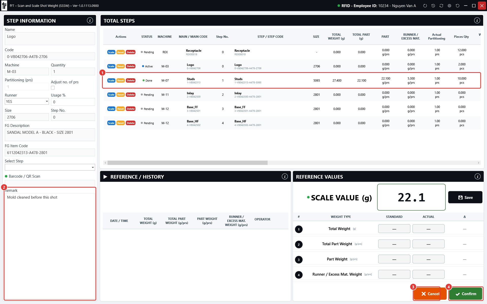

1. Satu step yang sudah ditimbang (**Done**). Pada contoh ini hanya Studs yang ditimbang; pada order sebenarnya biasanya semua baris diselesaikan. Hanya baris yang Done (Part Weight > 0) yang disimpan.
2. **Remark** – catatan opsional yang disimpan bersama step yang sedang dipilih/aktif (di sini step berikutnya, Logo), mis. "Cetakan dibersihkan sebelum shot ini".
3. **Cancel** – membatalkan sesi **dan menghapus login RFID Anda**.
4. **Confirm** – menyimpan.

Saat menekan **Confirm**, layar menampilkan *"Saving data…"* – tunggu, jangan tutup aplikasi:

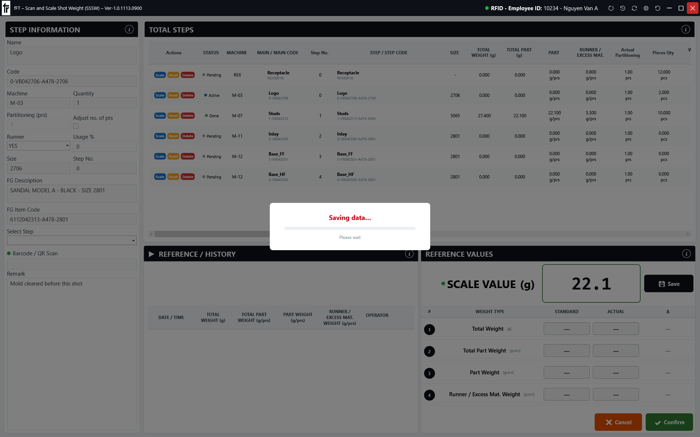

Pesan berhasil:

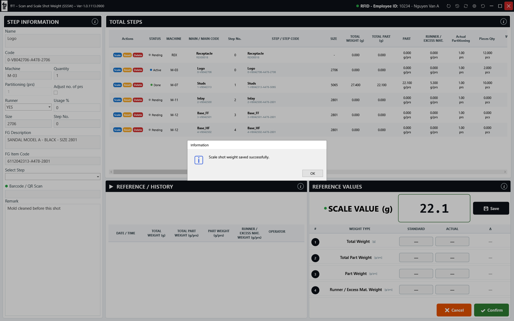

*"Scale shot weight saved successfully."* – tekan **OK**; layar siap untuk order berikutnya.

Yang disimpan: setiap step dengan Part Weight > 0 (termasuk step yang dimuat dari penimbangan sebelumnya). Catatan berisi kode/nama karyawan, tanggal/jam, dan nama mesin. Jika step tersebut adalah **step terakhir dari barang jadi (FG)**, rata-rata berat part juga dikirim otomatis ke laporan FG.

---

## 10. Pesan yang mungkin muncul

| Pesan | Arti | Tindakan |
|-------|------|----------|
| *RFID card not yet scanned.* | Menekan Confirm tanpa login. | Tempelkan kartu (atau klik area karyawan dan ketik ID). |
| *The previous step has not been weighed.* | Step sebelumnya dikurangkan tetapi belum punya berat. | Timbang step sebelumnya. |
| *Component / previous step(s) of this step (BOM level 2) have no weight yet and must be weighed first: …* | Komponen di dalam step ini belum ditimbang (disebutkan). | Timbang komponen yang disebut, lalu timbang step ini. Belum ada yang disimpan. |
| *N previous step(s) are missing Part Weight and must be weighed first: …* | Aturan banyak ukuran / non-woven – semua step yang lebih kecil harus selesai. | Timbang step yang disebut. |
| *Cannot scale this step.* / *Do not allow to scale this step.* | Step terkunci pada pemeriksaan saat ini. | Tekan **Scale** pada baris – jendela timbang terbuka (atau jawab **Yes** pada pertanyaan pindah step, lihat 6.10). |
| *Scale not completed for step: …* | Item REX belum punya berat saat Confirm. | Timbang item REX. |
| *Label does not match the item being weighed.* | Label yang di-scan milik item lain. | Scan label yang benar. |
| *Cannot reset this line.* | Baris terkunci. | Pindah step terlebih dahulu. |
| *Transaction error …* | Masalah database saat menyimpan. Belum ada yang disimpan. | Periksa jaringan, tekan Confirm lagi; jika berulang hubungi IT. |

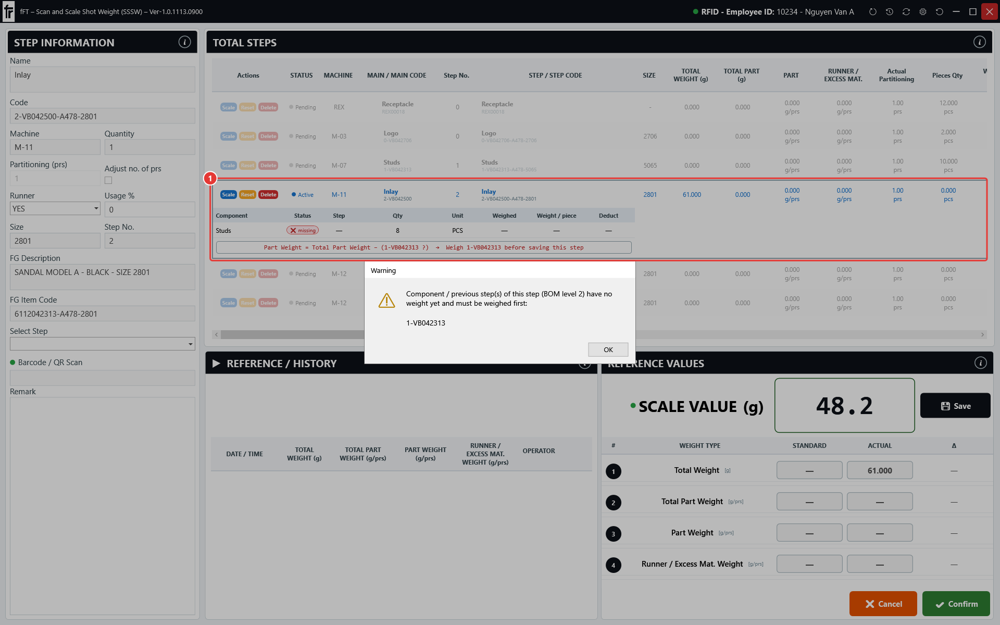

Contoh: peringatan komponen belum ditimbang saat menyimpan *Inlay* (detail baris menampilkan *✖ missing*).

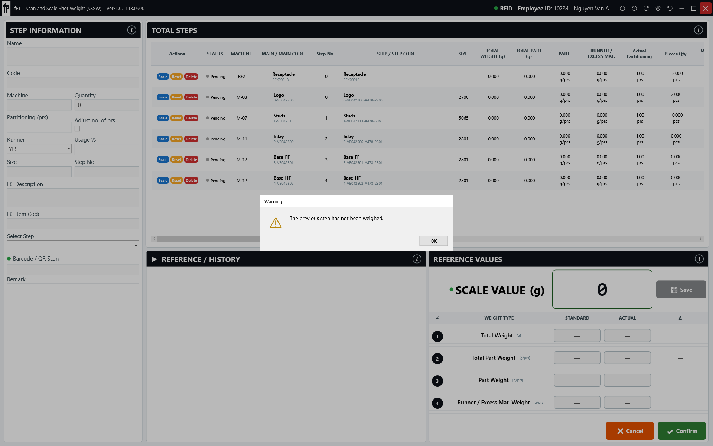

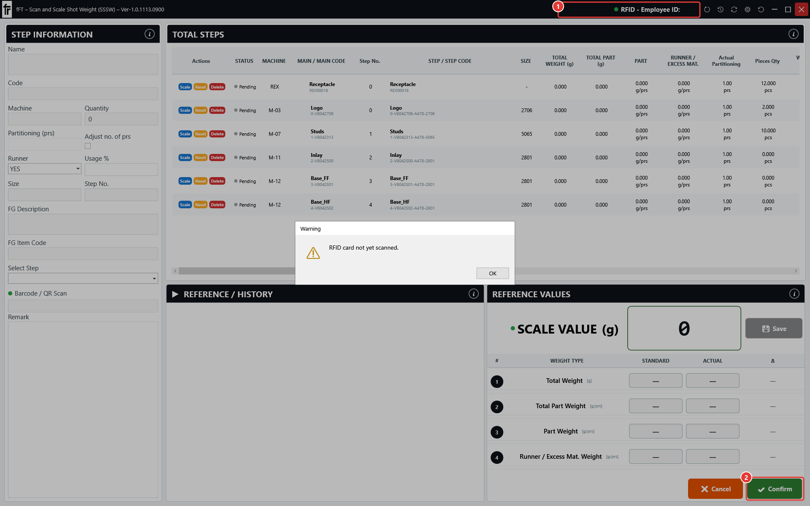

---

## 11. Pemecahan masalah

| Masalah | Kemungkinan penyebab | Solusi |
|---------|----------------------|--------|
| Lampu Scale **merah**, SCALE VALUE tetap 0 | Timbangan mati, kabel jaringan, IP salah | Periksa daya dan kabel jaringan; tekan **Reload**; hubungi IT. |
| SCALE VALUE negatif atau bergeser | Timbangan belum nol / meja bergetar | Singkirkan semua barang, tekan Zero/Tare, tunggu stabil. |
| Tombol **Save** redup | Pembacaan timbangan belum stabil | Tunggu angka stabil. |
| Lampu Barcode merah, QR tidak terbaca | Scanner terputus | Colok ulang scanner atau pilih step di **Select Step**. |
| Lampu RFID merah | Pembaca kartu terputus | Colok ulang; sementara klik area karyawan untuk mengetik ID. |
| Daftar step kosong | Tidak ada order untuk QR ini / Hydra belum sinkron | Tekan ikon **Hydra**, lalu **Reload**. |
| Nilai PART jauh di bawah standar | Salah satu komponen di dalamnya salah ditimbang | Periksa panel detail (Kasus D/E), **Reset** komponen yang salah dan timbang ulang. |
| Δ merah pada setiap item | Kalibrasi timbangan atau salah meletakkan barang | Periksa dengan anak timbangan standar; hubungi teknisi. |
| Aplikasi lambat setelah beberapa jam | Terlalu banyak sesi terbuka | **Cancel**, restart aplikasi. |

---

## 12. Kartu ringkasan cepat

```
1  Tempelkan kartu RFID (atau klik area karyawan → ketik ID)
2  Scan label QR  (atau pilih di Select Step)
3  Untuk setiap step, berurutan:
     • Scale pada baris             → step menjadi Active
     • Step injeksi:  seluruh shot → Save   |   part saja → Save
     • REX / insert:  semua buah untuk 1 pasang → Save
     • Non-woven/Mesh:  timbang → Save → ketik Usage % → Enter
4  Periksa warna  (hijau OK · oranye peringatan · merah BERHENTI)
5  Semua baris Done?  → Remark (opsional) → Confirm → OK
   Salah?  → Reset pada baris, timbang ulang       Cancel = mulai dari awal (dan logout)
```
