# Hướng dẫn vận hành SSSW (Tiếng Việt)

> **Đối tượng:** công nhân vận hành và kỹ thuật viên chuyền cân shot ép nhựa trên trạm SSSW.
> **Ngôn ngữ:** Tiếng Việt (file này) · [English](OPERATOR_MANUAL.en.md) · Tài liệu cho Dev: [EN](DEVELOPER_MANUAL.en.md) / [VI](DEVELOPER_MANUAL.vi.md)
> **Ảnh chụp màn hình:** chụp từ màn hình thật của ứng dụng với **dữ liệu giả lập (mẫu)** — mã hàng, máy, tên, trọng lượng chỉ là ví dụ, không phải dữ liệu nhà máy. Khung đỏ và số trong vòng tròn đỏ được giải thích ngay dưới mỗi ảnh. Giao diện phần mềm hiển thị bằng tiếng Anh nên tên nút/cột được giữ nguyên tiếng Anh.

---

## Mục lục

1. [Ứng dụng dùng để làm gì](#1-ứng-dụng-dùng-để-làm-gì)
2. [Tổng quan màn hình](#2-tổng-quan-màn-hình)
3. [Đăng nhập bằng thẻ RFID](#3-đăng-nhập-bằng-thẻ-rfid)
4. [Nạp danh sách step của sản phẩm](#4-nạp-danh-sách-step-của-sản-phẩm)
5. [Cách đọc bảng TOTAL STEPS](#5-cách-đọc-bảng-total-steps)
6. [Các trường hợp cân](#6-các-trường-hợp-cân)
   - [6.1 Trường hợp A – Step ép thường (cân 2 lần)](#61-trường-hợp-a--step-ép-thường-cân-2-lần)
   - [6.2 Trường hợp B – REX / receptacle (cân 1 lần)](#62-trường-hợp-b--rex--receptacle-cân-1-lần)
   - [6.3 Trường hợp C – Non-woven / Mesh (chỉ dùng một phần %)](#63-trường-hợp-c--non-woven--mesh-chỉ-dùng-một-phần-)
   - [6.4 Trường hợp D – Step chứa chi tiết khác (BOM level 2)](#64-trường-hợp-d--step-chứa-chi-tiết-khác-bom-level-2)
   - [6.5 Trường hợp E – Step "chain" (step trước nằm trong step sau)](#65-trường-hợp-e--step-chain-step-trước-nằm-trong-step-sau)
   - [6.6 Trường hợp F – Nhiều đôi trong 1 shot (Partitioning)](#66-trường-hợp-f--nhiều-đôi-trong-1-shot-partitioning)
   - [6.7 Trường hợp G – Runner = NO](#67-trường-hợp-g--runner--no)
   - [6.8 Trường hợp H – 1 khuôn nhiều size (vd. Logo)](#68-trường-hợp-h--1-khuôn-nhiều-size-vd-logo)
   - [6.9 Trường hợp I – Hàng PU (cân theo chiếc, L / R)](#69-trường-hợp-i--hàng-pu-cân-theo-chiếc-l--r)
   - [6.10 Trường hợp J – Cleat_Ring và step bị khóa](#610-trường-hợp-j--cleat_ring-và-step-bị-khóa)
7. [Màu dung sai](#7-màu-dung-sai)
8. [Các nút trên dòng: Scale / Reset / Delete](#8-các-nút-trên-dòng-scale--reset--delete)
9. [Remark, Confirm và Cancel](#9-remark-confirm-và-cancel)
10. [Các thông báo có thể gặp](#10-các-thông-báo-có-thể-gặp)
11. [Xử lý sự cố](#11-xử-lý-sự-cố)
12. [Thẻ tóm tắt nhanh](#12-thẻ-tóm-tắt-nhanh)

---

## 1. Ứng dụng dùng để làm gì

SSSW (**S**can and **S**cale **S**hot **W**eight) kiểm tra trọng lượng từng step của sản phẩm so với **định mức BOM** và **các lần cân gần nhất**, rồi lưu kết quả vào cơ sở dữ liệu. Bạn luôn làm 3 việc:

1. **Nhận diện** – đăng nhập (thẻ RFID) và nạp các step của sản phẩm (quét tem QR).
2. **Cân** – đặt hàng lên cân, bấm **Save** trên màn hình; chương trình tự tính phần còn lại.
3. **Xác nhận** – bấm **Confirm** khi tất cả step đã *Done*.

> Chương trình tự tính toán (runner, trọng lượng chi tiết, phần trừ các chi tiết khác). Bạn chỉ cần đặt **đúng hàng** lên cân và bấm **Save**.

---

## 2. Tổng quan màn hình

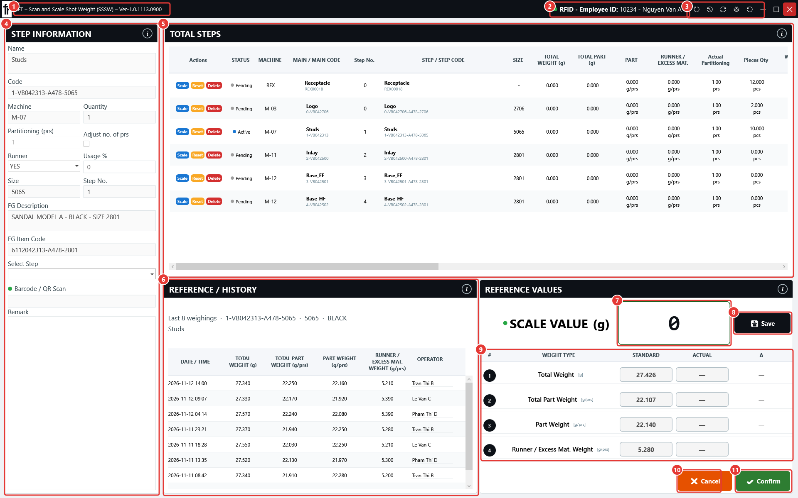

| # | Khu vực | Công dụng |
|---|---------|-----------|
| 1 | **Thanh tiêu đề** | Mã nhà máy (vd. `fFT`), tên ứng dụng và **phiên bản**. Kéo để di chuyển cửa sổ. |
| 2 | **RFID – Employee ID** | Chấm xanh = đầu đọc thẻ đã kết nối. Hiển thị `mã thẻ – tên bạn` sau khi quẹt thẻ. **Bấm vào** để nhập tay mã nhân viên. |
| 3 | **Các biểu tượng công cụ** | Reload · History · Hydra · Settings · Update (xem bảng dưới), rồi thu nhỏ / phóng to / đóng. |
| 4 | **STEP INFORMATION** | Thông tin step đang cân (tên, mã, máy, partitioning, runner, size, FG…). Có thêm ô **Select Step**, ô **Barcode / QR Scan** và ô **Remark**. |
| 5 | **TOTAL STEPS** | Mỗi step của sản phẩm một dòng, kèm trạng thái và trọng lượng. Nút **Scale / Reset / Delete** nằm trên từng dòng. |
| 6 | **REFERENCE / HISTORY** | Các lần cân gần nhất của step đang chọn (ngày giờ, trọng lượng, người cân). |
| 7 | **SCALE VALUE (g)** | Số đọc trực tiếp từ cân. Chấm xanh cạnh tiêu đề = cân đã kết nối. |
| 8 | **Save** | Lưu số đang hiện trên cân vào step đang cân. |
| 9 | **REFERENCE VALUES** | STANDARD (trung bình các lần cân gần nhất) so với ACTUAL (lần cân này) và chênh lệch Δ, tô màu theo dung sai. |
| 10 | **Cancel** | Hủy toàn bộ dữ liệu trên màn hình **và đăng xuất**. |
| 11 | **Confirm** | Ghi tất cả step đã hoàn tất vào cơ sở dữ liệu. |

**Biểu tượng công cụ (mục 3)**

| Biểu tượng | Tên | Công dụng |
|------------|-----|-----------|
| ⟳ (mũi tên tròn) | Reload | Tải lại danh sách sản phẩm/step từ cơ sở dữ liệu. |
| 🕘 | History | Mở màn hình xem lịch sử cân. |
| ⇄ | Hydra | Lấy lệnh sản xuất mới nhất từ MES (Hydra). |
| ⚙ | Settings | Mở form dữ liệu gốc / cài đặt (toàn màn hình). Chỉ dành cho kỹ thuật; đóng form xong danh sách cân tự tải lại. |
| ↺ | Update | Kiểm tra phiên bản mới của ứng dụng. |

Rê chuột vào biểu tượng **ⓘ** nhỏ ở tiêu đề mỗi khối để đọc hướng dẫn ngắn.

**Đèn thiết bị** – xanh = đã kết nối, đỏ = chưa kết nối: đèn RFID (trên header), đèn Barcode (bên trái "Barcode / QR Scan") và đèn Scale (bên trái "SCALE VALUE").

---

## 3. Đăng nhập bằng thẻ RFID

Bạn phải đăng nhập trước khi bấm **Confirm**.

**Trước khi đăng nhập** – đèn RFID xanh, tên còn trống:


1. Tiêu đề cửa sổ và phiên bản.
2. Khu vực nhân viên – còn trống.

**Sau khi quẹt thẻ** vào đầu đọc:


1. `RFID – Employee ID: <mã thẻ> – <tên bạn>`. Tên được giữ khi chuyển giữa các step; chỉ bị xóa khi bấm **Cancel**.

**Đầu đọc thẻ hỏng?** Bấm vào khu vực nhân viên (mục 1 ở trên). Một cửa sổ nhỏ mở ra: gõ **Employee ID**, bấm **Enter**; tên hiện ra; bấm **OK**. Nếu mã mới, cửa sổ yêu cầu nhập tên – gõ tên, **Enter**, rồi **OK**.

---

## 4. Nạp danh sách step của sản phẩm

Làm **một** trong hai cách:

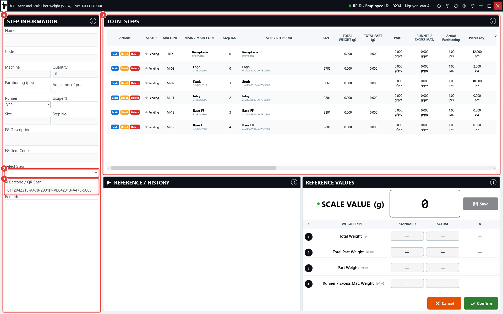

1. **Barcode / QR Scan** – quét tem QR trên lệnh sản xuất hoặc trên chi tiết. Chương trình tự tìm lệnh và nạp tất cả step.
2. **Select Step** – bấm vào danh sách và chọn step (có thể gõ một phần mã/tên để tìm trên mọi cột).
3. **TOTAL STEPS** – sau khi nạp, mọi step của sản phẩm hiện ở đây.
4. **STEP INFORMATION** – điền thông tin step sắp cân.

Thông báo có thể gặp: *"Label information not found."*, *"Step information not found."*, *"No matching data found!"* → tem chưa được đăng ký; báo tổ trưởng.

---

## 5. Cách đọc bảng TOTAL STEPS

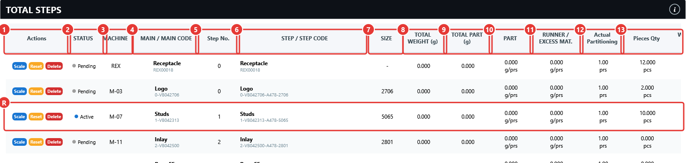

| # | Cột | Ý nghĩa |
|---|-----|---------|
| 1 | **Actions** | **Scale** (chọn/cân step này) · **Reset** (xóa trọng lượng của dòng) · **Delete** (bỏ dòng khỏi phiên cân). |
| 2 | **STATUS** | **Pending** (xám) – chưa cân · **Active** (xanh dương) – step đang cân · **Done** (xanh lá) – đã đủ trọng lượng. |
| 3 | **MACHINE** | Máy ép của step (`REX` cho chi tiết chèn). |
| 4 | **MAIN / MAIN CODE** | Chi tiết chính mà step thuộc về. |
| 5 | **Step No.** | Thứ tự step (0 = chi tiết dùng cho nhiều step, vd. REX). Step nhỏ cân trước. |
| 6 | **STEP / STEP CODE** | Tên và mã đầy đủ của step (gồm màu và size). |
| 7 | **SIZE** | Mã size của step. |
| 8 | **TOTAL WEIGHT (g)** | Trọng lượng cả shot (chi tiết + runner) – lần cân 1. |
| 9 | **TOTAL PART (g)** | Trọng lượng chỉ phần chi tiết – lần cân 2. |
| 10 | **PART (g/prs)** | **Kết quả:** trọng lượng 1 đôi (hàng PU: 1 chiếc, `g/pcs`) sau khi đã trừ. |
| 11 | **RUNNER / EXCESS MAT.** | Trọng lượng runner trên 1 đôi (tự tính). |
| 12 | **Actual Partitioning** | Số đôi (PU: số chiếc) trong 1 shot. |
| 13 | **Pieces Qty** | Số chiếc của chi tiết này trong 1 đôi (theo BOM). |
| R | **Dòng đang chọn** | Dòng bạn bấm được làm nổi, các dòng khác mờ đi. Bấm lại đúng dòng để bỏ chọn. |

Còn nhiều cột bên phải (kéo bảng sang ngang): Weight per Unit, PPIC Partitioning, Mold Pairs Shot, FG / FG code, Machine group, Mold ID, Remarks, Article, Hydra order, Category, Percent of usage, QR code, Quantity.

**Bấm vào dòng** để mở **chi tiết BOM level 2** (các chi tiết đã nằm trong step này và bị trừ – xem [Trường hợp D](#64-trường-hợp-d--step-chứa-chi-tiết-khác-bom-level-2)).

---

## 6. Các trường hợp cân

Quy tắc chung cho mọi trường hợp:

- Luôn chờ số **SCALE VALUE** **ổn định** rồi mới bấm **Save**.
- Cân phải hiện **0.00** khi chưa đặt gì (nếu không, bấm *Zero/Tare* trên cân).
- Step đang cân là step **Active** (xanh dương). Bấm **Scale** trên dòng để chọn.
- Khi một step **Done**, chương trình tự chuyển sang step kế tiếp còn cần cân.

### 6.1 Trường hợp A – Step ép thường (cân 2 lần)

Dùng cho mọi chi tiết ép (Logo, Studs, Inlay, Base…) **không phải** REX. Ví dụ: step **Studs**.

**Bước 1 – Chọn step.** Bấm **Scale** trên dòng (hoặc quét QR / chọn ở *Select Step*).

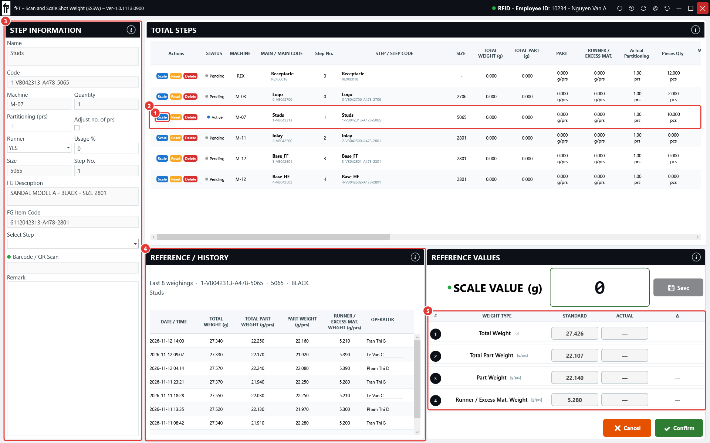

1. Nút **Scale** của dòng – đặt step thành *Active*.
2. Dòng được làm nổi, trạng thái = **Active**.
3. **STEP INFORMATION** hiện thông tin step (tên, máy, size, partitioning, runner YES).
4. **REFERENCE / HISTORY** liệt kê các lần cân gần nhất của step.
5. Cột **STANDARD** = trung bình các lần cân đó.

**Bước 2 – Cân lần 1: cả shot (chi tiết + runner).** Đặt nguyên shot lên cân, chờ ổn định, bấm **Save**.

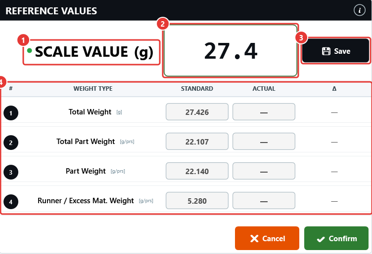

1. Tiêu đề kèm đèn xanh *cân đã kết nối*.
2. **SCALE VALUE** – số đọc trực tiếp (ví dụ 27.40 g).
3. **Save** – bấm khi số ổn định.
4. Bảng so sánh ở dưới: STANDARD 27.426 so với ACTUAL 27.400.

**Bước 3 – Cân lần 2: chỉ phần chi tiết.** Lấy runner ra, **chỉ để chi tiết** trên cân. Chờ số ổn định, bấm **Save** lần nữa.

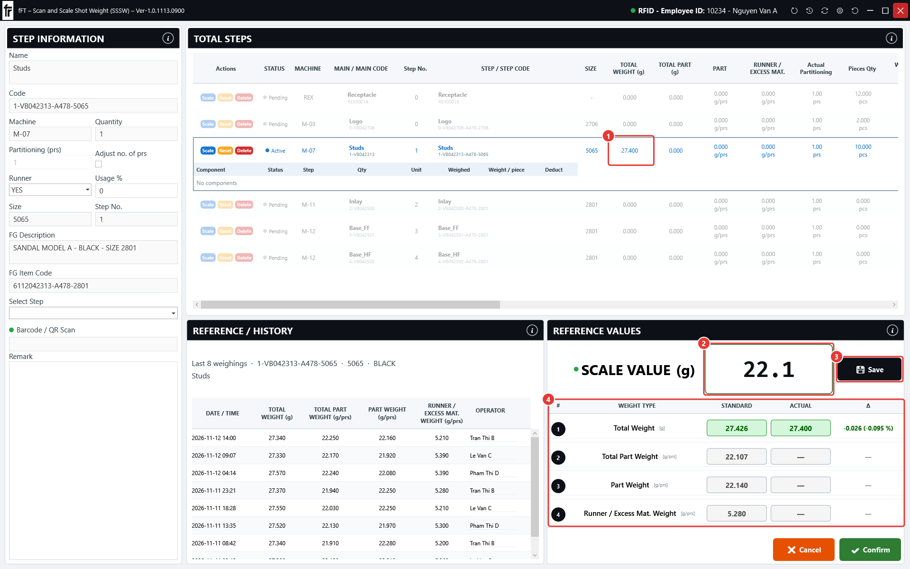

1. **TOTAL WEIGHT** của dòng đã có (27.400).
2. **SCALE VALUE** giờ là chỉ chi tiết (22.10 g).
3. **Save**.
4. Cột ACTUAL sẽ được điền sau khi lưu.

**Kết quả.**

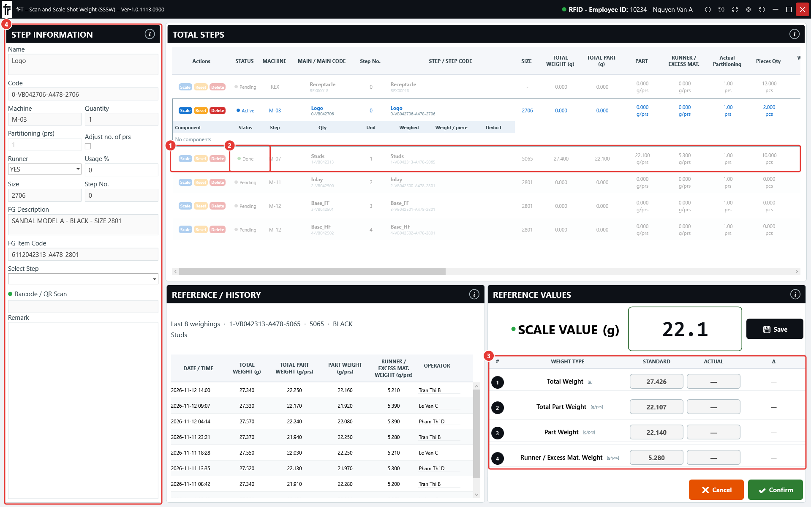

1. Trạng thái = **Done** (xanh lá).
2. **TOTAL WEIGHT 27.400 · TOTAL PART 22.100 · PART 22.100 g/prs · RUNNER 5.300 g/prs** được tự tính.
3. Cả 4 dòng REFERENCE VALUES đều có ACTUAL và Δ.
4. Chương trình đã chuyển sang step kế tiếp.

> **Công thức (1 đôi/shot):** Total Part = lần cân 2; Runner = Total Weight − Total Part; Part = Total Part (trừ các chi tiết đã nằm trong đó, xem Trường hợp D/E).

### 6.2 Trường hợp B – REX / receptacle (cân 1 lần)

Hàng có mã bắt đầu bằng **REX** (đinh kim loại, receptacle) không có runner: **chỉ cân một lần**. Cân **tất cả số chiếc cần cho 1 đôi cùng lúc** – cột *Pieces Qty* cho biết số chiếc (vd. 12 pcs).

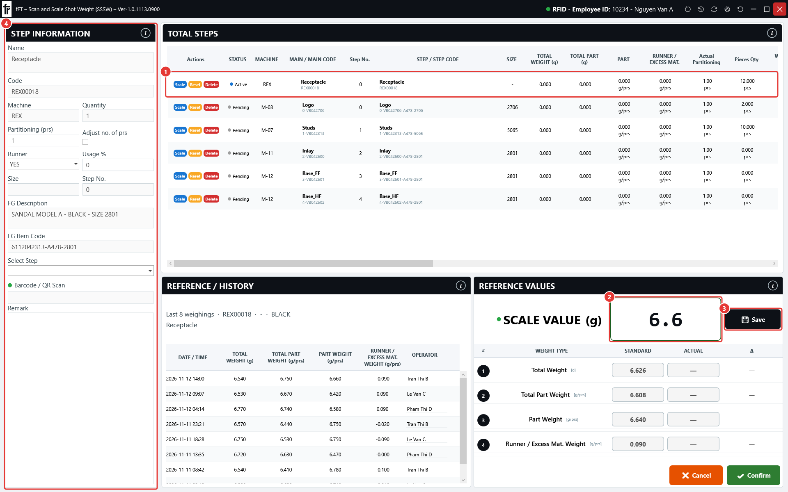

1. Dòng REX (Machine `REX`, Step No. 0, Pieces Qty 12 pcs). Bấm **Scale**.
2. **SCALE VALUE** – trọng lượng 12 chiếc (6.60 g).
3. **Save** – một lần bấm là xong step.
4. **STEP INFORMATION** – lưu ý ô *Quantity*.

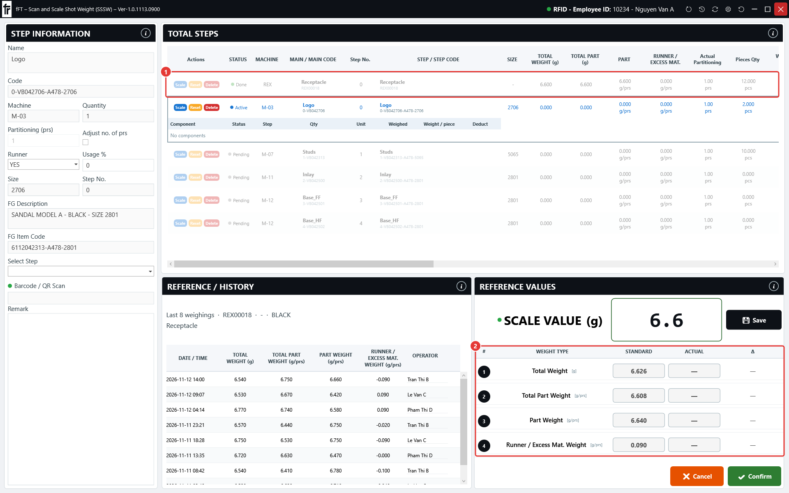

1. Trạng thái **Done**; Total Weight = Total Part = Part = 6.600; **trọng lượng 1 chiếc = 6.60 ÷ 12 = 0.55 g** (dùng sau này để trừ đinh khỏi các step khác).
2. REFERENCE VALUES so với lịch sử.

### 6.3 Trường hợp C – Non-woven / Mesh (chỉ dùng một phần %)

Với vật liệu loại REX như **Non Woven** hoặc **Mesh**, chỉ một phần tấm vật liệu nằm trong sản phẩm. Ô **Usage %** (STEP INFORMATION) chỉ mở khóa cho các hàng này.

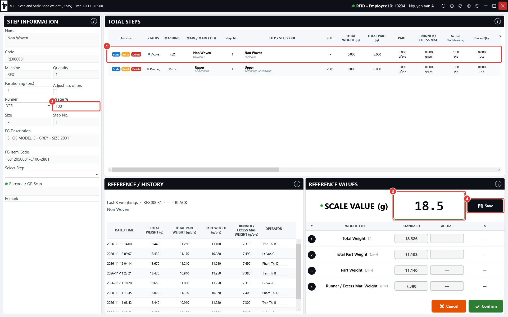

1. Chọn dòng Non-woven (category *Non Woven*).
2. **Usage %** – chỉnh được với hàng này.
3. Đặt vật liệu lên cân: 18.50 g.
4. **Save**.

Sau đó gõ tỉ lệ sử dụng và bấm **Enter**:

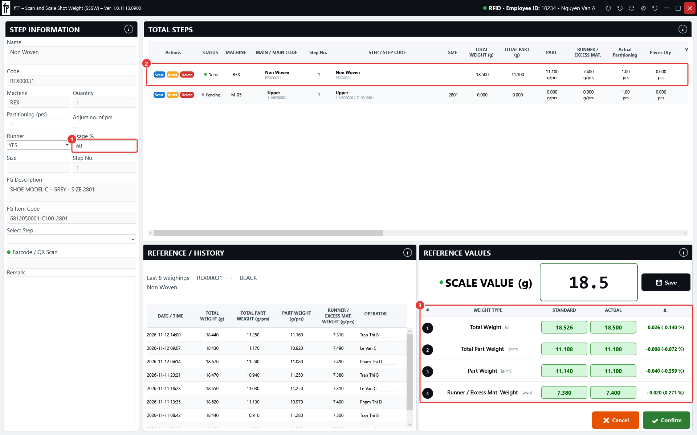

1. **Usage % = 60** → phần dùng = 18.50 × 60 % = **11.10 g**; phần còn lại (7.40 g) là vật liệu thừa.
2. Dòng hiện Total Weight 18.500, Total Part 11.100, Runner / Excess 7.400.
3. So sánh với lịch sử.

### 6.4 Trường hợp D – Step chứa chi tiết khác (BOM level 2)

Một số step đã chứa chi tiết khác (vd. *Inlay* chứa 8 *Studs*). Chương trình **trừ** trọng lượng của chúng để **PART** chỉ là trọng lượng nhựa mới.

> **Quy tắc:** cân các chi tiết bên trong (ở đây là **Studs**) **trước**. Nếu chưa cân, chương trình từ chối lưu step.

Bấm vào dòng để mở **bảng chi tiết**. Nếu một chi tiết chưa cân:

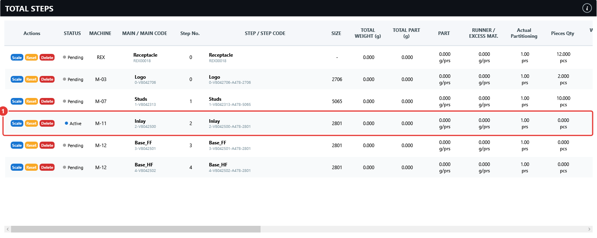

1. Dòng chi tiết **Studs – ✖ missing**; công thức màu đỏ cho biết cần cân chi tiết nào trước.

Sau khi **Studs** đã Done, cân Inlay (shot 61.00 g, rồi chi tiết 48.20 g):

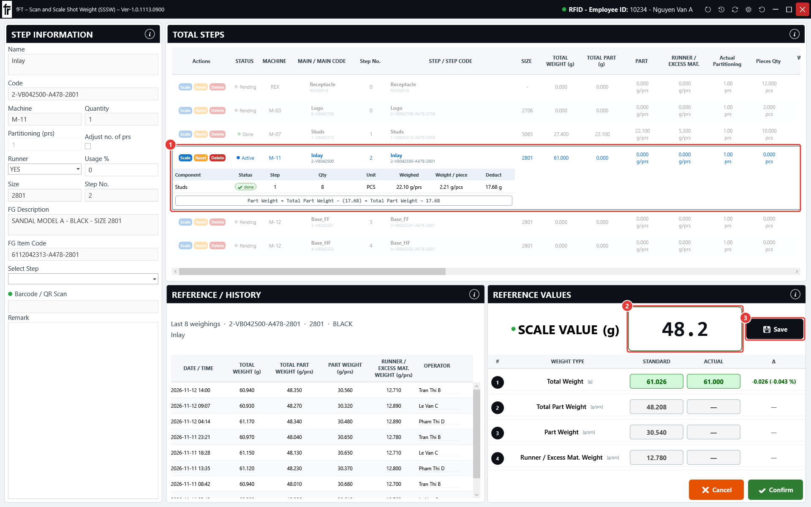

1. Chi tiết: **Studs × 8 pcs, 2.21 g/pcs → trừ 17.68 g**, trạng thái ✔ done.
2. **SCALE VALUE** 48.20 g (chỉ chi tiết).
3. **Save**.


1. **PART = 48.20 − 17.68 = 30.52 g/prs.**
2. Các giá trị tham chiếu của step.

### 6.5 Trường hợp E – Step "chain" (step trước nằm trong step sau)

Nếu step ngay trước chỉ được dùng **bên trong** step này, thì toàn bộ **Total Part** của nó cũng bị trừ (ghi *(previous step)* trong bảng chi tiết). Ví dụ: **Base_FF** chứa Inlay.

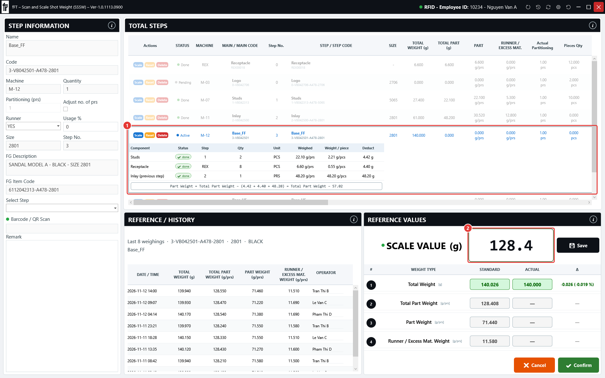

1. Chi tiết: **Studs ×2** (4.42 g) + **Receptacle ×8** (4.40 g) + **Inlay (previous step)** 48.20 g.
2. **SCALE VALUE** – 128.40 g (chỉ chi tiết).
3. Công thức dưới bảng: `Part Weight = Total Part Weight − (4.42 + 4.40 + 48.20) = Total Part Weight − 57.02`.

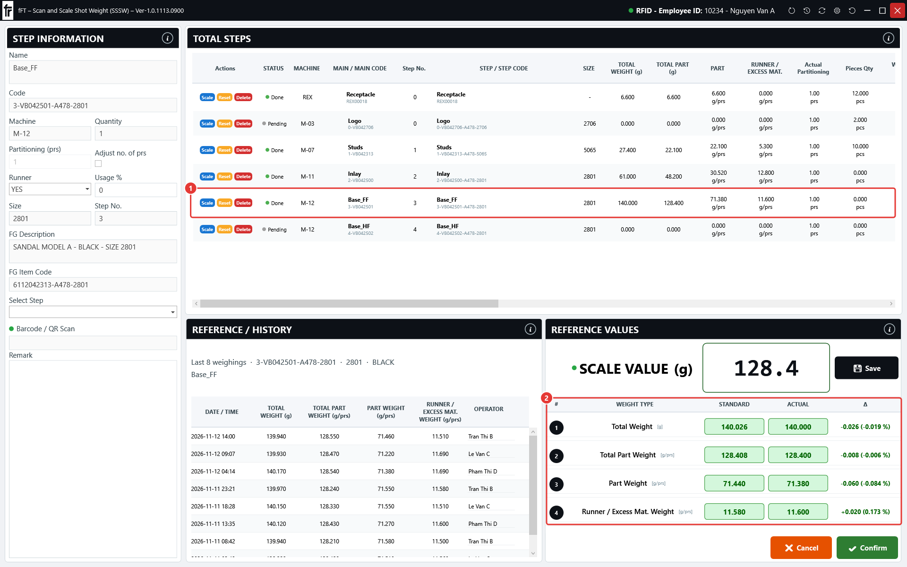

1. **PART = 128.40 − 57.02 = 71.38 g/prs.**
2. Giá trị tham chiếu.

Nếu step trước chưa cân sẽ có thông báo *"The previous step has not been weighed."* – hãy cân step trước.

### 6.6 Trường hợp F – Nhiều đôi trong 1 shot (Partitioning)

Khi khuôn ép **N đôi** trong 1 shot, lần cân 2 là trọng lượng của **cả N đôi**; chương trình chia cho N. Ô **Partitioning** hiển thị N và thường bị khóa.

Nếu hôm nay N khác (vd. bịt bớt một lòng khuôn), tick **Adjust no. of prs**, gõ số thực tế và bấm **Enter**:

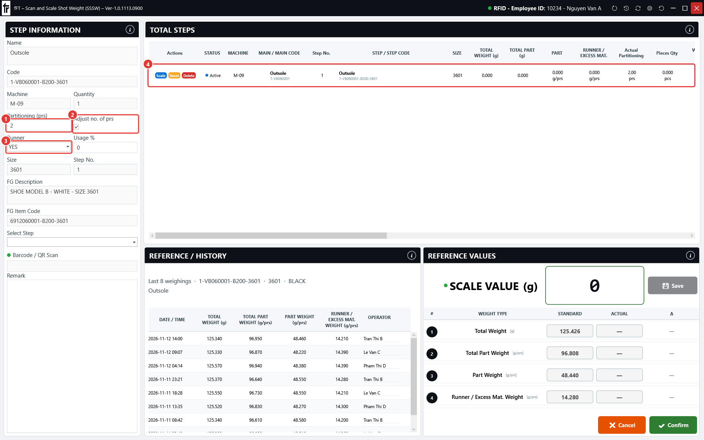

1. **Partitioning (prs)** – mở khóa sau khi tick.
2. Ô **Adjust no. of prs**.
3. **Runner** – YES/NO (xem Trường hợp G).
4. Dòng hiện *Actual Partitioning 2.00 prs*.

Cân như Trường hợp A: shot 125.40 g, rồi chi tiết của cả 2 đôi 96.80 g.

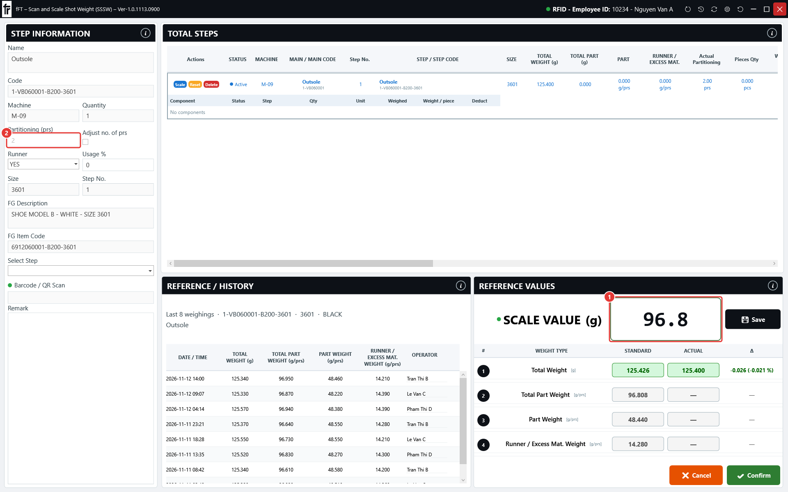

1. 96.80 g trên cân = chi tiết của **2 đôi**.
2. Partitioning = 2.

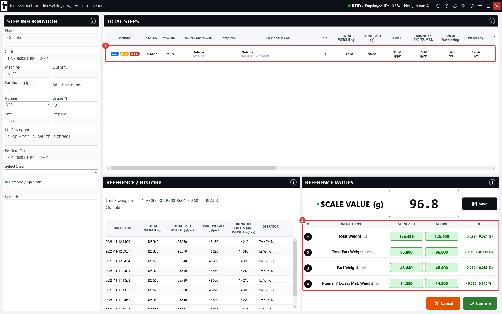

1. **TOTAL PART 96.800 → PART = 96.80 ÷ 2 = 48.40 g/prs; RUNNER = (125.40 − 96.80) ÷ 2 = 14.30 g/prs.**
2. Giá trị tham chiếu.

### 6.7 Trường hợp G – Runner = NO

Nếu shot **không có runner** (khuôn hot-runner), đặt **Runner = NO** trước khi cân. Runner được lưu bằng 0.

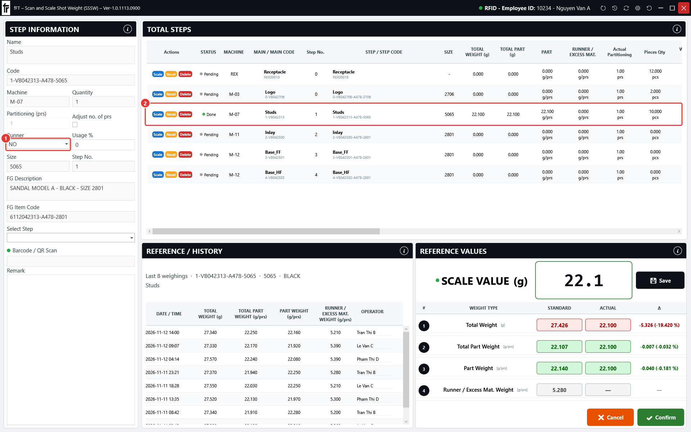

1. Danh sách **Runner** đặt là **NO**.
2. Dòng kết quả: Runner / Excess = 0.000.

### 6.8 Trường hợp H – 1 khuôn nhiều size (vd. Logo)

Một khuôn có thể ép nhiều size cùng shot (các dòng cùng máy, khuôn và mã chính). Chúng được liệt kê cùng nhau.

1. Cân **cả shot một lần** (Total Weight) ở dòng size đầu – giá trị được copy cho mọi size của khuôn đó.

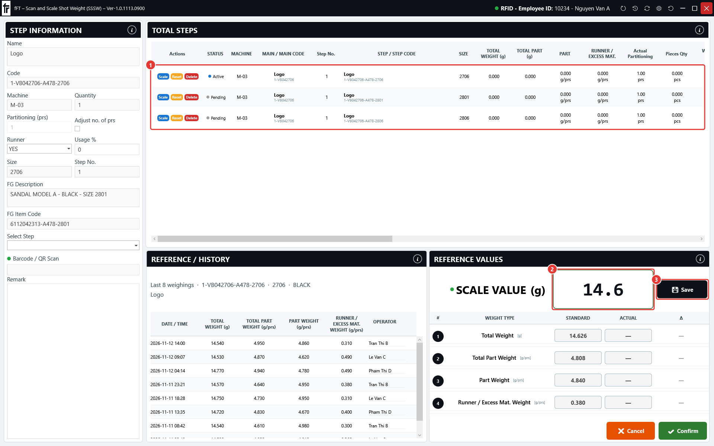

1. Ba dòng size (2706, 2801, 2806) cùng máy và khuôn.
2. **SCALE VALUE** – cả shot, 14.60 g.
3. **Save** – Total Weight hiện ở **cả ba** dòng.

2. Sau đó cân **riêng từng size** (lấy các size khác ra) và **Save**.

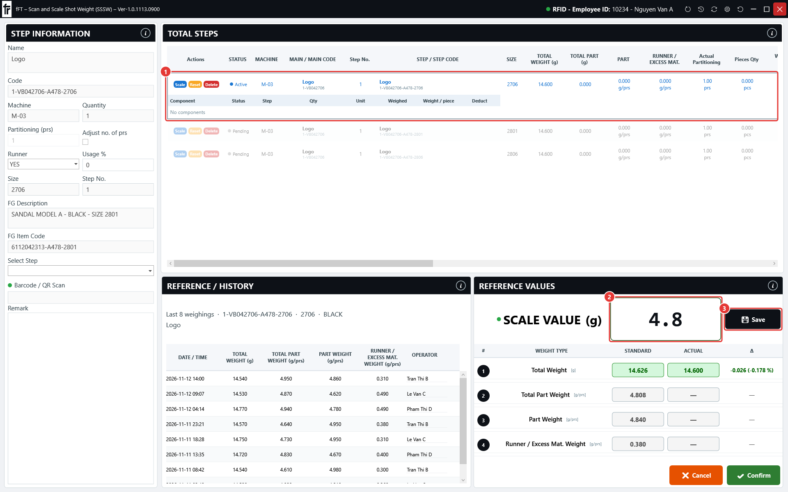

1. Dòng size 2706.
2. 4.80 g – chỉ chi tiết size 2706.
3. **Save**.

Sau mỗi lần Save, size kế tiếp tự động thành Active:

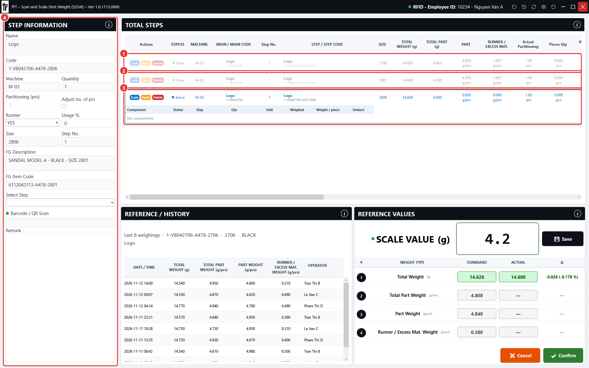

1. 2706 **Done** (4.80 g).
2. 2801 **Done** (4.20 g).
3. 2806 **Active** – cân ngay bây giờ.
4. STEP INFORMATION hiện size 2806.

**Runner** của các size dùng chung: `(Total Weight − tổng trọng lượng các chi tiết) ÷ số đôi`. Giá trị chốt khi đã cân đủ mọi size.

> Với khuôn nhiều size, mọi step có **Step No. nhỏ hơn** phải được cân trước. Nếu không: *"N previous step(s) are missing Part Weight and must be weighed first"*.

### 6.9 Trường hợp I – Hàng PU (cân theo chiếc, L / R)

Hàng PU (machine group **PU**) tính theo **chiếc**, không phải đôi: đơn vị hiện `pcs`, `g/pcs-L`, `g/pcs-R`. Chi tiết **trái (…L)** và **phải (…R)** được cân trong **cùng một shot**.

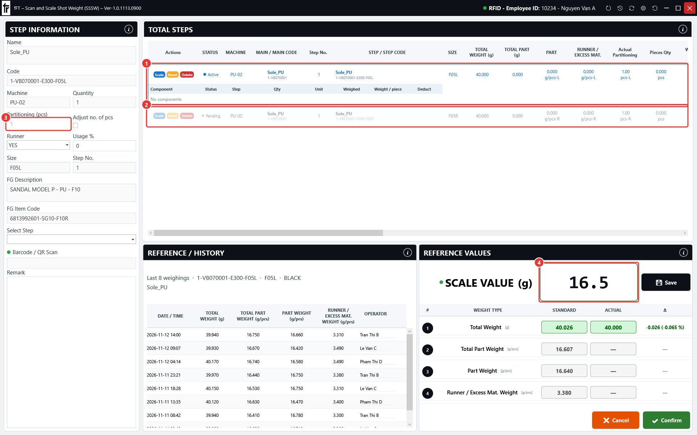

1. Dòng trái `…-F05L`.
2. Dòng phải `…-F05R` (cùng khuôn, cùng step).
3. Partitioning tính theo **pcs**.
4. Số đang hiện: **chỉ chi tiết L** (16.50 g) sau khi đã lưu cả shot (40.00 g).

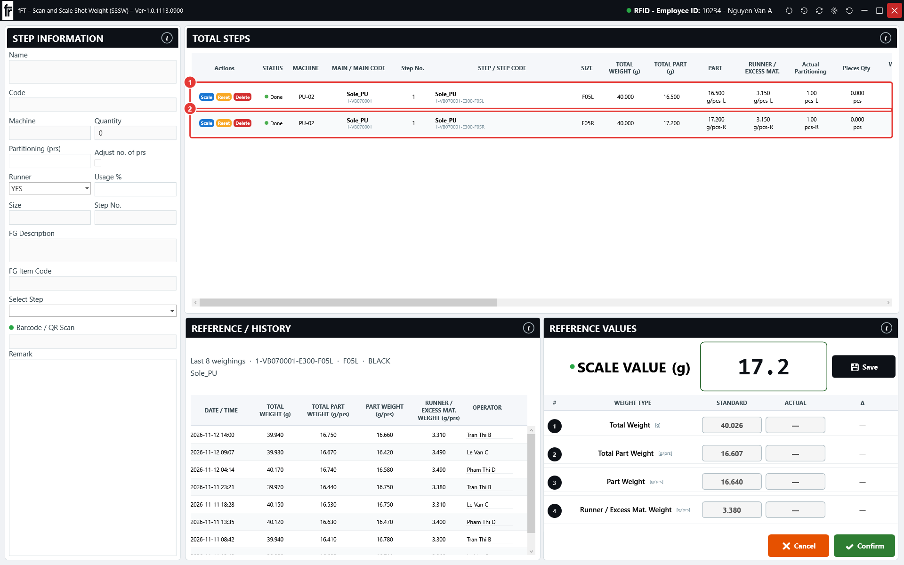

1. L: Part **16.500 g/pcs-L**.
2. R: Part **17.200 g/pcs-R**, Runner 3.150 g mỗi chiếc.

Lưu ý:
- Bấm **Scale** trên dòng PU của **step không phải cuối**: một **cửa sổ cân** mở ra phía trước màn chính, chứa step đó cùng cặp L/R (danh sách chính nằm phía sau, bị mờ). Cân L và R trong cửa sổ đó rồi bấm **Confirm** – cửa sổ tự đóng và trọng lượng được nạp lại vào danh sách chính. **Cancel** trong cửa sổ chỉ đóng cửa sổ.
- Step PU chỉ trừ chi tiết **cùng phía** (L trừ L, R trừ R).

### 6.10 Trường hợp J – Cleat_Ring và step bị khóa

Step `Cleat_Ring` cân đúng như **Trường hợp A** (2 lần). Với Cleat_Ring (và Logo), **PART = Total Part ÷ số đôi** – chương trình không trừ chi tiết nào khác. Nếu Cleat_Ring ép quanh đinh REX, hãy cân REX trước để so sánh với chuẩn có ý nghĩa.

**Step bị khóa.** Logo, Cleat_Ring, Studs và Inlay nhiều size phải cân trong nhóm riêng. Nếu bấm **Scale** trên step đang *bị khóa* ở lượt kiểm tra hiện tại, một **cửa sổ cân** mở ra phía trước màn chính cho step đó (tiêu đề `WEIGH STEP · <mã step> · <tên>`). Danh sách chính không bị dựng lại. Cân step trong cửa sổ như bình thường rồi bấm **Confirm** (cửa sổ tự đóng) – danh sách chính sẽ nhận trọng lượng mới. Nếu không mở được cửa sổ, chương trình hỏi:

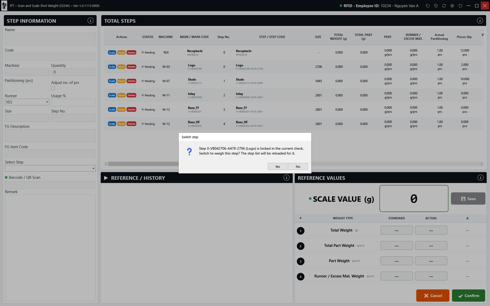

*"Step … is locked in the current check. Switch to weigh this step? The step list will be reloaded for it."* Bấm **Yes** để tiếp tục. Nếu có step đã cân nhưng chưa Confirm, thông báo ghi rõ số step sẽ bị bỏ – **hãy Confirm trước nếu muốn giữ**.

---

## 7. Màu dung sai

Sau mỗi lần cân, giá trị **Actual** được so với **STANDARD** (trung bình 15 lần cân gần nhất). Δ = Actual − Standard, **tính bằng gram**:

| Màu | Điều kiện (mặc định) | Việc cần làm |
|-----|----------------------|--------------|
| 🟩 **Xanh lá** | −1 g ≤ Δ ≤ +1 g | Đạt – tiếp tục. |
| 🟧 **Cam** | từ 1 g đến 3 g (cả hai phía) | Cảnh báo – kiểm tra lại chi tiết, báo kỹ thuật nếu lặp lại. |
| 🟥 **Đỏ** | lệch hơn 3 g (cả hai phía) | Vượt dung sai – dừng lại, gọi kỹ thuật khuôn / tổ trưởng. |

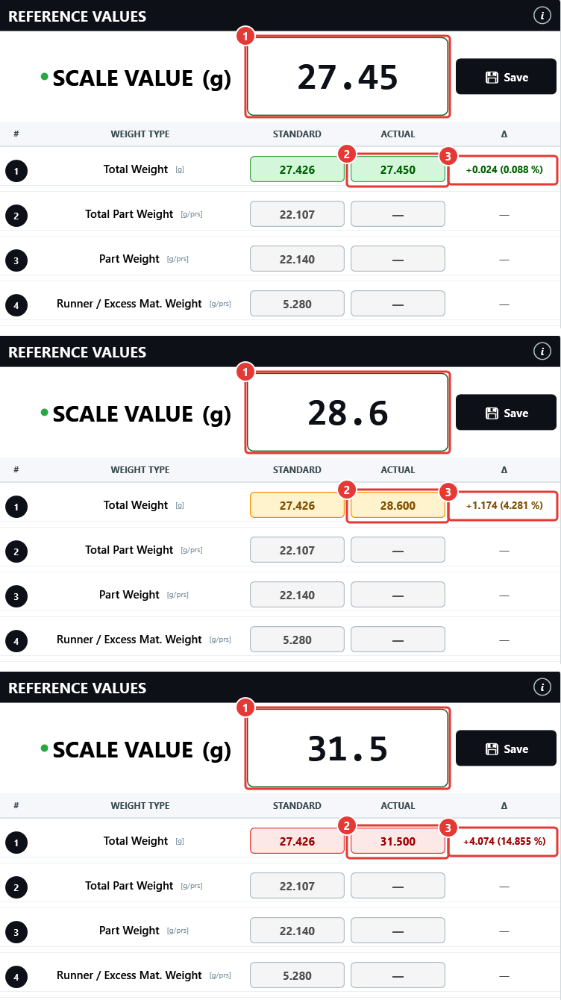

Từ trên xuống: 27.45 g (Δ +0.024 – xanh) · 28.60 g (Δ +1.174 – cam) · 31.50 g (Δ +4.074 – đỏ).

1. Khung số cân.
2. Ô **ACTUAL** – được tô màu.
3. **Δ** – chênh lệch theo gram và %.

Ngưỡng (1 g / 3 g) là cài đặt (`DeltaLevel1`, `DeltaLevel2`) và có thể khác trên chuyền của bạn. Màu **không** chặn việc lưu – chỉ để bạn tham khảo.

---

## 8. Các nút trên dòng: Scale / Reset / Delete

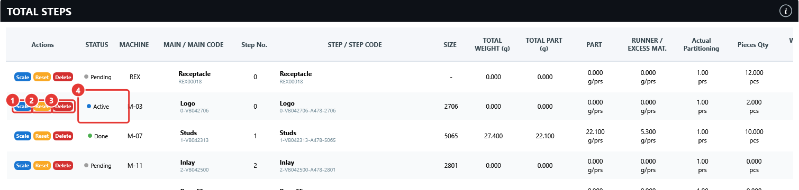

1. **Scale** – chọn dòng này làm step đang cân (và mở tham chiếu/lịch sử).
2. **Reset** – đưa trọng lượng của dòng về 0 để cân lại. Với khuôn nhiều size, Reset **tất cả size** của khuôn đó.
3. **Delete** – bỏ dòng khỏi danh sách hiện tại (sẽ không được lưu).
4. Dòng đang chọn – trạng thái **Active**.

Để **cân lại một step đã Done**: bấm **Reset** trên dòng, rồi **Scale**, rồi cân lại.

Nút bị mờ khi step không được phép cân ở lượt kiểm tra hiện tại (xem *step bị khóa*).

---

## 9. Remark, Confirm và Cancel

Khi mọi step đều **Done** (xanh lá) bạn có thể ghi chú và xác nhận.

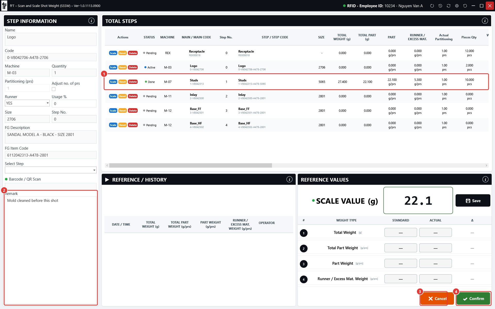

1. Một step đã cân (**Done**). Trong ví dụ này chỉ cân Studs; lệnh thực tế thường cân hết các dòng. Chỉ các dòng Done (Part Weight > 0) mới được lưu.
2. **Remark** – ghi chú tùy chọn, lưu cùng step đang được chọn/Active (ở đây là step kế tiếp, Logo), vd. "Đã vệ sinh khuôn trước shot này".
3. **Cancel** – hủy phiên cân **và xóa đăng nhập RFID**.
4. **Confirm** – lưu.

Khi bấm **Confirm**, màn hình hiện *"Saving data…"* – hãy chờ, không đóng ứng dụng:

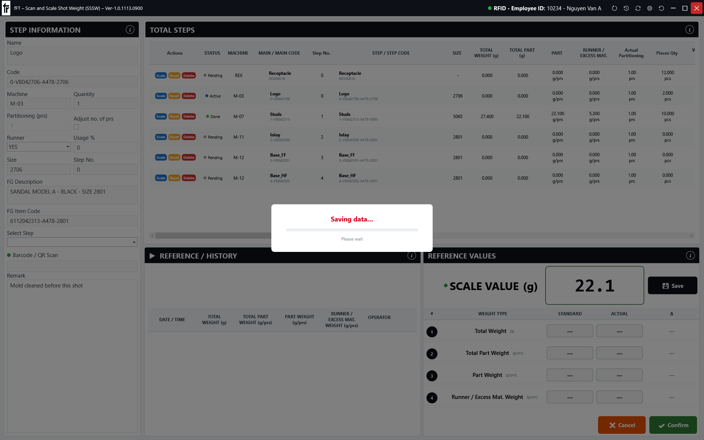

Thông báo thành công:

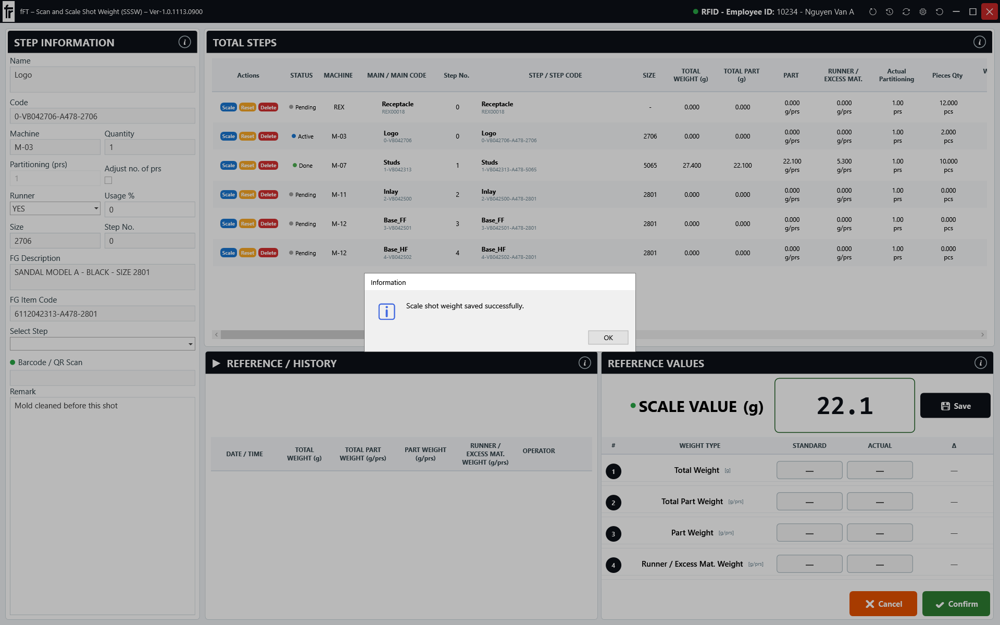

*"Scale shot weight saved successfully."* – bấm **OK**; màn hình sẵn sàng cho lệnh tiếp theo.

Dữ liệu được lưu: mọi step có Part Weight > 0 (kể cả step nạp từ lần cân trước). Bản ghi gồm mã/tên nhân viên, ngày giờ và tên máy. Nếu là **step cuối của thành phẩm (FG)**, trọng lượng trung bình còn được tự động đẩy sang báo cáo FG.

---

## 10. Các thông báo có thể gặp

| Thông báo | Ý nghĩa | Cách xử lý |
|-----------|---------|------------|
| *RFID card not yet scanned.* | Bấm Confirm khi chưa đăng nhập. | Quẹt thẻ (hoặc bấm khu vực nhân viên và gõ mã). |
| *The previous step has not been weighed.* | Step trước bị trừ nhưng chưa có trọng lượng. | Cân step trước. |
| *Component / previous step(s) of this step (BOM level 2) have no weight yet and must be weighed first: …* | Chi tiết bên trong step chưa cân (có liệt kê). | Cân các chi tiết được liệt kê rồi cân lại step. Chưa lưu gì. |
| *N previous step(s) are missing Part Weight and must be weighed first: …* | Quy tắc nhiều size / non-woven – các step nhỏ hơn phải xong. | Cân các step được liệt kê. |
| *Cannot scale this step.* / *Do not allow to scale this step.* | Step bị khóa ở lượt kiểm tra hiện tại. | Bấm **Scale** trên dòng – cửa sổ cân mở ra (hoặc trả lời **Yes** câu hỏi chuyển step, xem 6.10). |
| *Scale not completed for step: …* | Hàng REX chưa có trọng lượng khi Confirm. | Cân hàng REX. |
| *Label does not match the item being weighed.* | Tem vừa quét thuộc hàng khác. | Quét đúng tem. |
| *Cannot reset this line.* | Dòng đang bị khóa. | Chuyển step trước. |
| *Transaction error …* | Lỗi cơ sở dữ liệu khi lưu. Chưa lưu gì. | Kiểm tra mạng, bấm Confirm lại; nếu lặp lại báo IT. |

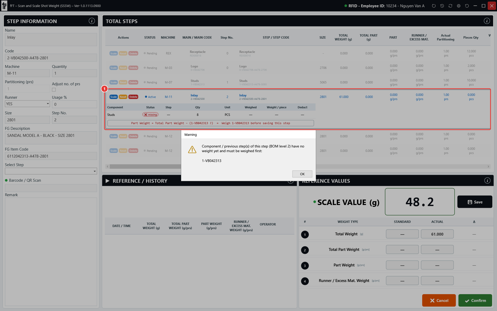

Ví dụ: cảnh báo thiếu chi tiết khi lưu *Inlay* (bảng chi tiết hiện *✖ missing*).

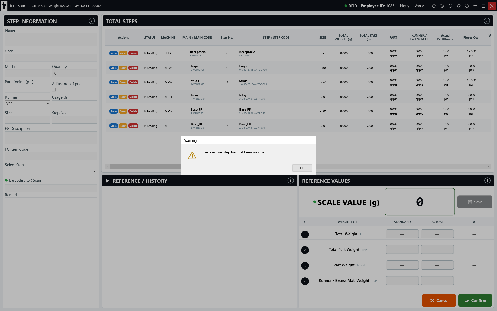

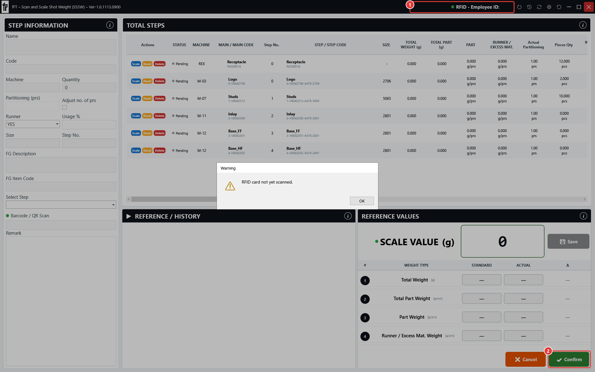

---

## 11. Xử lý sự cố

| Sự cố | Nguyên nhân có thể | Cách khắc phục |
|-------|--------------------|----------------|
| Đèn Scale **đỏ**, SCALE VALUE luôn bằng 0 | Cân tắt, dây mạng, sai IP | Kiểm tra nguồn và dây mạng; bấm **Reload**; báo IT. |
| SCALE VALUE âm hoặc nhảy | Cân chưa về 0 / bàn rung | Bỏ hết hàng ra, bấm Zero/Tare trên cân, chờ ổn định. |
| Nút **Save** bị mờ | Số cân chưa ổn định | Chờ số ổn định. |
| Đèn Barcode đỏ, không đọc được QR | Máy quét mất kết nối | Cắm lại máy quét hoặc chọn step ở **Select Step**. |
| Đèn RFID đỏ | Đầu đọc thẻ mất kết nối | Cắm lại; tạm thời bấm khu vực nhân viên để gõ mã. |
| Danh sách step trống | Không có lệnh cho QR này / chưa đồng bộ Hydra | Bấm biểu tượng **Hydra**, rồi **Reload**. |
| PART thấp hơn chuẩn nhiều | Một chi tiết bên trong cân sai | Xem bảng chi tiết (Trường hợp D/E), **Reset** chi tiết sai và cân lại. |
| Δ đỏ ở mọi hàng | Cân lệch chuẩn hoặc đặt nhầm hàng | Kiểm tra bằng quả cân chuẩn; báo kỹ thuật. |
| Ứng dụng chậm sau nhiều giờ | Mở quá nhiều phiên | **Cancel**, khởi động lại ứng dụng. |

---

## 12. Thẻ tóm tắt nhanh

```
1  Quẹt thẻ RFID (hoặc bấm khu vực nhân viên → gõ mã)
2  Quét tem QR  (hoặc chọn ở Select Step)
3  Với từng step, theo thứ tự:
     • Scale trên dòng              → step thành Active
     • Step ép:  cả shot → Save   |   chỉ chi tiết → Save
     • REX / đinh:  tất cả chiếc của 1 đôi → Save
     • Non-woven/Mesh:  cân → Save → gõ Usage % → Enter
4  Xem màu  (xanh đạt · cam cảnh báo · đỏ DỪNG)
5  Mọi dòng Done?  → Remark (tùy chọn) → Confirm → OK
   Sai?  → Reset trên dòng, cân lại       Cancel = làm lại từ đầu (và đăng xuất)
```
