# REX / RPU tiêu hao theo gram của step PU — tài liệu review test

> Dành cho người review trước khi merge. Ảnh chụp từ **màn hình thật + ViewModel thật** với **dữ liệu giả lập** (không kết nối được DB nhà máy). Harness: `manual/screenshot-harness/` (cảnh `raw`). Số liệu BOM lấy theo ảnh SSMS của step `4-FC992601-SG11-F05L`.

## 1. Vấn đề & nguyên nhân

| # | Nguyên nhân | Sửa |
|---|---|---|
| 1 | `IsSelfRow` coi **mọi** dòng đơn vị `G` là self → `REX00172` (5.715 g), `RPU00001` (118.59 g) biến mất khỏi Row Details, Pieces Qty = 0, không bị trừ | Dòng `REX…`/`RPU…` đơn vị `G` **không** là self (`-0000` và trùng step vẫn là self) |
| 2 | `AddLevel2OnlyRexRows` và ~30 chỗ `StartsWith("REX")` bỏ sót RPU | `IsNonInjectionCode` (REX hoặc RPU); RPU lên lưới như REX |
| 3 | Mã REX/RPU không có `-` → `PrefixUpToSecondHyphen` rỗng → hai dòng bị coi là "cùng khuôn nhiều size" và **ghi đè lẫn nhau** (phát hiện khi chụp test, xem ảnh 17e) | Loại dòng `G` khỏi nhánh multi-size |
| 4 | Thêm category 34/101 vào `CategoryOfNonInjectionUsagePartial` sẽ làm `HasNonwovenRex` chuyển step PU sang công thức cũ | `HasNonwovenRex` bỏ qua dòng `G` → **công thức các step không đổi** |

**Quy tắc giá trị:** có lịch sử → nạp lịch sử; không có → giá trị BOM Level 2 và `%` = 100; cân mới → trừ theo giá trị cân mới; đổi `%` → theo `%` mới; không cân → trừ theo BOM. Category chưa cấu hình → cảnh báo báo admin (OMS).

## 2. Dữ liệu giả lập

FG `6813992601-SG10-F05L`, hai step: `2-FC992601-SG11-F05L` **Outsole** (step 1) và `4-FC992601-SG11-F05L` **PU_Midsole** (step 2, hàng PU). Level 2 của PU_Midsole:

| Mã | Qty | Unit | Category |
|---|---|---|---|
| `4-FC992601-SG11-0000` | 1 | G | self |
| `2-FC992601` (Outsole) | 1 | PCS | step trước (chain) |
| `REX00172` TPU film | 5.715 | G | 34 |
| `RPU00001` FIXEKO 2020 HP | 118.59 | G | 101 |

Cấu hình test: `CategoryOfNonInjectionUsagePartial` = 20, 21 (non-woven, mesh) **và 34, 101**.

> Ghi chú harness: Outsole được dựng là step ép thường (không phải hàng PU) vì step PU không phải step cuối sẽ tải lại danh sách từ DB để lấy chân R đối xứng, mà harness không có DB. Công thức Level 2 không phụ thuộc điều này.

## 3. Các bước test

### Test 1 — REX/RPU lên lưới Total Steps
Cả hai dòng xuất hiện (Step No. 0), Pieces Qty = 5.715 / 118.590. Trước đây RPU không có dòng, REX có Pieces Qty 0.

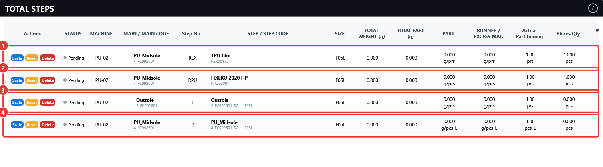

### Test 2 — Chưa cân REX/RPU: trừ theo giá trị BOM (không có lịch sử)
Cân Outsole (125.00 / 116.50), rồi PU_Midsole (300.00 / 270.00). Row Details liệt kê TPU film 5.71 g, FIXEKO 118.59 g và Outsole 116.50 g. Công thức: `Part = Total Part − 240.81`.

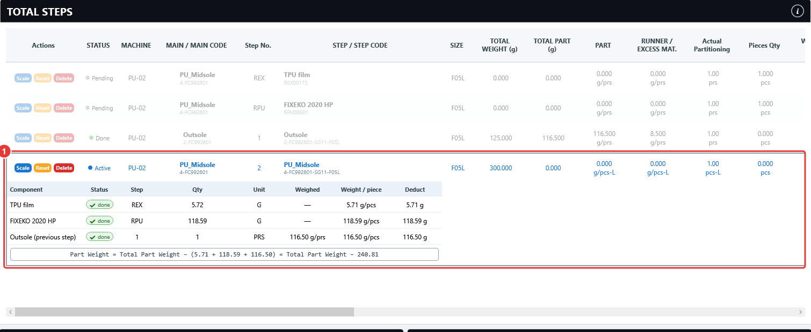

Sau Save: Part = 270.00 − 240.805 = **29.195** g/pcs-L.

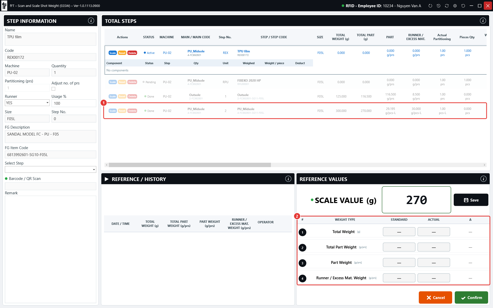

### Test 3 — Cân mới REX00172 / RPU00001
Usage % mặc định **100**; cân REX 6.20 g, RPU 120.00 g.

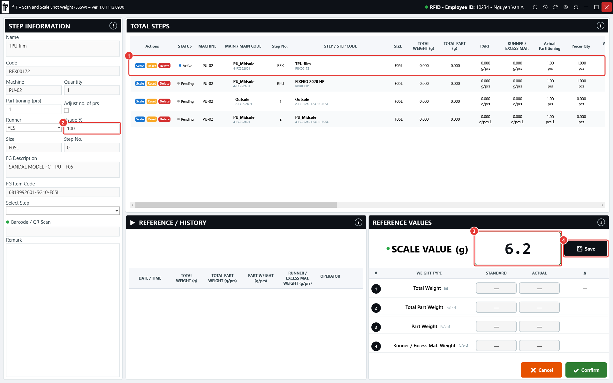

PU_Midsole trừ theo giá trị cân mới: `Part = Total Part − (6.20 + 120.00 + 116.50) = Total Part − 242.70`. Hai dòng REX/RPU giữ Total Weight riêng (6.200 / 120.000), runner 0 (sau khi sửa lỗi ghi đè, nguyên nhân #3).

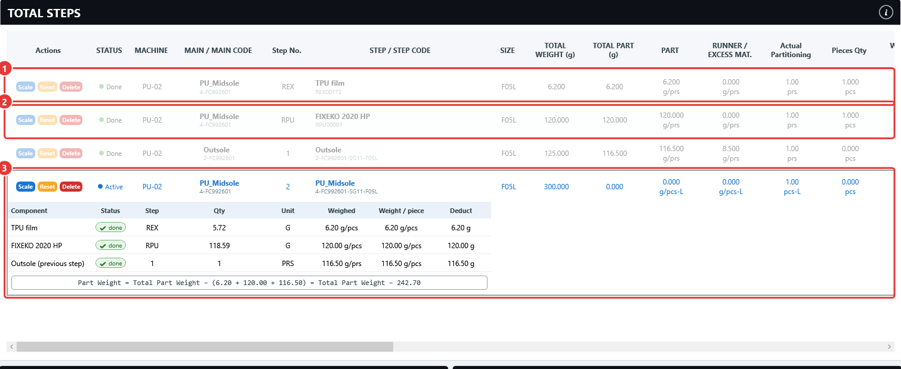

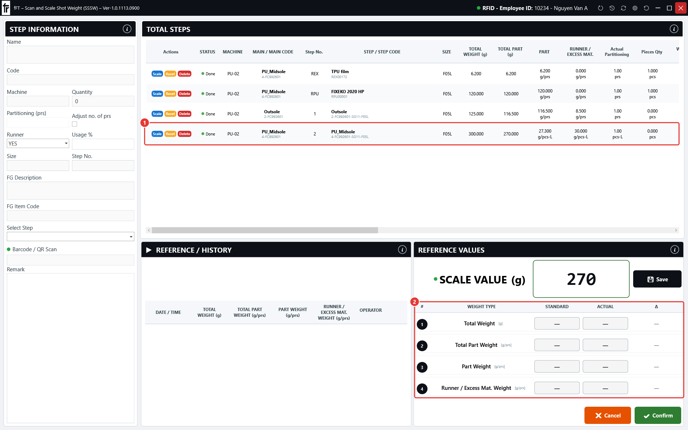

### Test 4 — Đổi % sử dụng
RPU cân 120 g, đổi Usage % = 50 → Total Part / Part = 60.000. Chỉ dòng đang chọn thay đổi.

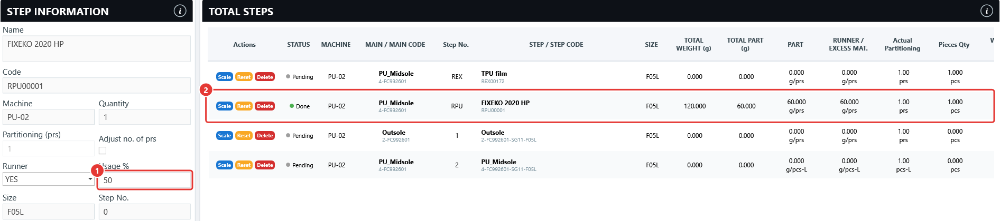

### Test 5 — Có lịch sử cân
Lịch sử `REX00172` = 6.10 g, `RPU00001` = 121.40 g được nạp lên lưới (Done). PU_Midsole trừ `6.10 + 121.40 + 116.50 = 244.00` mà không cần cân lại.

### Test 6 — Category chưa cấu hình (thiếu 101 trên OMS)
Cảnh báo yêu cầu báo admin thêm category vào `CategoryOfNonInjectionUsagePartial`. `RPU00001` không lên lưới nhưng vẫn bị trừ theo BOM.

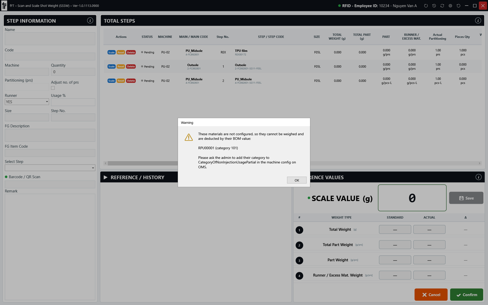

## 4. Unit test tự động (`tests/SSSW.Tests`): 22/22 pass

- `IsSelfRow_RexAndRpuWithUnitG_AreNotSelf_ButStepRowStillIs`
- `GramMaterials_NotWeighed_DeductBomQuantity` (30 + 5.715 + 118.59)
- `GramMaterials_Weighed_DeductWeighedUsage` (30 + 6.0 + 120.5)
- `GramMaterials_AreAggregatedIntoPieces`
- `NonGramComponents_StillNeedWeighing` (REX00018 đơn vị PCS vẫn bắt buộc cân, hành vi cũ giữ nguyên)
- 17 test cũ (Studs, Inlay, Base_FF, chain, aggregator…) vẫn pass.

## 5. Lưu ý / điểm cần review

- Ảnh là **mô phỏng**; chưa chạy với DB nhà máy. Chưa có test giao diện cho non-woven thật (REX00118, đơn vị `Y`): logic đó không bị sửa, chỉ thêm điều kiện loại dòng `G`.
- Cột Pieces Qty của dòng gram vẫn hiển thị đơn vị `pcs` ở lưới (chưa đổi nhãn sang `g`). Row Details đã hiện đơn vị `G`.
- Dòng `G` có category chưa cấu hình không lên lưới (không cân được), chỉ trừ BOM kèm cảnh báo.
- Step PU đã cân trước đây không có dòng RPU nên `C021` có thể đổi khi mở lại (đã xác nhận).
- Entity `FT600` vẫn `FT600_dev` (nhánh test), cần đổi lại trước release.

## 6. Ba lỗi phát hiện khi test trên app thật (2026-11-16) và cách sửa

| # | Hiện tượng | Nguyên nhân | Sửa |
|---|---|---|---|
| 1 | Cột **Step No.** của dòng REX (non-woven, receptacle, TPU film, keo) hiện `0` | Dòng chỉ có ở Level 2 có `C015 = 0` | Thêm `FT600.StepNoText`: dòng REX/RPU hiện **`REX` / `RPU`** (cột vẫn sắp xếp theo `C015`) |
| 2 | 1 khuôn nhiều size + non-woven dùng chung: cân size thứ 2 **không trừ** non-woven (Part 30.000, đúng ra 29.587) | `ApplyLegacyPartWeight` chỉ nhận REX có trong BOM Level 2 của **chính size đó**; BOM size 4.5 không liệt kê REX | Gộp mã Level 2 của **mọi size cùng khuôn** (cùng máy, khuôn, step, prefix) khi tìm REX non-woven cần trừ |
| 3 | Cân lại REX/RPU sau khi PU đã cân: **Runner** nhảy sang giá trị lớn (vd 262.1, 374.955) dù không có runner | Bước tính lại dây chuyền (`CascadeLevel2`) gán `C022 = C024 − C021`, tức Runner gồm cả trọng lượng các chi tiết đã trừ | Cascade chỉ tính lại **Part Weight (C021)** và g/chiếc; Runner giữ nguyên (không phụ thuộc chi tiết con) |

Lỗi 3 áp dụng cho mọi step có chi tiết con (không riêng PU); trước đây cũng sai ở Studs/Inlay/Base khi cân lại chi tiết con.

### Test 7 — Step No. = REX / RPU
Xem cột Step No. của hai dòng đầu (cùng ảnh Test 1).

### Test 8 — 1 khuôn 2 size + non-woven dùng chung
REX00118 cân 0.75 g, usage 55.04% → 0.413 g. Size 15 và size 4.5 cùng bị trừ: Part **59.587** và **29.587** (trước khi sửa size 4.5 ra 30.000), Runner 5.000.

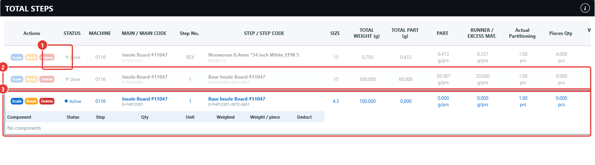

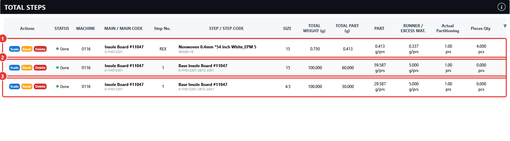

### Test 9 — PU: cân lại REX/RPU sau khi PU đã cân
PU cân 300 / 270 (Part 27.300, Runner 30.000). Cân lại REX 5.00 g và RPU 110.00 g: Part cập nhật **38.500**, Runner **giữ 30.000**.

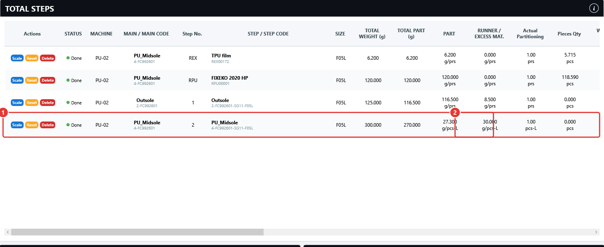

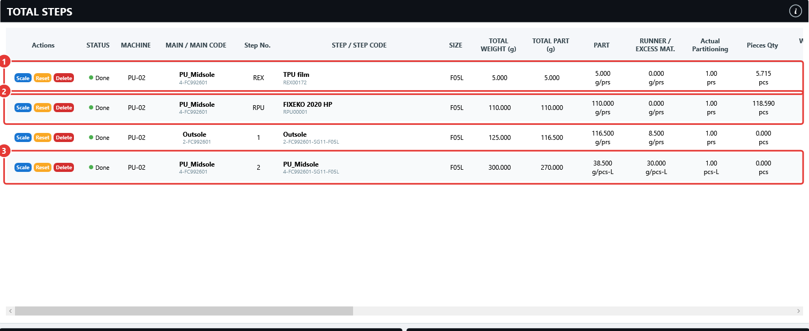

> Nếu ở app thật Part vẫn âm sau khi sửa (vd. −74.955 ở ảnh test), hãy gửi dòng công thức `Part Weight = Total Part Weight − (...)` ở Row Details của step PU để đối chiếu từng thành phần bị trừ. Trong giả lập, Part tính đúng theo công thức Level 2 (vd. 300 − 262.10 = 37.90 với Logo 0.50, Outsole 116.73, TPU 5.00, FIXEKO 110.00, Central_Shank 29.87).

## 7. Hoàn thiện hiển thị REX/RPU (test thật lần 2)

| # | Yêu cầu | Sửa |
|---|---|---|
| 1 | Row Details của hàng PU: cột Step ghi **RPU** cho dòng RPU (đang ghi REX) | Nhãn lấy 3 chữ đầu của mã (`REX` / `RPU`) |
| 2 | Lưới Total Steps, dòng REX/RPU: **Pieces Qty = 1 pcs** | `C039 = 1` cho dòng REX/RPU (g); khối lượng nằm ở Weight per Unit |
| 3 | **Weight per Unit** (`C036`) khi chưa có lịch sử = khối lượng BOM Level 2; có lịch sử / đã cân thì dùng giá trị đó | `CreateLevel2RexRow` đặt `C036 = Quantity` (g) của BOM; cân hoặc nạp lịch sử sẽ ghi đè |
| 4 | (kèm theo) REX/RPU chưa cân vẫn **Confirm được** (trừ theo BOM), không bị chặn "Scale not completed" | Bỏ dòng REX/RPU (g) khỏi kiểm tra đó; Row Details hiện "—" ở cột Weighed khi chỉ có giá trị mặc định |

### Test 10 — Pieces Qty = 1, Weight per Unit mặc định theo BOM (chưa có lịch sử)
`REX00172`: Pieces Qty 1.000 pcs, Weight per Unit **5.715**; `RPU00001`: 1.000 pcs, **118.590**.

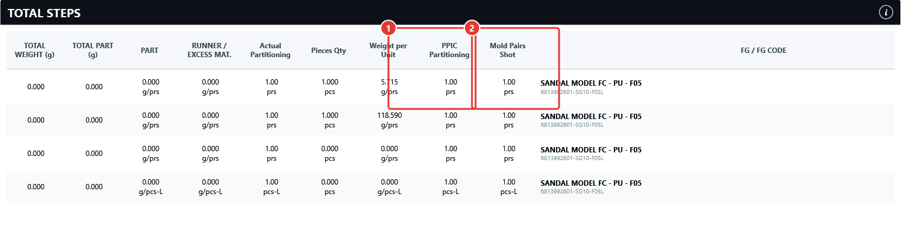

### Test 11 — Row Details ghi REX / RPU
TPU film = `REX`, FIXEKO 2020 HP = `RPU`; cột Weighed hiện "—" (chưa cân, đang dùng giá trị BOM).

