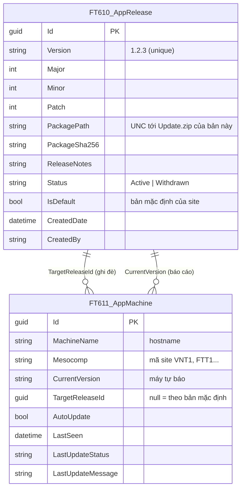
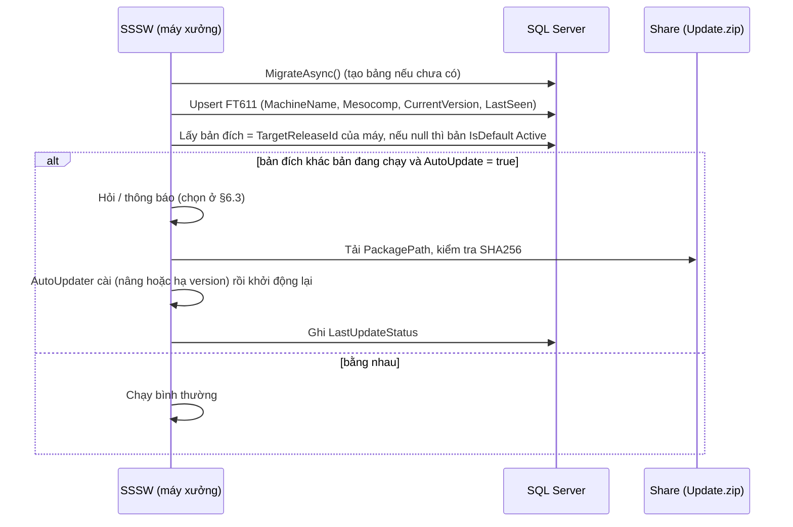

# Đề xuất: Version x.y.z + cập nhật qua DB + quản lý theo từng máy

- **Ngày**: 2026-11-04 · **Nhánh**: `feature/use-bom-level-2`
- **Trạng thái**: ⏳ **Chờ bạn duyệt** — đề xuất thiết kế, **chưa code** (chạm vào luồng tự cập nhật của máy xưởng và pipeline build Release nên cần chốt trước)

## 1. Yêu cầu

1. Version dạng `x.x.x`, bắt đầu từ **1.2.0**, tự tăng.
2. Quản lý version **theo từng máy** (hostname + `mesocomp`) trong **bảng DB**.
3. Khi **Release / publish** thì ghi bản phát hành vào DB; các máy đang chạy tự kết nối DB và **tự cập nhật**.
4. Có thể **revert về bản cũ** (toàn site hoặc riêng một máy).
5. Có **migration**: bảng chưa có thì tự tạo khi chạy.

## 2. Hiện trạng

| Phần | Hiện tại |
|------|----------|
| Version | `1.0.MMdd.HHmm` tự sinh theo giờ build (`SSSW.csproj`: `VersionPrefix` + `VersionSuffix`) |
| Phát hành | Build Release → `GenerateUpdateXml` ghi `update.xml`, `CreateUpdateZip` ghi `Update.zip`, `CopyUpdateToShare` chép cả hai lên `DeployDir` (`DeployConfig.props`). Mỗi lần ghi đè bản cũ → **không giữ lịch sử, không revert được** |
| Cập nhật trên máy | Chỉ khi người dùng bấm nút CheckUpdate: `AutoUpdater.Start(ConfigSystem.UpdatePath)` (đường dẫn `update.xml` lấy từ `FT608_Config` theo máy); hỏi "Update now?" |
| Quản lý theo máy | Không có; không biết máy nào đang chạy bản nào |

## 3. Thiết kế đề xuất

### 3.1 Version `x.y.z`

- Nguồn sự thật: bảng release trong DB. **Bản đầu tiên = 1.2.0**; mỗi lần Release sau đó **patch + 1** (1.2.1, 1.2.2…). Tăng minor/major thủ công bằng tham số khi build (`-p:BumpPart=minor|major`).
- `AssemblyVersion` / `FileVersion` / `Version` = `x.y.z` (bỏ hậu tố giờ). Build Debug dùng `x.y.z-dev` (không ghi DB).
- Cách lấy số tiếp theo trước khi biên dịch — **cần bạn chọn** (§6.1):
  - **A (khuyến nghị)**: thêm project console nhỏ `SSSW.ReleaseTool` (không WPF) với lệnh `next-version`, `publish`, `rollback`. Target MSBuild trước Build đọc `next-version` từ DB để gán `$(Version)`; sau khi đóng gói gọi `publish`.
  - B: file `Version.props` tự tăng bằng script trước build, DB chỉ ghi nhận sau — đơn giản hơn nhưng dễ lệch giữa file và DB.

### 3.2 Bảng DB

- Khóa duy nhất `FT611_AppMachine (MachineName, Mesocomp)`. Mỗi site có DB riêng (chuỗi kết nối khác nhau) nên bảng nằm trong DB của site; `Mesocomp` vẫn lưu để quản lý/đối chiếu.
- Bản phát hành cũ **không bị xóa** (gói zip giữ theo thư mục từng version) để revert.

### 3.3 Migration (bảng chưa có thì tự tạo)

- Tạo `AppVersionDbContext` **riêng** chỉ chứa 2 bảng trên, có **EF Core migration** thật và bảng lịch sử riêng `__SSSWMigrations`. Khi khởi động: `Database.MigrateAsync()` — chưa có bảng thì tạo, có rồi thì bỏ qua.
- Lý do không dùng migration của `DbContextDogeWH`: DB MES đã có sẵn nhiều bảng và **không có `__EFMigrationsHistory`**, `Migrate()` sẽ cố tạo lại mọi bảng và lỗi. Context riêng chỉ đụng 2 bảng mới nên an toàn.
- Quyền SQL: tài khoản của ứng dụng cần quyền `CREATE TABLE` trong lần chạy đầu; nếu không có sẽ ghi log và **tiếp tục chạy bình thường** (không chặn ứng dụng).

### 3.4 Luồng trên máy xưởng

- Kiểm tra khi khởi động và theo chu kỳ (mặc định 15 phút, cấu hình được); **không cập nhật giữa lúc đang cân** (đang có step chưa Confirm) — chỉ nhắc, cài khi người dùng đồng ý hoặc ở lần khởi động tiếp.
- Dùng lại `AutoUpdater.NET`: cấp thông tin bản đích qua `ParseUpdateInfoEvent` (DownloadURL = `PackagePath`) thay cho `update.xml`; với **revert** (bản thấp hơn) đặt `InstalledVersion` thấp hơn để thư viện chấp nhận cài.

### 3.5 Phát hành / Revert

- **Release** (`dotnet build -c Release`): `next-version` → build → đóng gói `Update.zip` → chép lên `<DeployDir>\releases\<version>\Update.zip` → tính SHA256 → `publish` ghi `FT610` (`Status=Active`, đặt `IsDefault` nếu bạn bật tự đặt mặc định). Lỗi DB hoặc share thì **build Release lỗi** (như hiện nay với share).
- **Revert toàn site**: `ReleaseTool rollback --to 1.2.1` đặt `IsDefault` về bản đó (bản mới hơn có thể đánh `Withdrawn`).
- **Revert / ghim riêng một máy**: đặt `FT611.TargetReleaseId` của máy đó (SQL hoặc `ReleaseTool machine --name HOST --to 1.2.1`).
- Có thể làm thêm màn hình quản trị trong ứng dụng (xem §6.4).

### 3.6 Các phần cần sửa trong code (khi được duyệt)

| Phần | Việc |
|------|------|
| `SSSW.csproj` | Bỏ version theo giờ; thêm target Release gọi `ReleaseTool`; giữ `Update.zip` nhưng chép theo thư mục version |
| `SSSW.ReleaseTool` (mới) | `next-version`, `publish`, `rollback`, `machine` |
| `models/ef/entities` | `FT610_AppRelease`, `FT611_AppMachine`; `AppVersionDbContext` + migration |
| `Program.cs` | Chạy migration lúc khởi động (không chặn khi lỗi) |
| `Services/AppUpdateService` (mới) | Upsert máy, xác định bản đích, gọi AutoUpdater, ghi trạng thái |
| `MainViewModel` | Gọi kiểm tra khi khởi động + định kỳ; nút CheckUpdate dùng dịch vụ mới; hiển thị version `x.y.z` trên tiêu đề |
| Test | Phân tích/so sánh version, chọn bản đích (máy ghi đè, mặc định, revert), tăng patch/minor/major |
| Docs | ARCHITECTURE, DATABASE_SCHEMA, CLAUDE.md (mục Release build), hướng dẫn phát hành / revert |

### 3.7 Rủi ro cần lưu ý

- **Hạ version**: bản cũ có thể không tương thích schema DB hiện tại (vd. cột `C039`). Cần quy ước chỉ thêm cột, không đổi nghĩa/xóa cột.
- Tài khoản ghi DB khi build Release (publish) phải có quyền; không đưa mật khẩu vào repo (dùng `appsettings.json` đã mã hóa như hiện nay).
- Máy không kết nối được DB: dùng bản đang chạy, không chặn thao tác cân.
- Nếu `ReleaseTool` lỗi giữa chừng (zip đã chép nhưng chưa ghi DB) → bản không xuất hiện trong DB nên không máy nào cập nhật; cần chạy lại `publish`.

## 4. Kế hoạch triển khai (sau khi duyệt)

1. Entity + `AppVersionDbContext` + migration; chạy khi khởi động.
2. Logic version (parse, so sánh, tăng) + test.
3. `SSSW.ReleaseTool` + sửa `SSSW.csproj` (next-version / publish).
4. `AppUpdateService` + tích hợp `MainViewModel` (kiểm tra khi mở + định kỳ, cập nhật, revert).
5. Tài liệu hướng dẫn phát hành và revert; cập nhật ARCHITECTURE / DATABASE_SCHEMA / CLAUDE.md.

## 5. Quy ước đặt tên đề xuất

Bảng `FT610_AppRelease`, `FT611_AppMachine` (tiếp nối dãy `FT60x`, giống `FT608_Config`, `FT609_ShotWeightUpToWL`); bảng lịch sử migration `__SSSWMigrations`.

## 6. Câu hỏi cần bạn chốt

1. **Lấy số version tiếp theo**: dùng project `SSSW.ReleaseTool` (A, khuyến nghị) hay file `Version.props` (B)?
2. **Mỗi site có DB riêng** (fVN / fFT) và bảng nằm trong DB của site — đúng không? `mesocomp` là mã công ty/site như `VNT1`, `FTT1` (từ `sp_MaterialGetCompanyName`)?
3. **Cách cập nhật trên máy**: hỏi "Update now?" như hiện tại, hay tự cập nhật im lặng khi không đang cân (kèm thông báo)? Máy có `AutoUpdate = false` thì chỉ báo.
4. Có cần **màn hình quản trị trong ứng dụng** (xem danh sách máy, chọn version cho từng máy, revert) hay chỉ SQL + `ReleaseTool` là đủ?
5. Release đầu tiên ghi vào DB là **1.2.0**; các lần sau patch + 1 tự động — đúng ý bạn? Khi nào tăng minor/major (thủ công bằng tham số)?
6. Giữ `update.xml` lên share song song (cho máy bản cũ chưa có cơ chế DB) trong giai đoạn chuyển tiếp không?
7. Tài khoản SQL của ứng dụng có quyền `CREATE TABLE` trong DB không (để migration tự tạo bảng)?
