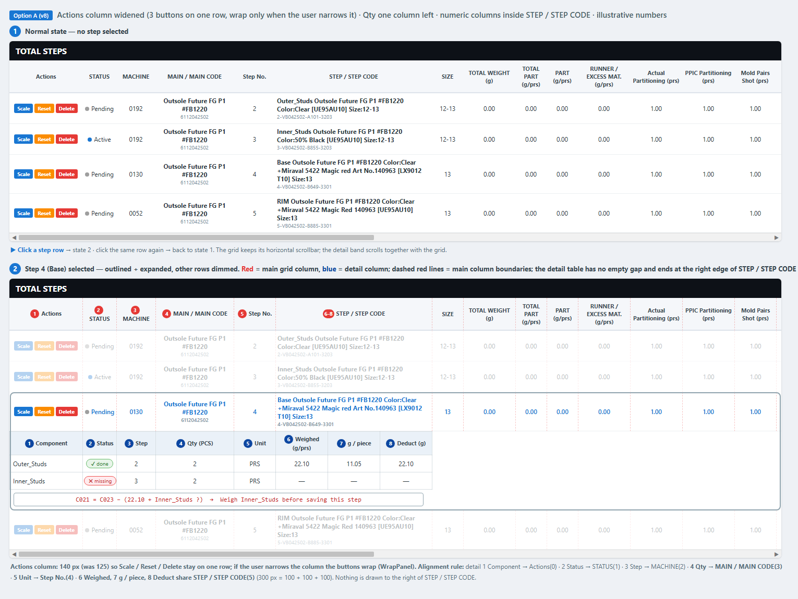
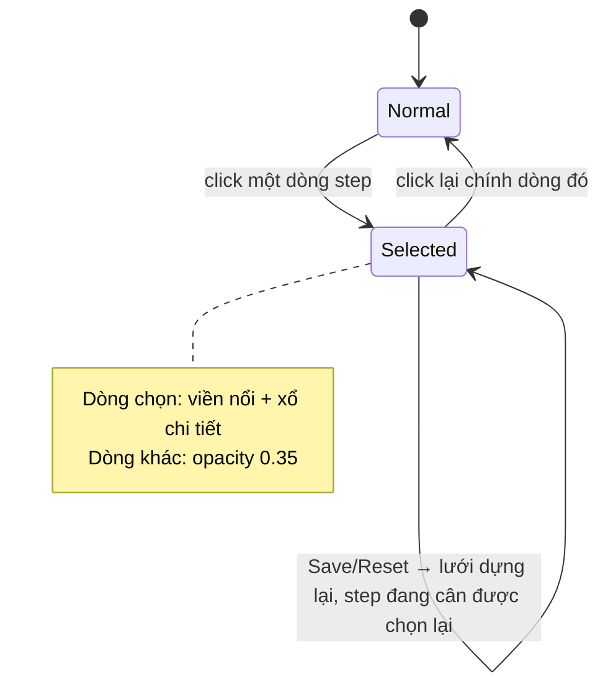
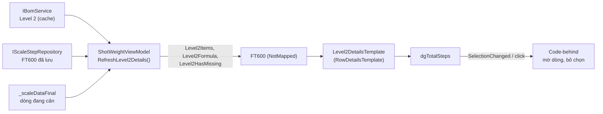

# Thiết kế UI: BOM Level 2 Row Details trong TOTAL STEPS

- **Ngày**: 2026-11-04 · **Nhánh**: `feature/use-bom-level-2`
- **Trạng thái**: ⏳ **Chờ review** hình v8 (v7 + cột Actions nới 125 → 140px để 3 nút nằm 1 hàng, chỉ tự xuống dòng khi user kéo hẹp cột). Code hiện có trên nhánh còn theo v3 — nếu duyệt v8 thì phải sửa `Level2DetailsTemplate` và cột Actions của `dgTotalSteps`; chưa code thêm gì theo yêu cầu này
- **Liên quan**: [`brainstorm/BOM_LEVEL2_UI_OPTIONS.md`](../brainstorm/BOM_LEVEL2_UI_OPTIONS.md) (các phương án), [`tech/BUSINESS_LOGIC.md`](../tech/BUSINESS_LOGIC.md) §4.8 (công thức `C021`), session [`2026-11-04`](../sessions/2026-11-04_status-column-align-bom-l2-ui-options.md)

## 1. Yêu cầu

1. Chọn phương án A (mở rộng dòng), thiết kế lại: chọn step nào thì **highlight** và **làm mờ** các dòng còn lại; **bỏ** tiêu đề "BOM LEVEL 2…"; click dòng lần nữa thì về bình thường.
2. Bỏ dòng *self* trong bảng chi tiết.
3. Chuyển toàn bộ cột và mô tả sang tiếng Anh.
4. Sắp lại thứ tự cột chi tiết (số xanh) và căn cùng đường dọc với cột lưới chính (số đỏ).
5. Giữ 8 cột như v3, nhưng chỉ cần trùng vị trí với các cột đầu của lưới; các cột sau không cần căn.
6. 3 cột cuối (Weighed, g / piece, Deduct) xếp chung trong bề rộng cột STEP / STEP CODE, để bảng chi tiết kết thúc đúng mép phải cột STEP / STEP CODE.
7. Dời cột Qty sang trái 1 cột (xuống dưới MAIN / MAIN CODE) để không còn khoảng trống; Unit dịch theo xuống dưới Step No.
8. Nới cột Actions để 3 nút Scale / Reset / Delete nằm trên 1 hàng như ban đầu; chỉ khi user kéo hẹp cột thì nút mới tự rớt xuống dòng.
9. **Viền highlight của step được chọn phải hiển thị đầy đủ 4 cạnh (trước đó mất cạnh trái và phải).**
10. **Bảng chi tiết có viền mờ, ăn sát theo đúng số cột chi tiết (8 cột), không kéo dài ra phần lưới phía sau.**

## 2. Hình thiết kế (v8 — theo đúng lưới thật, bảng chi tiết nằm gọn trong 6 cột đầu, Actions đủ rộng cho 3 nút)

- Lưới TOTAL STEPS thật có **nhiều cột** (hơn 20, kéo ngang bằng thanh cuộn): Actions, STATUS, MACHINE, MAIN / MAIN CODE, Step No., STEP / STEP CODE, SIZE, TOTAL WEIGHT, TOTAL PART, PART, RUNNER / EXCESS MAT., Actual Partitioning, PPIC Partitioning, Mold Pairs Shot, Quantity, … Hình v4 vẽ đủ các cột này (đường kẻ ngang cắt ở Quantity giống màn hình thật).
- Đường gióng đỏ nét đứt = ranh giới cột lưới chính. **Cột chi tiết 1–5 (Component, Status, Step, Qty, Unit) nằm đúng dưới Actions, STATUS, MACHINE, MAIN / MAIN CODE, Step No.** Cột 6–8 (Weighed, g / piece, Deduct) chia đều bề rộng 300px của cột STEP / STEP CODE (100 + 100 + 100), nên bảng chi tiết liền mạch, không có khoảng trống, và kết thúc đúng mép phải cột STEP / STEP CODE.
- Dải chi tiết rộng bằng cả lưới và **cuộn ngang cùng lưới**; mọi vùng bên phải cột STEP / STEP CODE (từ SIZE trở đi) để trống.
- **Viền chọn**: khung bo góc, xám xanh `#90A4AE`, đủ 4 cạnh quanh dòng step + bảng chi tiết.
- **Viền bảng chi tiết**: lưới viền mờ (`#90A4AE` ~35% độ đậm) chỉ bao đúng 8 cột chi tiết (từ Actions đến hết STEP / STEP CODE); khung công thức bên dưới cũng rộng bằng bảng.
- Dữ liệu trong hình là minh họa (bố cục lấy từ ảnh chụp lưới thật, FG `6112042502`; Qty/trọng lượng chi tiết do mình đặt ví dụ).

## 3. Ánh xạ cột chi tiết → cột lưới chính

**Chỉ số cột thật của `dgTotalSteps`**: 0 Actions · 1 STATUS · 2 MACHINE · 3 MAIN / MAIN CODE · 4 Step No. · 5 STEP / STEP CODE · 6 SIZE · 7 TOTAL WEIGHT · 8 TOTAL PART · 9 PART · 10 RUNNER / EXCESS MAT. · 11 Actual Partitioning · 12 PPIC Partitioning · 13 Mold Pairs Shot · 14 Quantity · 15 Weight per Unit · 16 Unit · 17 FG / FG CODE · … (còn các cột MACHINE GROUP, MOLD ID, REMARKS, ARTICLE, HYDRA ORDER, CATEGORY, Usage %…).

| # | Cột chi tiết | Vị trí trong lưới chính (index trong `dgTotalSteps`) | Rộng (px) | Nguồn dữ liệu |
|---|--------------|------------------------------------------------------|-----------|---------------|
| 1 | Component | Actions (0) | **140** (nới từ 125) | `ItemStepName` của BOM L2 |
| 2 | Status | STATUS (1) | 65 | đã cân / chưa cân |
| 3 | Step | MACHINE (2) | 75 | `C015` của chi tiết con, `REX` nếu non-injection |
| 4 | Qty (PCS) | MAIN / MAIN CODE (3) | 150 | `Quantity` BOM L2 |
| 5 | Unit | Step No. (4) | 80 | `Unit` BOM L2 |
| 6 | Weighed (g/prs) | STEP / STEP CODE (5) — phần 1/3 | 100 | `C021` đã cân |
| 7 | g / piece | STEP / STEP CODE (5) — phần 2/3 | 100 | `UnitWeightPerPiece` |
| 8 | Deduct (g) | STEP / STEP CODE (5) — phần 3/3 | 100 | `Qty × g/piece` |

**Cột Actions**: nới từ 125 → **140px** để Scale / Reset / Delete nằm trên 1 hàng như ban đầu. Trong ô Actions đổi `StackPanel` ngang thành `WrapPanel` — đủ rộng thì 1 hàng, user kéo hẹp cột thì nút tự rớt dòng (không bị cắt). Cột chi tiết Component (cùng cột 0) rộng thêm 15px nên tên dài ít bị cắt hơn.

Quy tắc căn: cột chi tiết 1–5 thẳng hàng với cột lưới 0–4. Cột chi tiết 6–8 chia đều `Columns[5].ActualWidth` (300px ÷ 3) nên mép phải bảng chi tiết trùng mép phải cột STEP / STEP CODE. Không còn cột chi tiết nào nằm dưới SIZE trở đi, và không còn cột lưới trống ở giữa.

> Lưu ý: lưới thật đã có sẵn các cột **Quantity (14)**, **Weight per Unit (15)**, **Unit (16)** nằm xa bên phải. Phương án này không dùng chúng cho chi tiết con vì chúng thuộc về chính step đang cân; chi tiết con dùng Qty/Unit riêng của BOM Level 2 đặt ở các cột nhìn thấy ngay (Step No., STEP / STEP CODE).

## 4. Tính khả thi

**Khả thi.** Lý do và điểm cần lưu ý (code hiện có là bản v3 — cả 8 cột bám cột lưới; v8 cần đổi: Actions 125 → 140 + `WrapPanel`, Qty → cột 3, Unit → cột 4, và 3 ô số (Weighed, g / piece, Deduct) thành các ô chia đều trong bề rộng cột 5):

| Vấn đề | Giải pháp | Ghi chú |
|--------|-----------|---------|
| 5 cột chi tiết đầu phải thẳng hàng với cột lưới | Mỗi ô là `Border` có `Width` bind `Columns[i].ActualWidth` của `DataGrid` (`RelativeSource AncestorType=DataGrid`) cho cột lưới 0–4 | Kéo đổi độ rộng cột vẫn thẳng hàng. Không dùng `ColumnDefinition` vì `RelativeSource` không hoạt động ở đó |
| 3 cột số cuối nằm trong cột STEP / STEP CODE | Một `Grid` con rộng bằng `Columns[5].ActualWidth` chia 3 phần đều (`*`, `*`, `*`) | Co giãn theo khi kéo đổi độ rộng cột STEP / STEP CODE; không phụ thuộc các cột phía sau |
| Lưới thật có nhiều cột hơn các mockup trước (v1–v3 đã lược bớt) | v4–v7 vẽ đủ bộ cột thật; v7 dùng luôn cột MAIN / MAIN CODE (cho Qty) nên không còn ô trống ở giữa | Nếu đổi thứ tự 6 cột đầu của lưới thì phải sửa chỉ số trong `Level2DetailsTemplate` |
| Lưới có thanh cuộn ngang | Dải chi tiết là một phần của `RowDetailsTemplate` nên cuộn cùng lưới; không dùng `AreRowDetailsFrozen` | Cần kiểm tra khi cuộn ở app thật |
| Cột Component hẹp (140px sau khi nới) | Cắt chữ + tooltip hiện mã chi tiết | Nới cột Actions thêm nếu vẫn chật |
| Viền chọn đủ 4 cạnh | Hình vẽ khung theo bề rộng vùng nhìn thấy của lưới. Trong `DataGridRow`, viền `BorderThickness=2` vẽ cả 4 cạnh nhưng trải theo **bề rộng toàn bộ các cột**, nên cạnh phải chỉ thấy khi cuộn ngang tới cuối | **Cần chốt cách làm** — (1) giữ viền của `DataGridRow` (cạnh phải ở cuối lưới); hoặc (2) vẽ khung phủ theo viewport (phải thêm lớp phủ tính theo vị trí dòng và `ScrollViewer`) để cạnh phải luôn thấy |
| Viền mờ bảng chi tiết | Mỗi ô chi tiết có `BorderBrush` mờ (`#5990A4AE`), `BorderThickness` 1; không vẽ viền cho phần còn lại của dải | Dễ làm trong `Level2DetailsTemplate`; khung công thức đặt `HorizontalAlignment=Left` và rộng bằng tổng 8 cột |
| 3 nút Actions bị rớt dòng ở độ rộng cũ (125px) | Nới cột 0 lên 140px + `WrapPanel` trong ô Actions | Ở 140px nằm 1 hàng; kéo hẹp hơn thì tự xuống dòng, không bị cắt |
| Chip Status trong 65px | Chữ ngắn "✔ done" / "✖ missing" | Có thể nới nhẹ cột STATUS |
| `FT600` không có `INotifyPropertyChanged` | `RefreshStepsGridCore()` dựng lại lưới, kèm dựng lại `Level2Items` | Selection bị reset mỗi lần dựng lại → `FocusGridRowAction` chọn lại step đang cân |
| Mờ dòng / bỏ chọn khi click lại | Code-behind thuần hiển thị (`ShotWeightWindow.xaml.cs`) | Đúng quy ước: code-behind chỉ làm việc không bind được |

## 5. Hành vi tương tác

## 6. Luồng dữ liệu

## 7. File đã thay đổi

| File | Nội dung |
|------|----------|
| [`models/Level2DetailItem.cs`](../../models/Level2DetailItem.cs) | DTO một dòng chi tiết |
| [`models/ef/entities/FT600.partial.cs`](../../models/ef/entities/FT600.partial.cs) | `Level2Items`, `Level2Formula`, `Level2HasMissing` (`[NotMapped]`) |
| [`UI/WPF/ViewModels/ShotWeightViewModel.cs`](../../UI/WPF/ViewModels/ShotWeightViewModel.cs) | `RefreshLevel2Details()` |
| [`UI/WPF/Styles/ShotWeightStyles.xaml`](../../UI/WPF/Styles/ShotWeightStyles.xaml) | `StepRowStyle`, `Level2DetailsTemplate`, `NullToCollapsed` |
| [`UI/WPF/Converters/ScaleConverters.cs`](../../UI/WPF/Converters/ScaleConverters.cs) | `NullToCollapsedConverter` |
| [`UI/WPF/ShotWeightWindow.xaml`](../../UI/WPF/ShotWeightWindow.xaml) | thuộc tính `dgTotalSteps` (RowDetails, RowStyle, sự kiện chuột) |
| [`UI/WPF/ShotWeightWindow.xaml.cs`](../../UI/WPF/ShotWeightWindow.xaml.cs) | mờ dòng, click lại để bỏ chọn |

## 8. Checklist review trên app thật

- [ ] Component / Status / Step / Qty / Unit thẳng hàng với Actions / STATUS / MACHINE / MAIN / MAIN CODE / Step No.; Weighed, g / piece, Deduct nằm gọn trong cột STEP / STEP CODE (đọc rõ, không bị cắt, header "Weighed (g/prs)" xuống dòng chấp nhận được).
- [ ] Cuộn ngang lưới (nhiều cột): phần chi tiết cuộn cùng lưới, không lệch.
- [ ] Chọn step → viền nổi, chi tiết xổ ra, dòng khác mờ; click lại → về bình thường.
- [ ] Nút Scale/Reset/Delete ở dòng mờ vẫn bấm được.
- [ ] Sau Save/Reset, step đang cân được chọn lại và trạng thái chi tiết (✔/✖, công thức) cập nhật.
- [ ] Step không có chi tiết con (Logo, Studs đầu chuỗi) hiện "No components".
- [ ] Màu viền dòng được chọn, tên Component dài, chip "✖ missing" trong cột 65px có chấp nhận được.
- [ ] Cột STATUS (đã căn lại 2026-11-04) thẳng hàng với MACHINE / Step No.
- [ ] Viền chọn đủ 4 cạnh (kể cả khi cuộn ngang) — chọn cách (1) hay (2) ở §4.
- [ ] Viền mờ bảng chi tiết ăn sát 8 cột, không tràn ra phía sau cột STEP / STEP CODE.
- [ ] Cột Actions 140px: 3 nút Scale / Reset / Delete nằm 1 hàng; kéo hẹp cột thì nút tự rớt dòng, không bị cắt; chiều cao dòng step không phình thêm.
