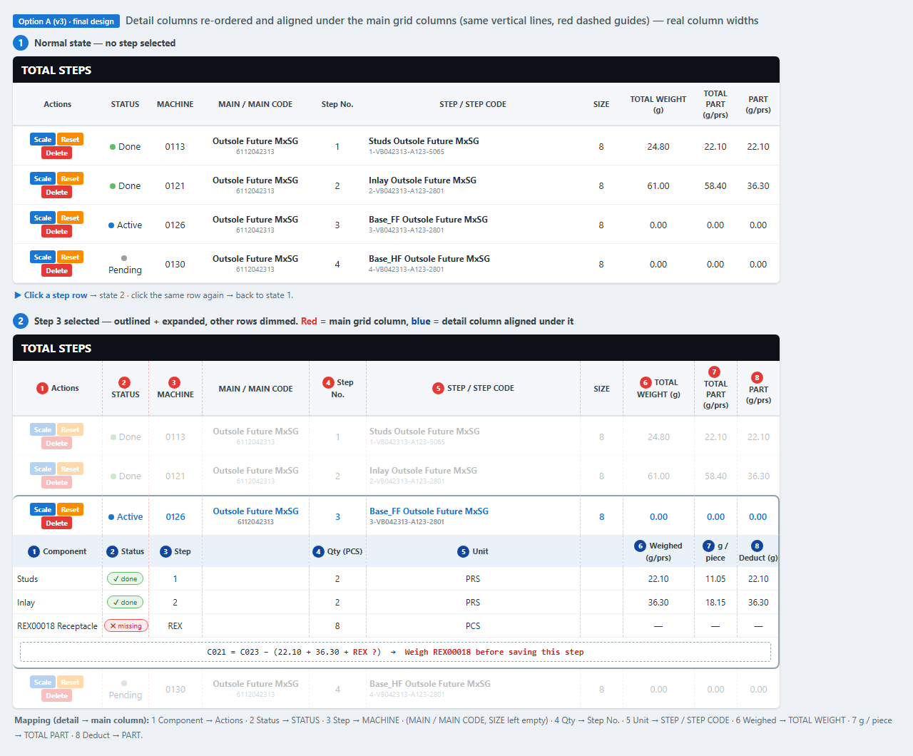
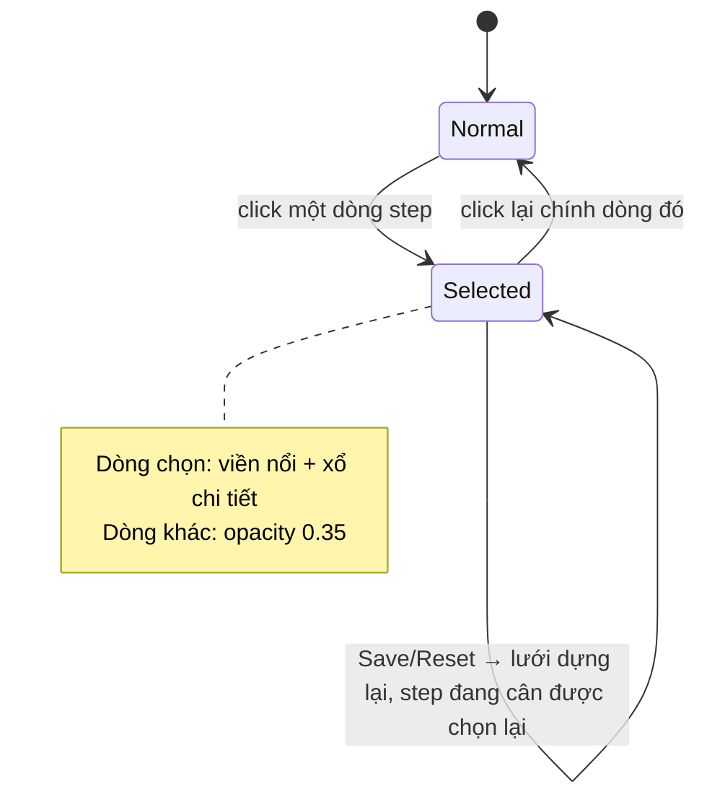
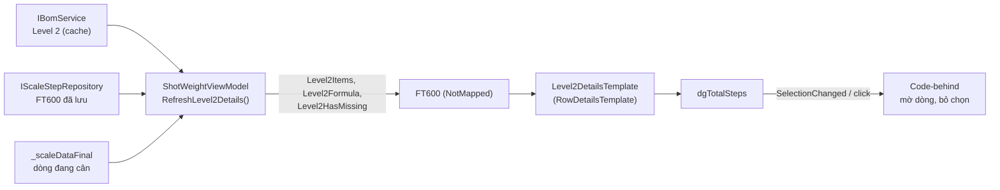

# Thiết kế UI: BOM Level 2 Row Details trong TOTAL STEPS

- **Ngày**: 2026-11-04 · **Nhánh**: `feature/use-bom-level-2`
- **Trạng thái**: ✅ Đã code · ⏳ chờ review trên app thật
- **Liên quan**: [`brainstorm/BOM_LEVEL2_UI_OPTIONS.md`](../brainstorm/BOM_LEVEL2_UI_OPTIONS.md) (các phương án), [`tech/BUSINESS_LOGIC.md`](../tech/BUSINESS_LOGIC.md) §4.8 (công thức `C021`), session [`2026-11-04`](../sessions/2026-11-04_status-column-align-bom-l2-ui-options.md)

## 1. Yêu cầu

1. Chọn phương án A (mở rộng dòng), thiết kế lại: chọn step nào thì **highlight** và **làm mờ** các dòng còn lại; **bỏ** tiêu đề "BOM LEVEL 2…"; click dòng lần nữa thì về bình thường.
2. Bỏ dòng *self* trong bảng chi tiết.
3. Chuyển toàn bộ cột và mô tả sang tiếng Anh.
4. **Sắp lại thứ tự cột chi tiết (số xanh) và căn cùng đường dọc với cột lưới chính (số đỏ).**

## 2. Hình thiết kế

Đường gióng đỏ nét đứt = ranh giới cột lưới chính; cột chi tiết nằm trọn trong các ranh giới đó.

## 3. Ánh xạ cột chi tiết → cột lưới chính

| # | Cột chi tiết | Cột lưới chính (index trong `dgTotalSteps`) | Rộng (px) | Nguồn dữ liệu |
|---|--------------|---------------------------------------------|-----------|---------------|
| 1 | Component | Actions (0) | 125 | `ItemStepName` của BOM L2 |
| 2 | Status | STATUS (1) | 65 | đã cân / chưa cân |
| 3 | Step | MACHINE (2) | 75 | `C015` của chi tiết con, `REX` nếu non-injection |
| — | *(trống)* | MAIN / MAIN CODE (3) | 150 | — |
| 4 | Qty (PCS) | Step No. (4) | 80 | `Quantity` BOM L2 |
| 5 | Unit | STEP / STEP CODE (5) | 300 | `Unit` BOM L2 |
| — | *(trống)* | SIZE (6) | 60 | — |
| 6 | Weighed (g/prs) | TOTAL WEIGHT (7) | 100 | `C021` đã cân |
| 7 | g / piece | TOTAL PART (8) | 60 | `UnitWeightPerPiece` |
| 8 | Deduct (g) | PART (9) | 60 | `Qty × g/piece` |

## 4. Tính khả thi

**Khả thi — đã triển khai.** Lý do và điểm cần lưu ý:

| Vấn đề | Giải pháp | Ghi chú |
|--------|-----------|---------|
| Cột chi tiết phải thẳng hàng với cột lưới | Mỗi ô là `Border` có `Width` bind `Columns[i].ActualWidth` của `DataGrid` (`RelativeSource AncestorType=DataGrid`) | Kéo đổi độ rộng cột vẫn thẳng hàng. Không dùng `ColumnDefinition` vì `RelativeSource` không hoạt động ở đó |
| Lưới thật có thêm cột so với mockup cũ | Vị trí MAIN / MAIN CODE và SIZE để trống | Nếu thêm/bớt/đổi thứ tự cột lưới thì phải sửa chỉ số trong `Level2DetailsTemplate` |
| Cột Component hẹp (125px) | Cắt chữ + tooltip hiện mã chi tiết | Có thể nới cột Actions nếu cần |
| Chip Status trong 65px | Chữ ngắn "✔ done" / "✖ missing" | Có thể nới nhẹ cột STATUS |
| `FT600` không có `INotifyPropertyChanged` | `RefreshStepsGridCore()` dựng lại lưới, kèm dựng lại `Level2Items` | Selection bị reset mỗi lần dựng lại → `FocusGridRowAction` chọn lại step đang cân |
| Mờ dòng / bỏ chọn khi click lại | Code-behind thuần hiển thị (`ShotWeightWindow.xaml.cs`) | Đúng quy ước: code-behind chỉ làm việc không bind được |

## 5. Hành vi tương tác

## 6. Luồng dữ liệu

## 7. File đã thay đổi

| File | Nội dung |
|------|----------|
| [`models/Level2DetailItem.cs`](../../models/Level2DetailItem.cs) | DTO một dòng chi tiết |
| [`models/ef/entities/FT600.partial.cs`](../../models/ef/entities/FT600.partial.cs) | `Level2Items`, `Level2Formula`, `Level2HasMissing` (`[NotMapped]`) |
| [`UI/WPF/ViewModels/ShotWeightViewModel.cs`](../../UI/WPF/ViewModels/ShotWeightViewModel.cs) | `RefreshLevel2Details()` |
| [`UI/WPF/Styles/ShotWeightStyles.xaml`](../../UI/WPF/Styles/ShotWeightStyles.xaml) | `StepRowStyle`, `Level2DetailsTemplate`, `NullToCollapsed` |
| [`UI/WPF/Converters/ScaleConverters.cs`](../../UI/WPF/Converters/ScaleConverters.cs) | `NullToCollapsedConverter` |
| [`UI/WPF/ShotWeightWindow.xaml`](../../UI/WPF/ShotWeightWindow.xaml) | thuộc tính `dgTotalSteps` (RowDetails, RowStyle, sự kiện chuột) |
| [`UI/WPF/ShotWeightWindow.xaml.cs`](../../UI/WPF/ShotWeightWindow.xaml.cs) | mờ dòng, click lại để bỏ chọn |

## 8. Checklist review trên app thật

- [ ] Cột chi tiết (Component → Deduct) thẳng hàng với cột lưới chính, kể cả sau khi kéo đổi độ rộng cột.
- [ ] Cuộn ngang lưới: phần chi tiết cuộn cùng lưới, không lệch.
- [ ] Chọn step → viền nổi, chi tiết xổ ra, dòng khác mờ; click lại → về bình thường.
- [ ] Nút Scale/Reset/Delete ở dòng mờ vẫn bấm được.
- [ ] Sau Save/Reset, step đang cân được chọn lại và trạng thái chi tiết (✔/✖, công thức) cập nhật.
- [ ] Step không có chi tiết con (Logo, Studs đầu chuỗi) hiện "No components".
- [ ] Màu viền dòng được chọn, tên Component dài, chip "✖ missing" trong cột 65px có chấp nhận được.
- [ ] Cột STATUS (đã căn lại 2026-11-04) thẳng hàng với MACHINE / Step No.
