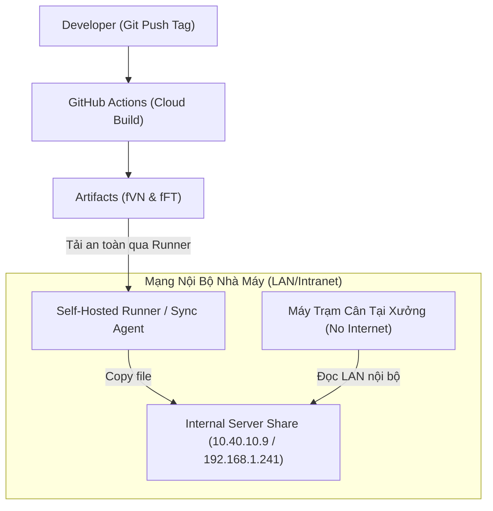

# 📄 Đề Xuất Kỹ Thuật: Triển Khai CI/CD & Auto-Update Qua GitHub Actions Cho Hệ Thống SSSW

> **Dành cho**: Đội ngũ Phát triển Phần mềm & Bộ phận IT / An ninh mạng Nhà máy Framas  
> **Dự án**: SSSW (Scan and Scale Shot Weight) – .NET 8 WPF/WinForms  
> **Ngày soạn**: 2026-10-26  
> **Trạng thái**: Đề xuất tham vấn (Draft for IT Review)

---

## 1. Mục Đích & Bối Cảnh

Hiện tại, phần mềm **SSSW** được sử dụng tại các trạm cân trên chuyền sản xuất ở 2 nhà máy: **fVN (Việt Nam)** và **fFT (Fast Track)**.

### 1.1. Thực trạng cơ chế phát hành hiện tại:
- Lập trình viên chạy lệnh build Release (`dotnet build -c Release`) trực tiếp trên máy tính cá nhân.
- MSBuild tự động nén `Update.zip` và copy đè lên thư mục Windows Share SMB nội bộ:
  - **fFT**: `\\10.40.10.9\Public$\98_Public_Share\99_Shared\05_IT\01_Update\36_SSSW\`
  - **fVN**: `\\192.168.1.241\FramasPublic\PUBLIC_Able to deleted\22 IT\01-UpdateApp\48.SSSW\`
- Ứng dụng client trên máy trạm xưởng dùng thư viện `AutoUpdater.NET` (v1.9.2) định kỳ đọc file `Update.xml` từ đường dẫn mạng nội bộ này để cập nhật.

### 1.2. Hạn chế & Rủi ro bảo mật của cơ chế cũ:
1. **Phụ thuộc kết nối Dev**: Lập trình viên bắt buộc phải có mặt tại nhà máy hoặc bật VPN nội bộ thì mới build Release được. Nếu mất kết nối share, quá trình build bị lỗi.
2. **Nguy cơ nhầm lẫn môi trường (Human Error)**: Lập trình viên có thể quên uncomment đúng cấu hình nhà máy trong `DeployConfig.props`, dẫn đến việc deploy nhầm bản cấu hình fVN sang fFT (hoặc ngược lại).
3. **Thiếu kiểm soát phiên bản & Rollback**: File trên share mạng bị ghi đè liên tục. Nếu một bản release phát sinh lỗi nghiêm trọng, việc quay lại phiên bản trước đó (Rollback) rất khó khăn và mất thời gian.
4. **Không có nhật ký phát hành (Changelog / Audit Trail)**: Không thể truy vết ai đã deploy phiên bản nào vào thời điểm nào.

---

## 2. Mô Hình Đề Xuất Triển Khai Qua GitHub Actions

### 2.1. Quy trình tổng thể:
Khi lập trình viên hoàn thành tính năng/sửa lỗi và gắn nhãn phiên bản (`git tag v1.0.xxxx`):
1. **GitHub Actions** tự động kích hoạt trên Cloud.
2. Tự động kiểm tra chất lượng code và build song song 2 gói độc lập:
   - `SSSW-fVN-Update.zip` & `update-fVN.xml`
   - `SSSW-fFT-Update.zip` & `update-fFT.xml`
3. Tự động tạo một bản phát hành chính thức trên **GitHub Releases** kèm theo Release Notes và lưu vết đầy đủ.

---

## 3. Đánh Giá 2 Phương Án Kết Nối Cập Nhật Cho Máy Trạm

Do máy tính cân shotweight đặt tại **chuyền sản xuất (mạng OT)**, chúng tôi đề xuất 2 phương án để IT nhà máy xem xét và lựa chọn:

### 🌟 PHƯƠNG ÁN 1: Hybrid CI/CD (Khuyến nghị số 1 – Đảm bảo 100% an ninh mạng xưởng)

> **Cơ chế**: GitHub Actions build trên Cloud $\rightarrow$ Tự động đồng bộ file Zip/XML về **Server Share nội bộ** của nhà máy thông qua **GitHub Self-Hosted Runner** (hoặc Webhook/SFTP).



* **Yêu cầu đối với IT**:
  - Cài đặt 1 **GitHub Actions Runner** (phần mềm nhẹ dạng Windows Service) trên 1 máy server thuộc mạng IT có kết nối Internet chiều ra (outbound HTTPS).
  - Server này có quyền ghi vào thư mục share `\\10.40.10.9\...` và `\\192.168.1.241\...`.
* **Đánh giá An ninh & Bảo mật**:
  - **MÁY TRẠM XƯỞNG KHÔNG CẦN RA INTERNET**: Vùng mạng sản xuất (OT) giữ nguyên trạng thái cách ly hoàn toàn, không cần mở cổng Firewall nào.
  - **Không lộ thông tin xác thực**: Máy trạm xưởng không cần giữ bất kỳ GitHub Token hay tài khoản truy cập nào.
  - **Ứng dụng SSSW giữ nguyên**: Client code C# không cần thay đổi logic cập nhật `AutoUpdater.Start(...)`.

---

### PHƯƠNG ÁN 2: Direct GitHub Releases (Máy trạm cập nhật trực tiếp qua Internet)

> **Cơ chế**: Ứng dụng SSSW tại máy trạm kết nối trực tiếp đến GitHub Releases qua đường truyền Internet để kiểm tra và tải bản cập nhật.

```mermaid
flowchart LR
    Dev["Developer (Push Tag)"] --> GA["GitHub Actions Release"]
    GA --> GH_Release["GitHub Releases (Assets)"]
    Workstation["Máy Trạm Cân Tại Xưởng"] -->|HTTPS (Port 443)| GH_Release
```

* **Yêu cầu đối với IT**:
  - Máy trạm xưởng phải được cấp quyền truy cập Internet ra ngoài (Outbound HTTPS - Port 443).
  - Cấu hình Firewall / Proxy công ty whitelist các domain sau:
    - `github.com`
    - `api.github.com`
    - `*.githubusercontent.com`
* **Vấn đề cần lưu ý**:
  - Vì repository SSSW là **Private Repository**, API tải file yêu cầu token xác thực (`Authorization: Bearer <TOKEN>`). 
  - Nếu chọn phương án này, cần thiết lập một **Reverse Proxy nội bộ** hoặc **Cloudflare Worker** làm cầu nối ẩn token để máy trạm không phải giữ token bảo mật.

---

## 4. Bảng So Sánh Cho IT Quyết Định

| Tiêu chí | Phương án 1: Hybrid CI/CD (Khuyên dùng) | Phương án 2: Direct GitHub |
|---|---|---|
| **Yêu cầu Internet tại máy xưởng** | **KHÔNG** (Giữ nguyên cô lập OT) | **CÓ** (Phải mở Firewall ra Internet) |
| **Mức độ an toàn thông tin** | **Tuyệt đối an toàn** | Cần quản lý token xác thực Private Repo |
| **Độ phức tạp thay đổi code SSSW** | **0%** (Không cần sửa code client) | Cần cập nhật `MainViewModel.cs` sang HTTPS URL |
| **Yêu cầu hạ tầng IT** | 1 máy chủ nội bộ chạy GitHub Runner | Cấu hình Firewall whitelist domain |
| **Khả năng rollback khi có lỗi** | Rất nhanh qua giao diện Git | Rất nhanh qua giao diện Git |

---

## 5. Kế Hoạch Triển Khai (Nếu IT Đồng Ý)

1. **Bước 1**: Đội ngũ phát triển đã chuẩn bị sẵn file workflow tại [`.github/workflows/build-and-release.yml`](file:///d:/0.Works/1.SourceCode/0.Projects/20251220_SSSW/.github/workflows/build-and-release.yml).
2. **Bước 2**: Bộ phận IT cấp quyền hoặc hỗ trợ cấu hình 1 Self-Hosted Runner trong mạng công ty.
3. **Bước 3**: Thử nghiệm phát hành phiên bản thử nghiệm (Beta/Staging) lên thư mục test của share fFT / fVN.
4. **Bước 4**: Kiểm tra máy trạm tại chuyền nhận diện phiên bản mới và cập nhật thành công.
5. **Bước 5**: Chuyển đổi chính thức và vô hiệu hóa cơ chế build tay từ máy dev cá nhân.
