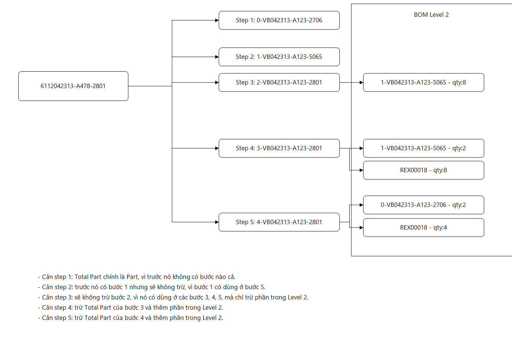

# Kế hoạch: Part Weight = trừ step trước (chain) kết hợp BOM Level 2

- **Ngày**: 2026-11-05 · **Nhánh**: `feature/use-bom-level-2`
- **Trạng thái**: 🟡 Đã code (build 0 lỗi), **chưa chạy app thật**; 5 câu hỏi ở brainstorm §7 đã được chốt
- **Brainstorm**: [PART_WEIGHT_CHAIN_AND_LEVEL2.md](../brainstorm/PART_WEIGHT_CHAIN_AND_LEVEL2.md)
- **Liên quan**: [BUSINESS_LOGIC.md](../tech/BUSINESS_LOGIC.md) §4.4, §4.8; [PLAN_BOM_LEVEL2_PARTWEIGHT.md](PLAN_BOM_LEVEL2_PARTWEIGHT.md)

## 1. Mục tiêu

Part Weight (C021) của step ép = `Total Part/N − (Total Part của step chain ngay trước) − Σ chi tiết con Level 2`, trong đó:
- **chain** = step chỉ được tham chiếu bởi step kế liền sau nó (hoặc không được tham chiếu);
- step không phải chain nằm trong Level 2 → trừ theo Level 2, **không** trừ step trước;
- không có Level 2 và không có chain → Part Weight = chính nó;
- giữ công thức cũ cho **1 khuôn nhiều size** và **vải nonwoven / mesh**.

## 2. Thứ tự ưu tiên khi tính Part Weight (step ép, lần cân thứ hai)

| # | Điều kiện | Công thức |
|---|---|---|
| 1 | Logo / Cleat_Ring | `C021 = C023/N` |

| 2 | Thuộc 1 khuôn nhiều size hoặc có nonwoven/mesh | Cũ: `C023/N − Σ C021 các bước trước − Σ C021 REX non-injection cùng step` |
| 3 | Có Level 2 hoặc có step chain ngay trước | `C023/N − C023(P)/N(P) − Σ Qty × g/chiếc` (bỏ dòng P và dòng self khỏi Level 2) |
| 4 | Còn lại | `C021 = C023/N` |

`C022 = (C024 − C023)/N` (Runner = YES). `C036 = C021 / C039`.

## 3. Phạm vi thay đổi (code)

| Phần | Thay đổi | Trạng thái |
|---|---|---|
| `ShotWeightViewModel.IsChainOnly / ChainCandidatesBefore / ChainPredecessors / ChainPredecessorCodes` | Xác định step chain theo §4 brainstorm | ✅ |
| `ComputePartWeight` | Tính C021 theo #3 ở trên, trả danh sách chi tiết thiếu | ✅ |
| `ApplyLevel2PartWeight` | Dùng `ComputePartWeight`; thiếu → cảnh báo + chặn | ✅ |
| `CascadeLevel2` | Tính lại step đã cân khi step vừa cân là chi tiết con hoặc là step chain ngay trước của nó | ✅ |
| `PreviousStepsToCheck` | Nhóm cũ: mọi step trước; còn lại: chỉ step chain ngay trước | ✅ |
| `RefreshLevel2Details` | Bỏ dòng step-chain khỏi Level 2, thêm dòng "(previous step)"; công thức hiển thị gồm phần trừ step trước; nhóm công thức cũ không hiển thị | ✅ |
| `PartWeightCalculator` | Không đổi (nhận danh sách chi tiết con đã lọc) | ✅ |
| Tách logic chain ra lớp thuần `ChainResolver` + unit test | Để test không cần ViewModel | ⏳ |
| `PiecesFor` / `ApplyPieceQuantities` / `UpdateWeightPerPiece` | C039 chỉ lấy từ Level 2 (bỏ fallback Quantity Level 1, bỏ step chain); không có → `C039 = 0`, `C036 = 0` | ✅ |

## 4. Ví dụ kiểm thử (FG `6112042313-A478-2801`, N = 1, đơn vị g/prs)

Giả sử Total Part cân: Logo 6, Studs 20, Inlay 45, Base_FF 90, Base_HF 110; g/chiếc Studs = 2, REX = 2.

| Cân | Kỳ vọng | Tính |
|---|---|---|
| Step 1 Logo | 6 | = Total Part |
| Step 2 Studs | 20 | Logo (step 1) dùng ở Level 2 của step 5 → không trừ |
| Step 3 Inlay | 45 − 8×2 = 29 | Studs (step 2) dùng ở Level 2 → trừ theo Level 2 |
| Step 4 Base_FF | 90 − 45 − (2×2 + 8×2) = 25 | Inlay là chain → trừ Total Part 45; bỏ dòng Inlay trong Level 2 |
| Step 5 Base_HF | 110 − 90 − (Logo 2×g/chiếc + REX 4×2) | Base_FF là chain → trừ Total Part 90; bỏ dòng Base_FF trong Level 2 |

Unit test cần có (sau khi tách `ChainResolver`):
1. `IsChainOnly`: Inlay, Base_FF là chain; Studs, Logo không.
2. Step không có step trước: không chain, = chính nó.
3. FG không có Level 2: mọi step trước là chain → trừ step trước (giống logic gốc).
4. Cùng thứ tự nhiều size: chọn dòng cùng size.
5. Step trước chưa cân → báo thiếu.
6. Cascade: cân lại Inlay → Base_FF đã cân được tính lại.

## 5. Kiểm thử thủ công trên app (cần DB)

| # | Kịch bản | Kỳ vọng |
|---|---|---|
| 1 | FG ví dụ, cân lần lượt 1 → 5 | Giá trị như §4; bảng Row Details hiển thị dòng "(previous step)" ở step 4, 5 |
| 2 | Cân step 4 khi step 3 chưa cân | Báo "previous step has not been weighed", không ghi |
| 3 | Cân step 3 khi Studs chưa cân | Báo thiếu chi tiết Studs (Level 2) |
| 4 | Cân lại step 3 | Step 4 (đã cân) tự tính lại |
| 5 | Khuôn nhiều size | Giống trước khi sửa (công thức cũ) |
| 6 | Vải nonwoven | Giống trước khi sửa |
| 7 | N = 2 cùng size | `C023 = S`, `C021 = S/2 − …`, runner `(W − S)/2` |
| 8 | FG không có Level 2 | Step 1 = chính nó; step sau trừ step trước (chain) |

## 6. Tài liệu cần cập nhật (Docs-Sync)

- [x] Brainstorm + Plan (file này)
- [x] `tech/BUSINESS_LOGIC.md` §4.8 (quy tắc chain)
- [x] Session log
- [ ] `architecture/ARCHITECTURE.md` (mermaid luồng tính Part Weight) nếu đổi lớp
- [ ] `ShotWeightWindow_Documentation_EN.md` (công thức Part Weight)

## 7. Rủi ro / rollback

- Rủi ro: BOM thực tế khác sơ đồ → xem brainstorm §8. Mỗi lần tính ghi log `PartWeight L2` để đối chiếu.
- Rollback: hoàn nguyên commit chứa thay đổi này (commit trước đó `897067f` là bản "Part Weight Level 2 + công thức cũ cho nhiều size/nonwoven").
