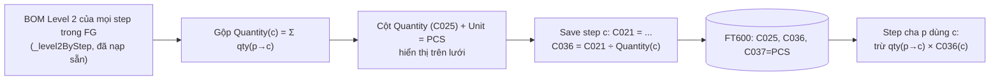

# Đề xuất: Quantity / Weight per Unit theo BOM Level 2 + lỗi nạp trọng lượng "mờ"

- **Ngày**: 2026-11-04 · **Nhánh**: `feature/use-bom-level-2`
- **Trạng thái**: ✅ **Đã duyệt và triển khai (2026-11-04)** — xem **§4 Quyết định và triển khai**; §1–§3 giữ lại làm lịch sử phân tích
- **Liên quan**: [BUSINESS_LOGIC.md](../tech/BUSINESS_LOGIC.md) §4.8, [ALLOWSCALE_LOGIC_REVIEW.md](../tech/ALLOWSCALE_LOGIC_REVIEW.md)

## 0. Lỗi dòng Active bị mờ khi vào lần đầu — đã sửa

- **Nguyên nhân**: khi lưới dựng lại, hàm tính độ mờ llúc tạo dòng (`LoadingRow`) dùng `row.IsSelected`, nhưng lúc đó cờ này chưa được gán, nên dòng đang chọn bị coi là "dòng khác" và bị mờ.
- **Đã sửa** (`ShotWeightWindow.xaml.cs`): so khớp theo `row.Item == SelectedItem` (không dùng `IsSelected`) và áp dụng lại độ mờ sau khi layout xong (`DispatcherPriority.Loaded`).

## 1. Vì sao step `2-VB042313-A123-2801` có giá trị cân trên lưới dù FT600 không có dữ liệu

Hàng Inlay trong ảnh hiện `20.00 / 15.00 / 15.00 / 5.00` và trạng thái **Done**. Giá trị này **không phải của chính step đó** mà do truy vấn "nạp trọng lượng lần cân trước" khớp quá rộng (`ShotWeightViewModel.cs`, vòng "Đọc dữ liệu các bước đã cân trước đó"):

```csharp
var mainCode = item1.C002.Split('-')[1];            // "2-VB042313-A123-2801" -> "VB042313"  (mã MODEL)
stepPrevious = db.FT600s.Where(x => x.C015 == item1.C015 &&                    // cùng số thứ tự step (3)
        (x.C002 == item1.C002 ||                                               // đúng mã step
         (x.C002.Contains(mainCode) && x.C008 == item1.C008)))                 // HOẶC mã bất kỳ cùng model + cùng size
    .OrderByDescending(x => x.CreatedDate).FirstOrDefault();
```

Nhánh sau (`Contains("VB042313")` + cùng size `8` + cùng `C015 = 3`) khớp **mọi bản ghi của cùng model**: màu khác (`A456`…), hoặc một step khác nằm ở vị trí số 3 của FG khác cùng model. Tức là Inlay đang mượn trọng lượng của một bản ghi khác.

**Hệ quả nghiêm trọng**: dòng được nạp được đánh dấu `IsReusedFromHistory`; khi Confirm nó được **insert lại với `C002` của step này** (chỉ đổi FG code/name) — tức ghi vào FT600 một bản ghi cho `2-VB042313-A123-2801` mang **trọng lượng của chi tiết khác**.

**Cách xác định đúng bản ghi đã bị mượn** (chạy trên DB):

```sql
SELECT TOP 10 id, C002, C003, C015, C008, C013, C021, C022, C023, C024, C036, CreatedDate
FROM FT600_dev
WHERE C015 = 3
  AND (C002 = '2-VB042313-A123-2801' OR (C002 LIKE '%VB042313%' AND C008 = '8'))
ORDER BY CreatedDate DESC;
```
(Dòng đầu tiên là dòng đang được dùng; nếu `C002` khác `2-VB042313-A123-2801` thì đúng là khớp "mờ".)

**Đề xuất sửa** (chọn một):

| # | Cách | Ưu / nhược |
|---|------|-----------|
| **1 (khuyến nghị)** | Chỉ khớp **đúng `C002`** (như đang làm cho REX) | Đơn giản, đúng với BOM Level 2 (chi tiết con tra theo mã chính xác). Mất việc "dùng chung trọng lượng giữa các màu" nếu xưởng đang dựa vào đó |
| 2 | Giữ khớp theo model nhưng bắt buộc **cùng loại step** (cùng tiền tố tên `C003`: Inlay/Studs/Logo…) và cùng size, bỏ điều kiện `C015` | Giữ chia sẻ giữa các màu, tránh mượn nhầm loại khác; vẫn có thể lấy nhầm màu |
| 3 | Giữ nguyên | Không khuyến nghị |

Câu hỏi: xưởng **có chủ ý** dùng chung trọng lượng Inlay/Studs/Logo giữa các màu cùng model không?

## 2. Quantity và Weight per Unit theo BOM Level 2

### 2.1 Hiện trạng

| Cột FT600 | Hiện đang là | Vấn đề |
|-----------|--------------|--------|
| `C025` Quantity | `Quantity` của **BOM Level 1** (`item.Quantity`, dòng 816) — mặc định `1` (1 đôi) cho mọi step | Studs thực tế dùng 8 chiếc trong Inlay và 2 chiếc trong Base_FF nhưng cột Quantity ghi `1.00` |
| `C036` Weight per Unit | `0` lúc tạo; chỉ được gán khi cân Logo/Cleat_Ring (`scale / C025`) và REX; Studs/Inlay/Base không có | Studs hiện `0.00` nên không có trọng lượng/chiếc để trừ |
| `C037` Unit | `Unit` của BOM Level 1 (`PRS`) | Không phản ánh số chiếc |

Phần trừ ở Row Details hiện đang **ước lượng** "1 đôi = 2 chiếc" (`PRS` → chia 2). Với Studs (8 + 2 chiếc) giả định đó sai.

### 2.2 Định nghĩa đề xuất

Với mỗi chi tiết `c` (step hoặc REX) trong một FG:

```
Quantity(c)   = Σ  qty(p → c)        trên mọi step p của FG có c trong BOM Level 2 (bỏ dòng self), đơn vị PCS
WeightPerUnit(c) [g/pcs] = Part Weight C021(c) [g/prs]  ÷  Quantity(c)
Phần trừ khi p dùng c   = qty(p → c)  ×  WeightPerUnit(c)
```

- Nếu `c` không là chi tiết của step nào (step cuối như Base_HF) thì **giữ nguyên** Quantity của Level 1.
- `C021(c)` là trọng lượng toàn bộ phần nhựa của step `c` cho 1 đôi → chia cho tổng số chiếc `c` dùng trong 1 đôi ra g/chiếc.

### 2.3 Ví dụ (FG `6112042313-A478-2801`, theo BOM Level 2 đã thấy)

| Quan hệ (cha → con × Qty PCS) |
|-------------------------------|
| Inlay → Studs ×8 |
| Base_FF → Studs ×2, Inlay ×2, REX00018 ×8 |
| Base_HF → Logo ×2, REX00018 ×4, Base_FF ×2 |

| Chi tiết | Quantity gộp (hiện: 1) | Cách tính |
|----------|------------------------|-----------|
| Logo | **2** | 2 (Base_HF) |
| Studs | **10** | 8 (Inlay) + 2 (Base_FF) |
| Inlay | **2** | 2 (Base_FF) |
| Base_FF | **2** | 2 (Base_HF) |
| REX00018 | **12** | 8 (Base_FF) + 4 (Base_HF) |
| Base_HF | 1 (giữ Level 1) | không là chi tiết của step nào |

Ví dụ số: Studs cân `C021 = 22.10 g/prs` → `WeightPerUnit = 22.10 / 10 = 2.21 g/pcs`. Khi tính Inlay trừ `8 × 2.21 = 17.68 g`; khi tính Base_FF trừ `2 × 2.21 = 4.42 g` (+ Inlay `2 × C021(Inlay)/2` + REX…).



### 2.4 Phương án triển khai (chờ duyệt)

1. **Hàm gộp thuần** `ComponentQuantityAggregator.Aggregate(level2ByStep)` → `Dictionary<mã, tổng PCS>` (có unit test).
2. **Lưới**: sau `PreloadLevel2Async()`, gán `C025 = Quantity gộp` và `C037 = "PCS"` cho các dòng là chi tiết của step khác (kể cả dòng REX); step cuối giữ Level 1.
3. **Lúc Save** step `c` có Quantity gộp: `C036 = Round(C021 / C025, 3)`. Logo/Cleat_Ring (`C036 = scale / C025`) vẫn đúng vì `C025` giờ là số chiếc; REX giữ công thức hiện có với `C025` gộp.
4. **`PartWeightCalculator.UnitWeightPerPiece`**: dùng `C036` khi `C037 == "PCS"` và `C036 > 0`; nếu bản ghi cũ (không có `C037 = "PCS"`) thì **dự phòng** `C021 / Quantity gộp của FG hiện tại`. Bỏ giả định "PRS = 2 chiếc".
5. **Row Details**: cột `g / piece` hiển thị `C036` (hoặc giá trị dự phòng), `Deduct = qty × g/piece`.
6. **Test**: cập nhật `PartWeightCalculatorTests`, thêm test cho bộ gộp theo bảng ví dụ §2.3.
7. **Docs**: BUSINESS_LOGIC §4.8, DATABASE_SCHEMA (ý nghĩa mới của `C025`/`C036`/`C037`), ARCHITECTURE.

### 2.5 Tác động và rủi ro

- `C025` đổi nghĩa (từ "số đôi ở Level 1" sang "số chiếc gộp theo Level 2") và được **ghi vào FT600** — các báo cáo/SP khác đang đọc `C025` cần kiểm tra.
- Bản ghi cũ có `C036` theo nghĩa cũ (Logo/Cleat_Ring = `scale / 1`): chỉ dùng `C036` khi `C037 == "PCS"`, còn lại tính dự phòng như bước 4.
- Chi tiết dùng chung nhiều FG: `C036` (g/pcs) là thuộc tính của chi tiết nên tái sử dụng được; phần dự phòng giả định cùng cấu trúc BOM như FG hiện tại.
- REX có `Quantity gộp` (ví dụ 12) — cần xác nhận lúc cân REX người dùng đặt **toàn bộ 12 chiếc** lên cân (để `C036 = scale / 12`).

## 3. Câu hỏi cần bạn xác nhận

1. §1: chọn cách sửa 1, 2 hay 3? Xưởng có chủ ý dùng chung trọng lượng giữa các màu cùng model không?
2. §2.2: định nghĩa `Quantity(c) = Σ qty(p → c)` và `WeightPerUnit = C021 ÷ Quantity` có đúng ý bạn không? Với ví dụ Studs (8 + 2 = 10 chiếc, 22.10 g → 2.21 g/chiếc) có khớp thực tế xưởng không?
3. Cột Unit hiển thị `PCS` cho các chi tiết đã gộp; step cuối (Base_HF) giữ `PRS`/`1`?
4. REX: khi cân REX, người dùng cân tất cả `Quantity gộp` chiếc (12) cùng lúc?
5. Có báo cáo / stored procedure ngoài ứng dụng đọc `FT600.C025` mà đổi nghĩa sẽ ảnh hưởng không?

## 4. Quyết định và triển khai (2026-11-04)

| # | Câu hỏi | Quyết định | Đã làm |
|---|---------|------------|--------|
| 1 | Sửa lỗi nạp "mờ" (§1) | **Cách 1: chỉ khớp đúng `C002`**. Trọng lượng vẫn dùng chung giữa các màu vì mã step (vd. `2-VB042313-A123-2801`) không chứa màu FG | Vòng "Đọc dữ liệu các bước đã cân trước đó": `Where(x => x.C002 == item1.C002)`, bỏ điều kiện `C015` và `Contains(model)` |
| 2 | Lưu Quantity gộp ở đâu | **Cột mới `C039`** trong `FT600`; cột `C025` (Quantity) **giữ nguyên** | `FT600.C039` (`double?`, mặc định 0); người dùng tự tạo cột trong DB (script bên dưới) |
| 3 | Step cuối | Cũng tính Quantity và g/pcs | `ComponentQuantityAggregator.PiecesFor()`: step không là chi tiết của step nào → Quantity Level 1 quy ra chiếc (`PRS` = 2 chiếc, `PCS` giữ nguyên) |
| 4 | REX / Ring / Logo / Studs | Cân **đủ số lượng của 1 đôi** như hiện tại | `C036 = scale ÷ C039` (REX Receptacle, giữ làm tròn 2 số); Logo/Cleat_Ring/Studs/Inlay/Base: `C036 = C021 ÷ C039` (làm tròn 3 số) |
| 5 | Ảnh hưởng ngoài app | Không (cột mới đã/ sẽ tạo riêng) | `C025` không đổi nghĩa |

**Công thức đã triển khai**
- `C039(c) = Σ qty(p → c)` trên các step `p` thuộc FG đang cân (`_allStepsFG`), bỏ dòng self; không là chi tiết của step nào → Quantity Level 1 quy ra chiếc.
- `C036(c) [g/pcs] = C021(c) ÷ C039(c)`; phần trừ ở step cha = `qty(p → c) × C036(c)`.
- `PartWeightCalculator.UnitWeightPerPiece`: ưu tiên `C036` đã lưu; nếu chưa có (không phải REX) thì `C021 ÷ C039`. **Bỏ giả định "PRS = 2 chiếc".**
- Bản ghi cũ nạp từ DB (chưa có `C039`): gán `C039` theo FG hiện tại; `C036` cũ (nghĩa cũ) bị bỏ và tính lại từ `C021 ÷ C039`; REX giữ `C036` cũ.
- Cascade (`CascadeLevel2`) và Save đều cập nhật `C036` sau khi tính lại `C021`.
- Code: `ComponentQuantityAggregator`, `ShotWeightViewModel.ApplyPieceQuantities()`, `UpdateWeightPerPiece()`, `PiecesOf()`; test: `ComponentQuantityAggregatorTests`, `PartWeightCalculatorTests`.

**Script tạo cột trong DB** (chạy tay cho cả hai bảng):

```sql
ALTER TABLE dbo.FT600     ADD C039 float NULL;
ALTER TABLE dbo.FT600_dev ADD C039 float NULL;   -- bảng test
```

**Hiển thị trên lưới** (2026-11-04): cột `Pieces Qty (PCS)` (`C039`) thay vào vị trí cột `Quantity` cũ (sau `Mold Pairs Shot`, trước `Weight per Unit`); cột `Quantity` (`C025`) được dời xuống **cuối cùng** của lưới. Các cột đầu (0–5) không đổi nên Row Details vẫn thẳng hàng.
