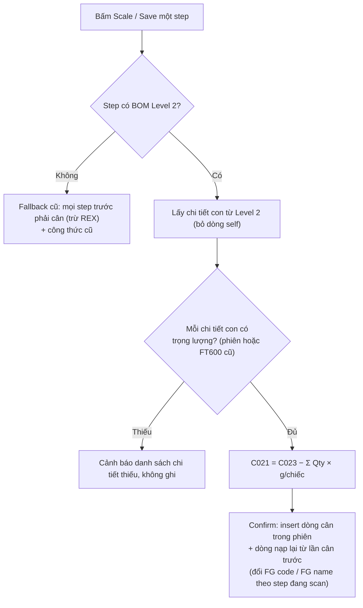
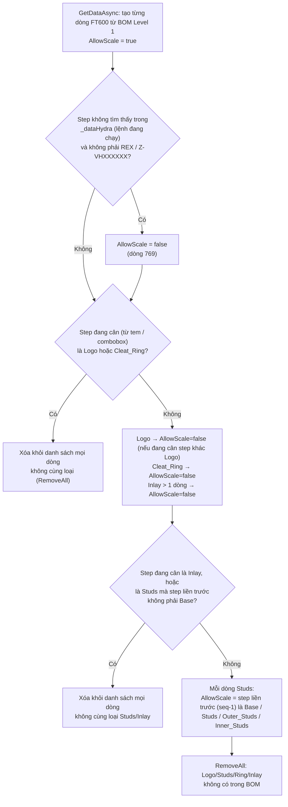

# Review logic khóa nút cân (`AllowScale`) — TOTAL STEPS

- **Ngày**: 2026-11-04 · **Nhánh**: `feature/use-bom-level-2`
- **Trạng thái**: ✅ **Đã chốt và triển khai (2026-11-04)** — §1–§5 mô tả logic **trước khi sửa** (giữ lại để đối chiếu); kết quả quyết định và code mới ở **§0** bên dưới.
- **Phạm vi**: nút **Scale / Reset / Delete** ở từng dòng TOTAL STEPS bị mờ (disabled) khi `FT600.AllowScale == false` ([ShotWeightWindow.xaml](../../UI/WPF/ShotWeightWindow.xaml) `IsEnabled="{Binding AllowScale}"`).
- **Liên quan**: [BUSINESS_LOGIC.md](BUSINESS_LOGIC.md) §4.4, session [2026-10-30 fix step matching / AllowScale](../sessions/2026-10-30_fix-step-matching-allowscale.md).

## 0. Quyết định và triển khai (2026-11-04)

| # | Câu hỏi | Quyết định | Đã làm trong code |
|---|---------|------------|-------------------|
| 1 | N1 — Logo chặn nhầm Base_FF | Làm theo **đề xuất A**: chỉ chặn theo chi tiết con BOM Level 2 | `PreviousStepsToCheck()`: điều kiện cũ "mọi step seq nhỏ hơn phải cân" chỉ còn cho step injection **không có** Level 2; REX không phụ thuộc step trước. Có Level 2 thì `ApplyLevel2PartWeight()` báo danh sách chi tiết con chưa cân khi Save |
| 2 | N2 — Studs bị khóa | **Cân tại chỗ** | Bỏ khóa (xem dòng 4–5) nên Studs/Logo/Inlay bấm Scale được ngay trong phiên |
| 3 | N6 — Confirm insert lại dòng cũ | Vẫn insert lại, nhưng **thay FG code / FG name** theo FG của step đang scan/chọn | `FT600.IsReusedFromHistory` đánh dấu dòng nạp từ lần cân trước; khi Confirm: `C013 = _stepItemCodeScale.C007`, `C014 = _stepItemCodeScale.C008`. Dòng cân lại trong phiên thì cờ về `false` |
| 4 | Quy tắc khóa Studs theo tên/vị trí | **Bỏ khóa**; mọi step cân theo Level 2: chọn cân step nào thì vào Level 2 lấy chi tiết, lấy thông tin cân của từng chi tiết để trừ | Đã xóa toàn bộ vùng lọc/khóa theo loại step trong `GetDataAsync` (Logo, Cleat_Ring, Studs, Inlay + `RemoveAll`) |
| 5 | Khóa khi step không có lệnh đang chạy | **Bỏ khóa luôn** | Bỏ `allowScale = ckHydra != null`; mọi dòng `AllowScale = true` |

**Hành vi mới**
- Mọi nút Scale / Reset / Delete đều bấm được (`AllowScale` luôn `true`; thuộc tính giữ lại để tương thích).
- Chọn cân một step → `ApplyLevel2PartWeight()` lấy chi tiết con từ BOM Level 2; trọng lượng 1 chiếc của từng chi tiết lấy từ dòng cân trong phiên, nếu không có thì lấy FT600 mới nhất theo mã chi tiết; thiếu thì cảnh báo, không ghi.
- Step không có dữ liệu Level 2 (SP rỗng/lỗi) vẫn dùng điều kiện cũ "step trước phải cân" + công thức cũ (fallback).

**Rủi ro cần để ý**
- Step không có lệnh đang chạy trong `_dataHydra` giờ cũng cân được; dòng của step đó có thể thiếu thông tin máy / lệnh Hydra (cột `C000`, `C004`…). Hãy kiểm tra khi lưu.
- Chi tiết con **không có dòng trong lưới** (vd. REX chỉ xuất hiện ở Level 2) không thể cân tại chỗ; chỉ dùng được nếu đã có FT600 trước đó. Nếu chưa, Save báo thiếu chi tiết đó.

## 1. Trường hợp trong ảnh

FG có 5 step (cùng một khuôn `0144`), người dùng quét tem của **step 4 — Base_FF**:

| Step | Tên | `AllowScale` | Lý do (theo code) |
|------|-----|--------------|-------------------|
| 1 | Logo | ❌ false | Đang cân step không phải Logo → mọi dòng Logo bị khóa (dòng 963) |
| 2 | Studs | ❌ false | Step liền trước Studs (seq 1) là **Logo**, không phải Base/Studs → khóa (dòng 1015–1022) |
| 3 | Inlay | ✅ true | Chỉ có 1 dòng Inlay nên không bị khóa (dòng 991) |
| 4 | Base_FF | ✅ true | Step đang chọn |
| 5 | Base_HF | ✅ true | Không thuộc nhóm Logo/Studs/Ring/Inlay → luôn true |

Ý đồ trong comment gốc (dòng 906–912): Logo / Cleat_Ring / Studs / Inlay là các chi tiết **cân riêng bằng tem riêng**, nên khi đang cân step khác thì khóa chúng lại.

## 2. Cách `AllowScale` được tính

Nơi `AllowScale` được dùng sau đó:

| Nơi | Dòng | Tác dụng |
|-----|------|----------|
| `OnGridScale` | ~1901 | Chặn bấm Scale → "Do not allow to scale this step." |
| `OnGridReset` / `OnGridDelete` | ~1931, ~1966 | Chỉ reset/xóa dòng có `AllowScale` |
| `ExecuteSave` | ~1222 | Chặn lưu nếu dòng đang chọn bị khóa |
| Tự chuyển sang step kế tiếp sau Save | ~1379 | Chỉ chọn dòng `AllowScale` chưa cân |
| `ExecuteConfirm` | ~1650, ~1750 | Chỉ kiểm tra / **insert FT600** các dòng `AllowScale && C021 > 0` |

## 3. Điều kiện "các bước trước phải cân rồi" — 4 chỗ, 4 cách khác nhau

| # | Nơi | Dòng | Điều kiện | Tính cả dòng bị khóa? |
|---|-----|------|-----------|-----------------------|
| 1 | `GetDataAsync` — lần nạp đầu | 1157–1161 | step có `AllowScale` và `C015` nhỏ hơn step chọn mà `C021 == 0` | **Không** (bỏ qua dòng khóa) |
| 2 | `GetDataAsync` — lần nạp sau (cùng FG) | 1186–1192 | mọi step có `C015` nhỏ hơn mà `C021 == 0` | **Có** |
| 3 | `OnGridScale` | 1906–1912 | như #2 | **Có** |
| 4 | `ExecuteSave` | 1228–1240 | như #2 | **Có** |

## 4. Nhận xét / điểm nghi vấn

**N1 — 🔴 Logo/Studs chưa cân vẫn chặn Base_FF, dù Logo không phải chi tiết của Base_FF.**
Ở ảnh: Logo (seq 1) và Studs (seq 2) chưa cân và đã bị khóa. Bấm Scale ở Base_FF → #3 báo "The previous step has not been weighed" vì Logo/Studs có `C021 == 0`. Nhưng theo BOM Level 2, Base_FF chỉ gồm **Studs ×2, Inlay ×2, REX00018 ×8** — **không có Logo** (Logo thuộc Base_HF). Rule "mọi step có seq nhỏ hơn" là phỏng đoán chuỗi tuyến tính, đúng loại giả định mà cách tính BOM Level 2 đã bỏ.

**N2 — 🔴 Bế tắc cho Studs: bị khóa nhưng lại bắt buộc phải cân.**
Studs là chi tiết bắt buộc của Base_FF (L2). Studs bị khóa (`AllowScale=false`) nên không bấm Scale được trong phiên này; muốn có `C021` cho Studs phải **quét riêng tem của Studs** ở một phiên khác. Chưa có hướng dẫn nào cho người dùng — chỉ thấy nút mờ và status "Pending".

**N3 — 🟠 Hai cách xét "dòng khóa" mâu thuẫn nhau (#1 và #2–#4).**
Lần nạp đầu coi dòng khóa là không cần cân, nhưng bấm Scale/Save lại coi là bắt buộc. Cùng một thao tác cho kết quả khác nhau tùy bạn vừa quét tem hay bấm nút.

**N4 — 🟠 Trạng thái hiển thị gây hiểu nhầm.**
Dòng bị khóa vẫn hiện "Pending" như dòng chờ cân bình thường; không có lý do khóa, không tooltip. Người dùng không phân biệt được "chưa tới lượt" với "phải quét tem riêng".

**N5 — 🟡 Quy tắc Studs dựa vào tên và vị trí.**
`ItemStepName.StartsWith("Base" | "Studs" | "Outer_Studs" | "Inner_Studs")` và `ParallelSequence - 1`. Đổi tên step trong Winline hoặc đổi thứ tự là quy tắc sai. Với BOM Level 2 có thể suy ra chính xác quan hệ "step này là chi tiết của step kia".

**N6 — 🟡 Confirm insert lại các dòng đã cân từ trước nếu chúng không bị khóa.**
`insert = AllowScale && C021 > 0`. Dòng Inlay "Done" (nạp từ lần cân trước, không bị khóa) có `C021 > 0` nên **được insert thêm một bản FT600 mới** mỗi lần Confirm; còn Logo/Studs bị khóa thì không. Cần xác nhận đây là chủ ý (ghi lại lần cân kèm người cân/ngày mới) hay vô tình.

**N7 — 🟡 Khác chiều dữ liệu cho cùng step.**
Dòng 769: step không có trong `_dataHydra` (không có lệnh đang chạy) bị khóa luôn, nhưng thông báo giống hệt các trường hợp khác.

## 5. Đề xuất (chưa làm — chờ bạn chọn)

| # | Đề xuất | Tác động | Rủi ro |
|---|---------|----------|--------|
| **A** | Thay điều kiện "mọi step seq nhỏ hơn" ở #2, #3, #4 bằng **"các chi tiết con L2 của step đang cân đã có trọng lượng"** (dùng đúng `ApplyLevel2PartWeight`/`Level2Items`); #1 giữ nguyên hoặc gộp chung | Base_FF không còn bị Logo chặn; Base_HF vẫn bị chặn nếu chưa cân Logo, REX, Base_FF. Thống nhất 4 chỗ | Trung bình — đổi hành vi chặn; cần kiểm tra các FG cũ không có L2 (giữ fallback điều kiện cũ) |
| **B** | Thêm `LockReason` cho dòng bị khóa (vd. "Weigh separately: scan Studs label", "No running order") hiển thị ở **tooltip trên các nút mờ** và đổi chữ STATUS thành "Locked" | Người dùng biết phải làm gì | Thấp — chỉ UI |
| **C** | Cho **quét tem Studs/Logo riêng** ngay từ màn này (hoặc nút mở dialog nhập) thay vì phải thoát phiên | Giải quyết N2 triệt để | Cao — thêm luồng nghiệp vụ |
| **D** | Thay quy tắc tên/vị trí (N5) bằng quan hệ L2: step bị khóa khi nó là chi tiết con được cân ở máy/khuôn khác với step đang chọn | Bền hơn khi đổi tên/thứ tự | Cao — cần quy tắc nghiệp vụ rõ |
| **E** | Chốt N6: nếu không muốn insert lại dòng cũ thì lọc `insert` theo "dòng vừa cân trong phiên này" | Tránh trùng bản ghi FT600 | Trung bình — đổi dữ liệu ghi |

**Gợi ý thứ tự**: A + B (ít rủi ro, giải quyết ngay N1/N3/N4), N2 xử lý bằng C hoặc để quy trình hiện tại nhưng có B hướng dẫn; D, E tách thành việc riêng sau khi bạn xác nhận nghiệp vụ.

## 6. Câu hỏi cần bạn xác nhận

1. N1: Logo chưa cân có được phép chặn Base_FF không, hay chỉ các chi tiết con L2 mới chặn? (đề xuất A: chỉ L2)
2. N2: Studs bắt buộc phải cân riêng bằng tem Studs trước khi cân Base — đúng quy trình xưởng? Nếu đúng, chỉ cần B (hướng dẫn) hay muốn C (cân tại chỗ)?
3. N6: Dòng đã cân từ trước (như Inlay Done) có được insert lại mỗi lần Confirm không?
4. Có FG nào mà Studs **không** cân riêng (cân cùng Base trong một phiên) không? Nếu có thì quy tắc N5 hiện tại đang khóa nhầm.
5. Câu thông báo mong muốn cho dòng bị khóa (tiếng Anh hay Việt, nội dung gợi ý tem cần quét)?
