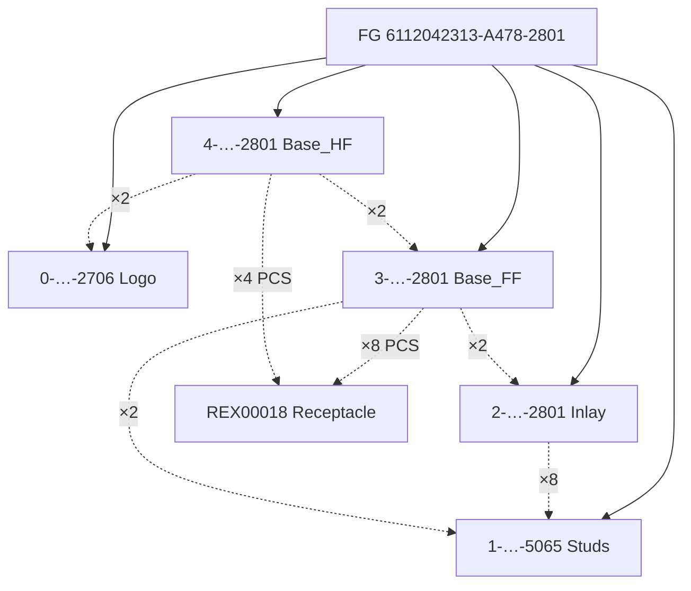
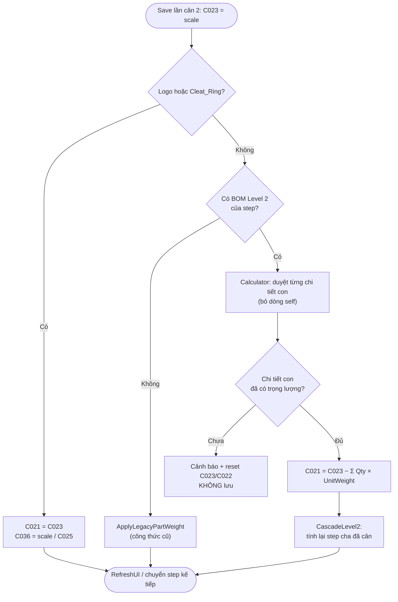
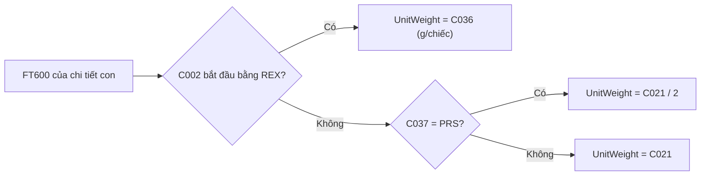

# ⚖️ Business Logic & Calculation Formulas

> Tài liệu mô tả toàn bộ logic nghiệp vụ, quy trình cân, công thức tính toán và các quy tắc đặc biệt trong `ShotWeightViewModel` và `ShotWeightFGViewModel`.

---

## 1. Các thuật ngữ & Khái niệm cốt lõi

- **Shot Weight**: Tổng khối lượng một lần ép nhựa của khuôn (bao gồm các sản phẩm/linh kiện ra khỏi khuôn + cuống nhựa dẫn hướng gọi là runner).
- **Part Weight**: Khối lượng của riêng linh kiện/sản phẩm (tính trên 1 đôi `g/prs` hoặc trên cả shot `g/shot`).
- **Runner Weight**: Khối lượng cuống nhựa (sprue/runner).
- **Step / Sequence**: Thứ tự ép hoặc lắp ghép (Step 1, Step 2...). Trong khuôn nhiều bước (multi-stage injection) hoặc khuôn nhiều màu (bi-color / multi-component), các bước trước phải được cân trước bước sau.

---

## 2. Các trường khối lượng chính (`C021`, `C022`, `C023`, `C024`)

| Cột | Tên trên UI | Ý nghĩa | Công thức cơ bản |
|-----|-------------|---------|------------------|
| **`C024`** | **Total / Gross Weight (g)** | Tổng khối lượng đo được ở lần cân đầu | Đọc trực tiếp từ cân khi đặt cả shot (Part + Runner) |
| **`C022`** | **Runner Weight (g)** | Trọng lượng cuống nhựa | Đọc từ cân ở lần cân thứ hai (chỉ đặt runner) |
| **`C023`** | **Part (g/shot)** | Trọng lượng toàn bộ sản phẩm trong 1 shot | `= C024 - C022` (Gross - Runner) |
| **`C021`** | **Part (g/prs)** | Trọng lượng tính trên 1 đôi sản phẩm | `= C023 / (Số đôi trên shot * % Usage)` |

---

## 3. Quy trình cân 2 bước chuẩn (Standard Injection Items)

Dành cho các linh kiện thông thường ép nhựa:

```
[Bắt đầu lượt cân]
       │
       ▼
[Lần cân 1: Đặt cả Shot (Part + Runner) lên cân]
       │
       ├─► UI hiển thị giá trị ổn định từ cân
       ├─► Bấm nút [SCALE] hoặc tự động đọc
       └─► Ghi nhận: C024 = Weight_Scale1
       │
       ▼
[Lần cân 2: Bỏ sản phẩm ra, CHỈ ĐẶT RUNNER lên cân]
       │
       ├─► Bấm nút [SCALE]
       ├─► Ghi nhận: C022 = Weight_Scale2 (Runner)
       ├─► Tự động tính C023: C023 = C024 - C022
       └─► Tự động tính C021: xem §4.8 (Logo/Cleat_Ring: C021 = C023; step ghép: C023 − Σ chi tiết con theo BOM Level 2)
       │
       ▼
[Hoàn tất 1 Step]
```

---

## 4. Các trường hợp xử lý đặc biệt (Special Business Rules)

### 4.1. Linh kiện REX / Cleat (Đinh sắt chèn sẵn)
- Mã item bắt đầu bằng `"REX"` (ví dụ đinh tán, insert kim loại).
- **Quy tắc**: REX không có cuống nhựa (Runner). Do đó **chỉ cần cân 1 lần**:
  - `C024 = Weight_Scale`
  - `C022 = 0` (không có runner)
  - `C023 = C024`
  - `C021 = C023 / PairsPerShot`
  - Hoàn tất bước ngay sau 1 lần cân.

### 4.2. Linh kiện `Cleat_Ring` (Vòng đệm bao quanh đinh)
- Khi ép nhựa bao quanh đinh REX (`Cleat_Ring`), tổng khối lượng đo được của cụm bao gồm cả phần đinh REX đã chèn vào từ trước.
- **Công thức Cascade**:
  ```
  Khối lượng nhựa thực của Cleat_Ring = Tổng cân được - Khối lượng đinh REX đã cân ở bước trước
  ```
- **Lưu ý kiểm tra logic (Fix ngày 2026-08-18)**:
  Filter phải khớp đúng chuỗi `StartsWith("Cleat_Ring")` để tránh ghi đè nhầm hoặc tính ra giá trị âm (`C021 < 0`).

### 4.3. Linh kiện `Inlay`
- Tương tự như insert kim loại/vải chèn trong lòng khuôn. Kể từ 2026-11-02, Part Weight của Inlay (và Studs/Base) được tính theo **BOM Level 2** (xem §4.8), không còn nhánh đặc cách theo tên step.

### 4.4. Kiểm tra thứ tự tuần tự (Sequential Step Validation)
- Nếu một sản phẩm có nhiều bước (`Step 1`, `Step 2`, `Step 3`):
  - Người dùng **bắt buộc phải cân xong các bước trước** (`C015 < current.C015` và `C021 > 0`).
  - Nếu cố tình cân bước sau khi bước trước chưa có trọng lượng, hệ thống bật popup cảnh báo:
    `"Previous step(s) are missing Part Weight and must be weighed first."` và từ chối lưu.

### 4.5. Khuôn nhiều Size trên cùng 1 Shot (Multi-size Molds)
- Cùng 1 khuôn ép ra nhiều cỡ giày khác nhau trong 1 lần ép:
  - Hệ thống gom nhóm theo tiền tố mã hàng (`PrefixUpToThirdHyphen`), tính tổng số đôi và phân bổ trọng lượng theo tỉ lệ định mức BOM tương ứng từng size.

---

### 4.8. Part Weight theo BOM Level 2 (từ 2026-11-02)

Thay cho cơ chế cũ "trừ Part Weight của mọi bước trước". Áp dụng cho injection step ở **lần cân thứ hai** (trừ Logo/Cleat_Ring vẫn `C021 = C023`).

```
C021(step) = C023(step) − Σ over child in L2(step), child ≠ self :  Qty(child) × UnitWeight(child)
```

- `L2(step)` = `sp_getBomWinlineOfItemFG @itemFG = <ItemStepCode của step>` (cache theo phiên, `IBomService`).
- Dòng **self**: mã kết thúc `-0000` / đơn vị `G` / trùng mã step → không trừ.
- `Qty` ở L2 hiểu là **số chiếc (PCS)**. `UnitWeight` (g/chiếc):
  - REX: `C036`.
  - Còn lại: `C021` (g/prs) ÷ 2 nếu `C037 == "PRS"`, giữ nguyên nếu PCS.
- Chi tiết con lấy từ dòng cùng phiên (`_scaleDataFinal`) trước, nếu không có thì FT600 mới nhất theo `C002`.
- Chi tiết con chưa cân (hoặc trọng lượng ≤ 0) → cảnh báo, **không ghi** `C023`/`C021`.
- Không có L2 (SP rỗng/lỗi, `Z-VHXXXXXX`) → rơi về công thức cũ (`ApplyLegacyPartWeight`).
- **Cascade**: khi một step đổi, các step cha đã cân có step đó trong L2 được tính lại `C021` và `C022 = C024 − C021`.

**Cây BOM của FG `6112042313-A478-2801`** (Level 1 → Level 2; số = Qty):



Nét đứt = quan hệ Level 2 (chi tiết con bị trừ khi tính `C021` của step cha). Base_HF **không** chứa Studs/Inlay trực tiếp nên không trừ chúng.

**Luồng quyết định khi bấm Save (lần cân 2)**:



**Trình tự gọi (sequence)**:

```mermaid
sequenceDiagram
    actor Op as Operator
    participant VM as ShotWeightViewModel
    participant BOM as IBomService
    participant Repo as IScaleStepRepository
    participant Calc as IPartWeightCalculator
    participant DB as SQL Server

    Op->>VM: Quét tem / chọn step
    VM->>BOM: GetLevel1Async(FG)
    BOM->>DB: sp_getBomWinlineOfItemFG @itemFG=FG
    loop mỗi step ép trong danh sách
        VM->>BOM: GetLevel2Async(stepCode)
        BOM->>DB: sp_getBomWinlineOfItemFG @itemFG=stepCode (cache)
    end
    VM->>Repo: GetLatestByStepCodesAsync(mã chi tiết con)
    Repo->>DB: SELECT FT600 mới nhất theo C002
    Op->>VM: Save (lần cân 2)
    VM->>Calc: Calculate(C023, stepCode, L2, FindWeighedChild)
    Calc-->>VM: PartWeightResult (C021 hoặc MissingChildren)
    alt thiếu chi tiết con
        VM-->>Op: Cảnh báo, không ghi
    else đủ
        VM->>VM: C021 = result; CascadeLevel2()
    end
```

**Quy đổi đơn vị `UnitWeight`**:



Ví dụ (FG `6112042313-A478-2801`): Base_FF = self + Studs×2 + Inlay×2 + REX00018×8; Base_HF = self + Logo×2 + REX00018×4 + Base_FF×2.

**Không đổi**: nhánh REX/Nonwoven/Mesh (§4.1), multi-size (§4.5), `C022`/`C023`/`C024`, `C036` của Logo/Cleat_Ring.
Code: `UI/WPF/Services/PartWeightCalculator.cs`, test: `tests/SSSW.Tests`.

---

## 5. Quy tắc Đăng nhập & Xác thực Thẻ RFID

1. **Bắt buộc có danh tính Operator trước khi Lưu**:
   - Khi bấm **[SAVE]**, kiểm tra `OperatorSession.IsLoggedIn` hoặc thông tin `FT029`.
   - Nếu chưa quẹt thẻ RFID:
     - Hệ thống yêu cầu quẹt thẻ hoặc mở dialog `frmRfidInput` để nhập mã nhân viên thủ công.
     - Sau khi xác nhận thành công, gán `C010` (Mã RFID) và `C011` (Mã NV) vào bản ghi.
2. **Session dùng chung (Singleton OperatorSessionService)**:
   - Một khi đã quẹt thẻ trên màn hình Main, phiên đăng nhập được duy trì cho cả tab Step Component và Finished Goods cho đến khi bấm nút Đăng xuất / Quét thẻ mới.

---

## 6. Luồng Lưu & Commit Transaction (`ExecuteSave`)

1. **Validate**:
   - Kiểm tra `AllowScale == true`.
   - Kiểm tra các bước trước đã hoàn tất.
   - Kiểm tra đã có thẻ RFID.
2. **Database Transaction**:
   - Mở Transaction EF Core: `await db.Database.BeginTransactionAsync()`.
   - `INSERT` danh sách dòng hợp lệ (`AllowScale == true && C021 > 0`) vào bảng `FT600`.
   - `UPDATE` cờ hoàn tất trên `FT601`: `C017 = true` cho các lệnh tương ứng.
   - `COMMIT` transaction.
3. **Đồng bộ Winline (Background Task / Optional)**:
   - Gọi `sp_Showweight_UpdateToWinline` nếu cấu hình tự động đẩy.
4. **Reset UI**:
   - Reset form về trạng thái sẵn sàng cho lượt quét mã / lệnh tiếp theo.
